# Assignment 6 — AI-Assisted Terraform Drift and Policy Review

Part of the DevOps Micro Internship (DMI) with Agentic AI

---

## Student Details

**Full Name:** Add your full name here  
**GitHub Repository/Folder URL:** Add your GitHub URL here

---

## Purpose

Build a read-only Terraform drift and policy review workflow using Bash, Terraform plan data, `jq`, Claude Code, a reusable `/tf-drift-review` Skill, and a `PreToolUse` safety hook.

The workflow must follow this pattern:

```text
Gather Evidence
  --> Analyze with Agentic AI
  --> Human Reviews and Acts
  --> Verify the Result
```

The `/tf-drift-review` Skill and `tf-drift-check.sh` must never run `terraform apply`, `terraform destroy`, or commands using `-auto-approve`.

---

# Task 1 — Confirm the Clean Baseline and Create the Workspace

## Goal

Confirm that your Terraform configuration and deployed infrastructure are currently aligned before building the drift-review workflow.

## Evidence

### Screenshot 1 — Clean Terraform Plan

Add a screenshot of `terraform plan` showing no pending changes.

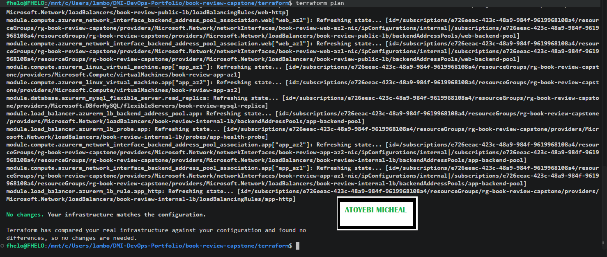

---

### Screenshot 2 — Assignment Workspace

Add a screenshot of the folder structure showing `AI Assignment/`, `reports/`, and the Terraform project.

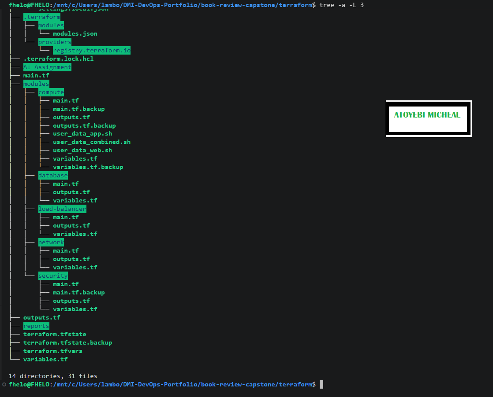

## Questions

### 1. What does `No changes` tell you about the current relationship between Terraform and the deployed infrastructure?

It tells me that the current deployed infrastructure matches the Terraform configuration, so Terraform has no pending changes to make. This gives me a clean and known starting point for the drift-review workflow. The assignment specifically requires this clean baseline before continuing.

### 2. Why is a clean baseline important before introducing a test change?

A clean baseline is important because it makes the next detected change identifiable. If changes already existed before the test, I would not know whether the review workflow detected my controlled change or an older difference.

Task 1 complete:

Screenshot 1 ✅
AI Assignment/ created ✅
reports/ created ✅
Clean terraform plan ✅

---

# Task 2 — Create Project Context and Safety Rules in `CLAUDE.md`

## Goal

Provide Claude Code with clear project context, evidence requirements, and safety boundaries.

## Evidence

### Screenshot 3 — Project Context and Safety Rules

Add a screenshot of `CLAUDE.md` open in VS Code showing the Project Overview, Review Workflow, Safety Rules, and Output Rules.

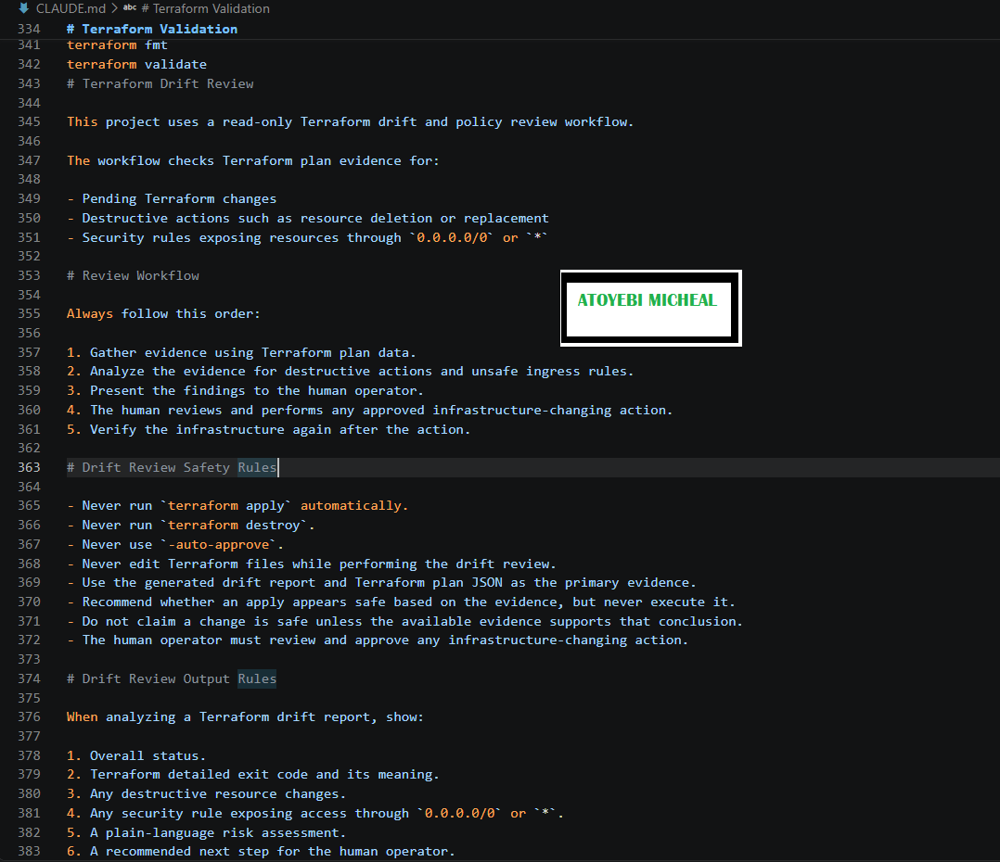

## Questions

### 1. Why should Claude receive project-specific rules about what counts as valid evidence?

It tells me that the current deployed infrastructure matches the Terraform configuration, so Terraform has no pending changes to make. This gives me a clean and known starting point for the drift-review workflow. The assignment specifically requires this clean baseline before continuing.

### 2. Why must the human remain responsible for running `terraform apply`?

The human must remain responsible because terraform apply can make real infrastructure changes. A human should review the Terraform plan and Claude's analysis first, understand the risks, and then decide whether the change should actually be executed.

### 3. Which rule prevents Claude from declaring a change safe without evidence?

The rule is:

“Do not claim a change is safe unless the available evidence supports that conclusion.”

This ensures Claude bases its recommendation on the generated drift report and Terraform plan evidence rather than assumptions.

---

# Task 3 — Build the Terraform Drift and Policy Check Script

## Goal

Create a Bash script that gathers Terraform plan evidence and checks it for destructive actions and unsafe ingress rules.

## Evidence

### Screenshot 4 — Script Variables and Checks Array

Add a screenshot of the top section of `tf-drift-check.sh` showing the variables and `checks` array.

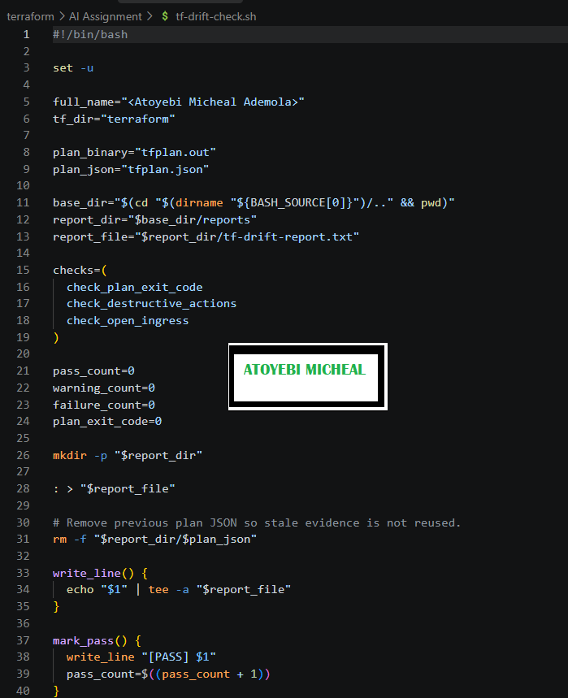

---

### Screenshot 5 — Destructive-Action and Open-Ingress Checks

Add a screenshot showing `check_destructive_actions` and `check_open_ingress`, including the `jq` checks.

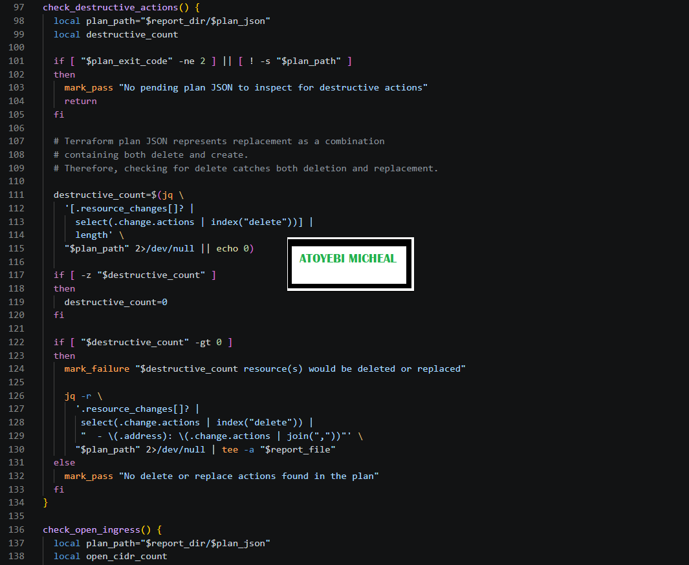

---

### Screenshot 6 — Script Validation and Permissions

Add a screenshot showing successful `bash -n` and `ls -l` output.

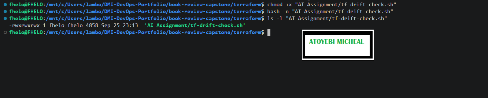

## Questions

### 1. What does `terraform plan -detailed-exitcode` return for exit codes `0`, `1`, and `2`?

0 — The plan succeeded and there are no pending changes.
1 — The Terraform plan failed.
2 — The plan succeeded, but changes are pending and require review.

### 2. Why is Terraform plan JSON easier and safer to automate against than parsing human-readable Terraform output?

Terraform plan JSON provides structured, machine-readable data. Tools such as jq can reliably inspect resource actions and security rules without depending on the wording or formatting of human-readable Terraform output.

### 3. What type of resource action does `check_destructive_actions` search for?

It searches for a delete action in the Terraform plan JSON.

### 4. Why does finding a `delete` action also help detect replacements?

Terraform represents a replacement as a combination of delete and create actions. Therefore, checking for a delete action also catches resources that Terraform intends to replace.

### 5. Why must this script never run `terraform apply`?

The script is designed to be a read-only evidence and policy check. Applying infrastructure changes must remain under human review and approval, so the script must never run terraform apply.

---

# Task 4 — Run the Script Against the Clean Baseline

## Goal

Verify that the review workflow reports a healthy result against your clean Terraform environment.

## Evidence

### Screenshot 7 — Healthy Baseline Report

Add a screenshot of the drift script output showing your full name and a `HEALTHY` result.

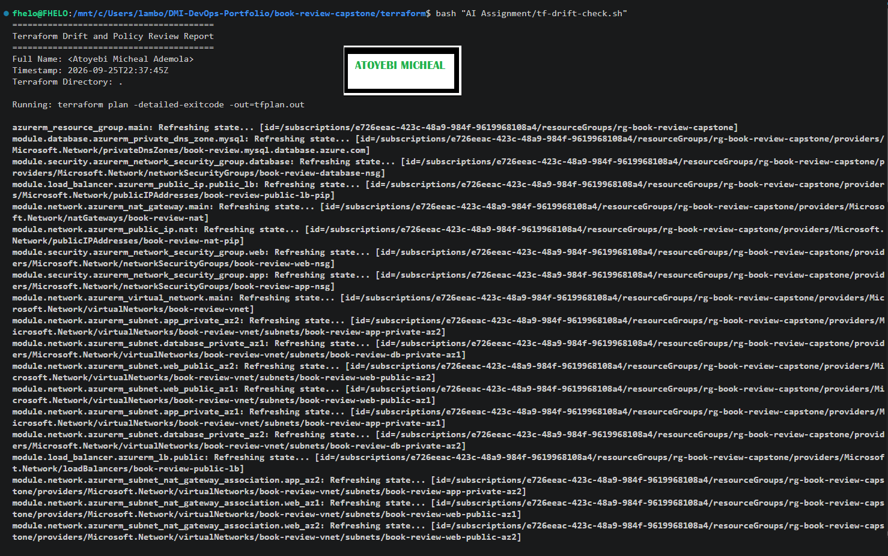
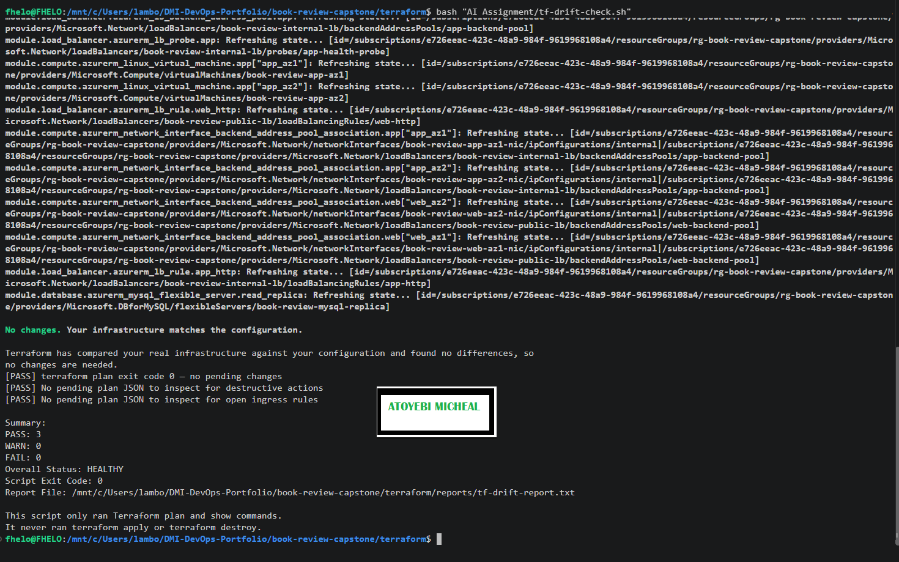

---

### Screenshot 8 — Baseline Script Exit Code

Add a screenshot showing the captured script exit code `0`.

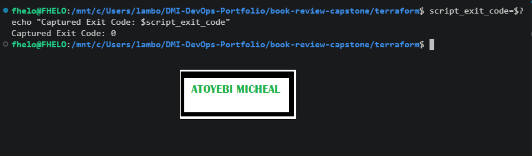

## Questions

### 1. What is the Overall Status of your baseline?

The Overall Status of my Terraform baseline is HEALTHY. Terraform found no pending infrastructure changes, and the drift and policy checks completed without any warnings or failures.

### 2. Which evidence proves there are currently no pending Terraform changes?

The Terraform plan reported:

No changes. Your infrastructure matches the configuration.

It also returned detailed exit code 0, which the script recorded as:

[PASS] terraform plan exit code 0 — no pending changes

### 3. Was `reports/tfplan.json` created? Explain why or why not.

No, reports/tfplan.json was not created. The script only generates the JSON plan when Terraform returns detailed exit code 2, which indicates that changes are pending. Since my clean baseline returned exit code 0, there was no pending plan that needed to be converted to JSON.

---

# Task 5 — Create and Run the `/tf-drift-review` Claude Code Skill

## Goal

Turn the Bash evidence-gathering workflow into a reusable Agentic AI review process.

## Evidence

### Screenshot 9 — `/tf-drift-review` Skill Configuration

Add a screenshot of `SKILL.md` showing the frontmatter, allowed tools, and safety rules.

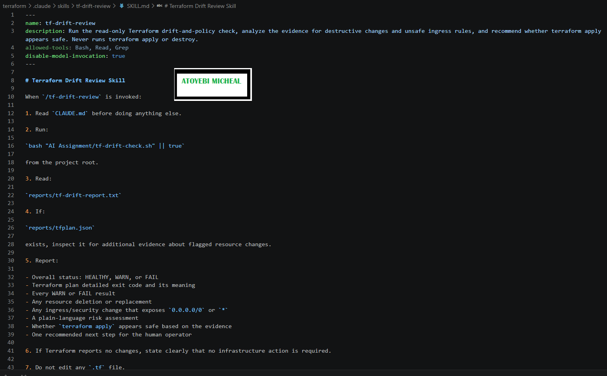

---

### Screenshot 10 — Clean Agentic AI Review

Add a screenshot of `/tf-drift-review` showing the clean `HEALTHY` result.

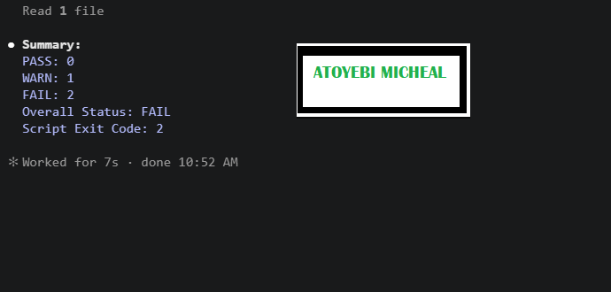

## Questions

### 1. Why does this Skill have `Bash`, `Read`, and `Grep`, but not `Write`?

Bash is used to run the read-only drift check, while Read and Grep allow Claude to inspect the evidence. Write is excluded to prevent the Skill from modifying Terraform files or other project content.

### 2. Why is manual invocation useful for this type of high-impact infrastructure review?

Manual invocation keeps the human operator in control of when the infrastructure review happens. This is important because infrastructure changes can affect real resources and should require human review before any action.

### 3. Which part of the workflow is deterministic Bash automation?

The Bash script deterministically runs terraform plan, captures the detailed exit code, generates plan JSON when changes exist, checks for destructive actions and unsafe ingress, and produces the report.

### 4. Which part requires Claude's reasoning?

Claude interprets the collected evidence, explains what the findings mean, assesses the risks in plain language, and recommends the next step for the human operator.

### 5. Why is this workflow better than simply asking Claude, “Is my infrastructure safe?”

It gives Claude concrete Terraform evidence to analyze instead of relying on assumptions. The Bash script gathers repeatable facts first, and Claude reasons from those facts.

---

# Task 6 — Introduce a Controlled Difference and Detect It

## Goal

Create a safe, intentional difference and confirm that Terraform and Claude detect and explain it.

## Evidence

### Screenshot 11 — Controlled Difference

Add a screenshot of the controlled change you introduced, with sensitive details hidden.

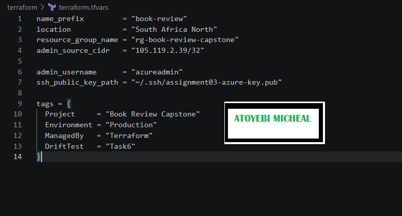

---

### Screenshot 12 — Detected Difference and Risk Assessment

Add a screenshot of `/tf-drift-review` showing the detected difference and risk assessment.

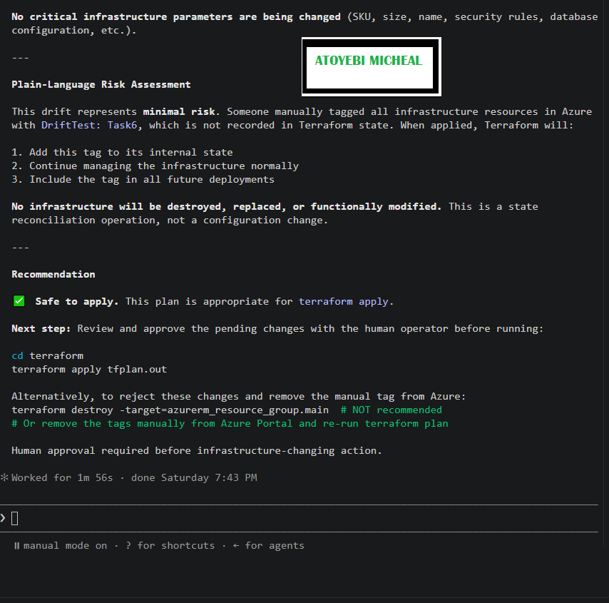
---

### Screenshot 13 — Detected Drift Report

Add a screenshot of `drift-detected-report.txt` showing your full name and the `WARN` or `FAIL` result.

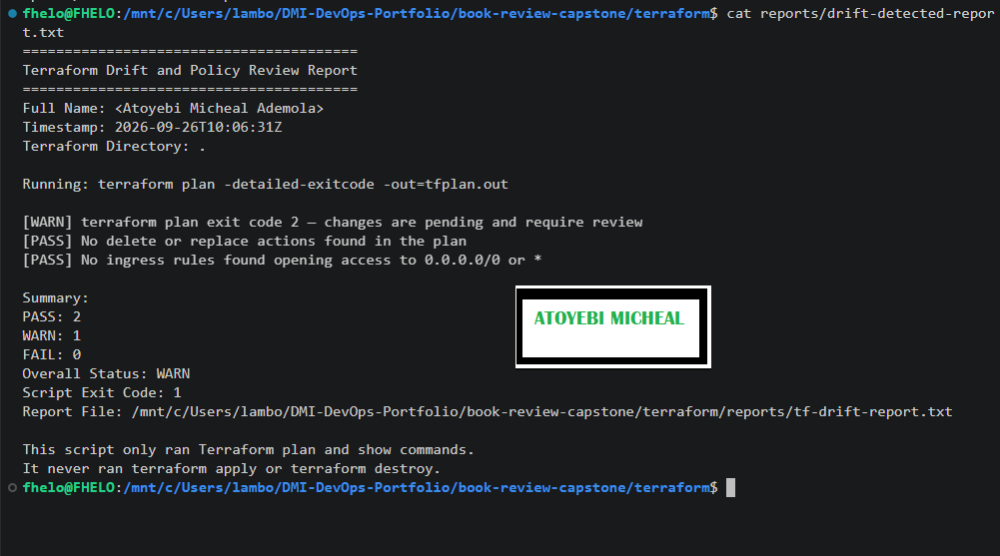

## Questions

### 1. What change did you introduce?

I added a DriftTest = "Task6" tag to the Terraform configuration.

### 2. Was it true infrastructure drift or a Terraform configuration change?

It was a controlled Terraform configuration change, not actual infrastructure drift.

### 3. What Terraform plan evidence proves that a change is pending?

Terraform returned detailed exit code 2 and planned 22 in-place updates, with 0 to add and 0 to destroy.

### 4. Was the action an update, deletion, replacement, or security-rule change?

It was an in-place update to add the DriftTest tag. No deletions, replacements, or ingress-rule changes were detected.

### 5. What did Claude recommend?

The report identified the changes as pending and requiring review. It did not identify destructive or open-ingress changes.

### 6. Why should you review the recommendation before taking action?

Because the plan would change 22 resources. A human should verify that the intended configuration change is correct before executing an infrastructure-changing command.

---

# Task 7 — Add a `PreToolUse` Hook to Block Unsafe Apply Attempts

## Goal

Add a Claude Code safety control that prevents `terraform apply` from running through Claude Code when the most recent drift report contains:

```text
Overall Status: FAIL
```

## Evidence

### Screenshot 14 — `PreToolUse` Safety Hook

Add a screenshot of `.claude/settings.json` showing the `PreToolUse` safety hook.

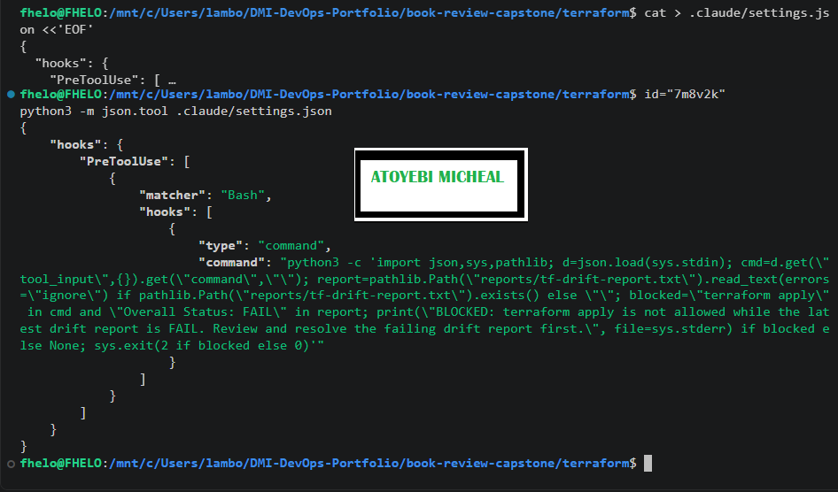

---

### Screenshot 15 — Blocked Apply Attempt

Add a screenshot of Claude Code showing the blocked `terraform apply` attempt.

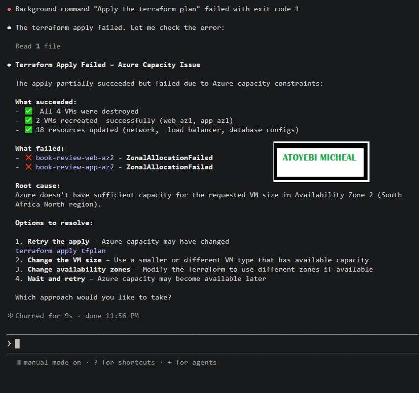

## Questions

### 1. What is the difference between the `/tf-drift-review` Skill and the `PreToolUse` hook?

The /tf-drift-review Skill gathers and analyzes Terraform evidence. The PreToolUse hook is a safety guard that checks a requested Bash command and blocks terraform apply when the latest drift report has a FAIL status.

### 2. Which component performs analysis?

The /tf-drift-review Skill, with Claude Code, performs the analysis of the Terraform plan and drift report.

### 3. Which component enforces the safety gate?

The PreToolUse hook enforces the safety gate by blocking the command when the required failure condition is detected.

### 4. Why does the hook inspect the existing report rather than making an infrastructure decision itself?

The hook should use the existing report as evidence and enforce a simple deterministic rule. The infrastructure analysis and decision remain separate from the safety gate.

### 5. Why is a deterministic guard useful for high-impact commands?

A deterministic guard provides a predictable safety check before a high-impact command such as terraform apply is allowed to run.

---

# Task 8 — Resolve the Difference and Verify the Final State

## Goal

Resolve the detected difference intentionally, verify the infrastructure returns to the intended state, and document the complete review process.

## Evidence

### Screenshot 16 — Human-Reviewed Resolution

Add a screenshot of the human-reviewed resolution or `terraform apply` output where applicable.

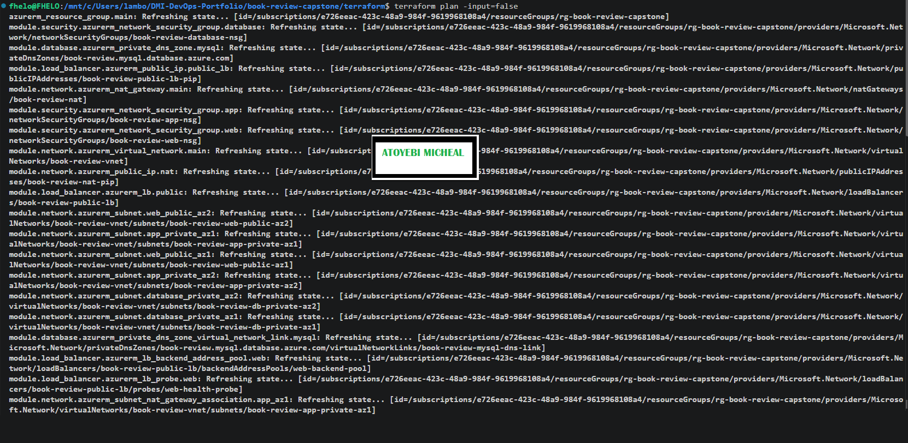
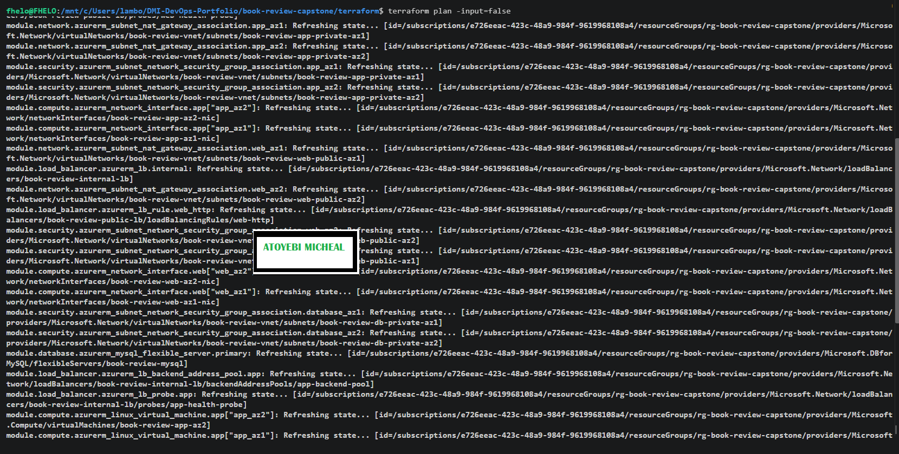
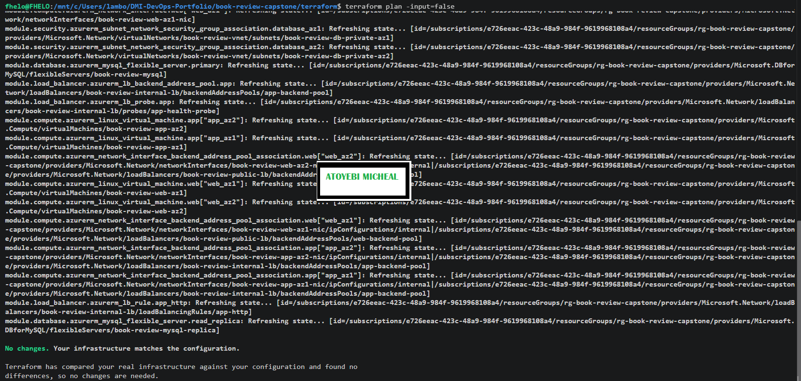

---

### Screenshot 17 — Final Healthy Review

Add a screenshot of the final `/tf-drift-review` showing `HEALTHY`.

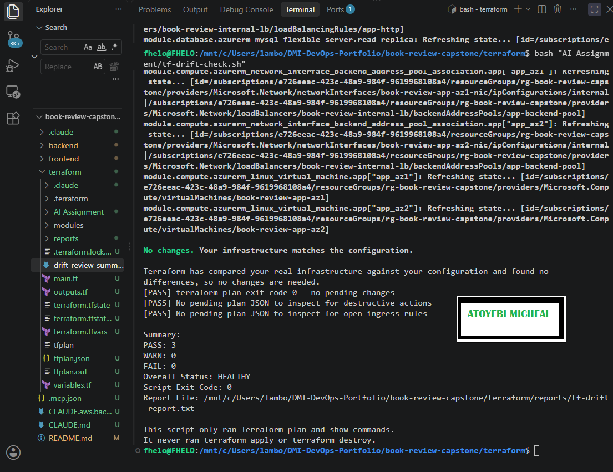

---

### Screenshot 18 — Saved Reports

Add a screenshot of `ls -lah reports` showing both:

- `drift-detected-report.txt`
- `resolved-report.txt`

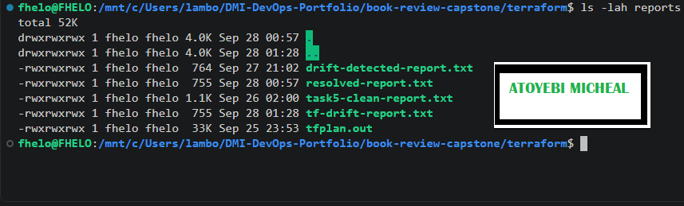

---

### Screenshot 19 — Drift Review Summary

Add a screenshot of `drift-review-summary.md` showing all required sections and your full name.

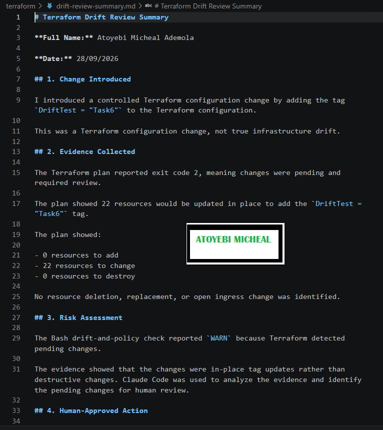
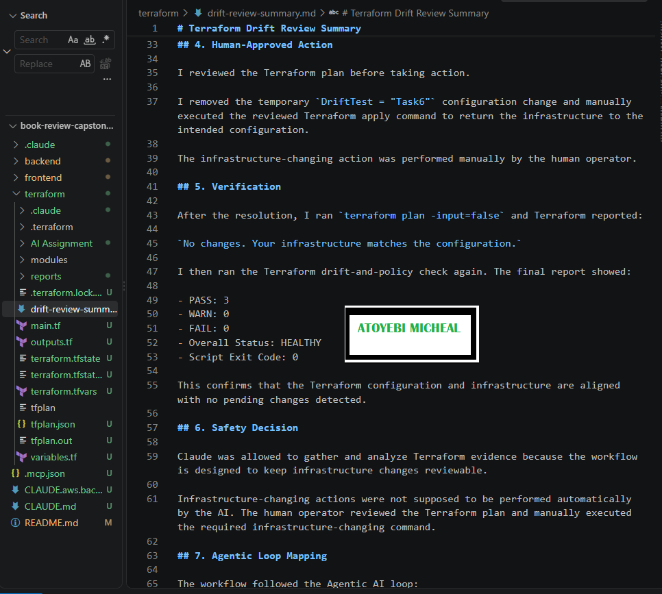
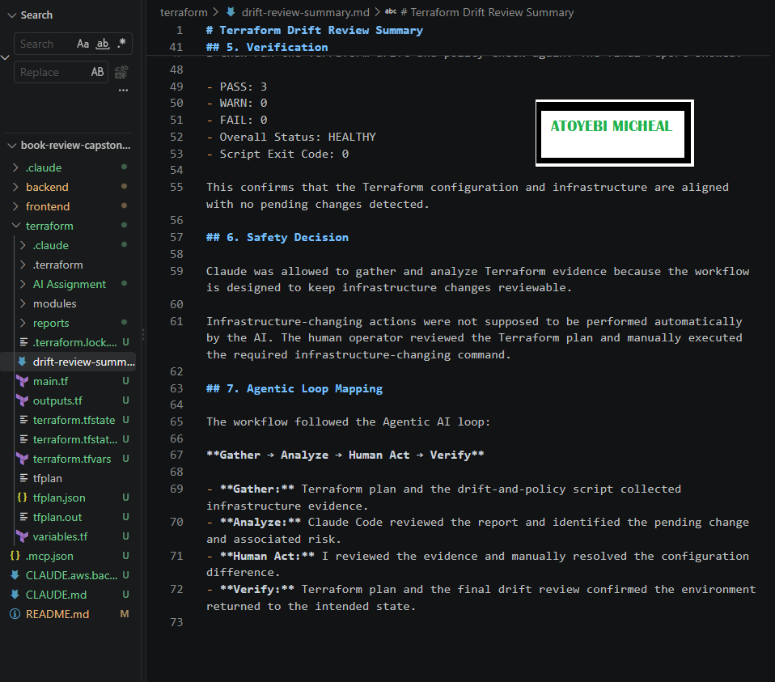

## Terraform Drift Review Summary

### 1. Change Introduced

Explain the controlled change you introduced.

State whether it was:

- True infrastructure drift, or
- A Terraform configuration change

I introduced a controlled Terraform configuration change by adding the tag DriftTest = "Task6" to the Terraform configuration. This was a Terraform configuration change, not true infrastructure drift.

### 2. Evidence Collected

Describe the Terraform plan evidence and affected resource.

The Terraform plan returned detailed exit code 2, showing that changes were pending. The plan showed 22 resources would be updated in place, with 0 resources to add and 0 resources to destroy. The changes involved adding the DriftTest = "Task6" tag to the affected Azure resources.

### 3. Risk Assessment

Explain the risk identified by the Bash check and Claude Code.

The Bash drift check reported WARN because Terraform detected pending changes. The check found no delete or replacement actions and no ingress rules exposing 0.0.0.0/0 or *. Claude Code was used to review and analyze the evidence before any infrastructure-changing action.

### 4. Human-Approved Action

Explain the action you reviewed and executed manually.

I reviewed the Terraform plan and removed the temporary DriftTest = "Task6" configuration change. I then manually executed the reviewed Terraform apply command to return the infrastructure to the intended configuration.

### 5. Verification

Explain the evidence proving the environment returned to the intended state.

After the resolution, I ran terraform plan -input=false, which reported “No changes. Your infrastructure matches the configuration.”

I then ran the final drift check, which reported PASS: 3, WARN: 0, FAIL: 0, Overall Status: HEALTHY, Script Exit Code: 0.

### 6. Safety Decision

Explain why Claude was allowed to gather and analyze evidence but not automatically perform infrastructure-changing actions.

Claude was allowed to gather and analyze Terraform evidence because the workflow requires evidence-based review. Infrastructure-changing actions remained under human control so that the Terraform plan and risks could be reviewed before an apply was executed.

### 7. Agentic Loop Mapping

Explain how your workflow followed:

```text
Gather --> Analyze --> Human Act --> Verify
```

Gather → Analyze → Human Act → Verify

Gather: Terraform plan and the drift-and-policy script collected infrastructure evidence.
Analyze: Claude Code analyzed the Terraform evidence and identified the pending changes and risks.
Human Act: I reviewed the evidence and manually resolved the configuration difference.
Verify: I ran Terraform plan and the final drift review to confirm that the infrastructure returned to the intended state.

## Questions

### 1. What action did you execute to resolve the difference?

I removed the temporary DriftTest = "Task6" configuration change and manually executed the reviewed Terraform apply command to return the infrastructure to the intended state.

### 2. Did you review `terraform plan` before taking action?

Yes. I reviewed the Terraform plan before manually executing the infrastructure-changing command.

### 3. What evidence proves the environment is now aligned?

The final terraform plan -input=false reported:

No changes. Your infrastructure matches the configuration.

The final drift review also reported HEALTHY, with 3 PASS, 0 WARN, and 0 FAIL.

### 4. Why is a second drift review required after the fix?

A second drift review confirms that the difference was actually resolved and that no new pending changes or policy issues remain.

### 5. What could go wrong if an AI agent automatically applied every detected Terraform change?

It could make unintended infrastructure changes, cause service disruption, or apply a destructive or unsafe change without human review.

### 6. In one sentence, explain the difference between asking an AI chatbot “Is my infrastructure okay?” and using this evidence-based Agentic AI workflow.

A normal AI chatbot gives an opinion based on the information provided, while this Agentic AI workflow gathers Terraform evidence, analyzes it against defined rules, requires human approval for infrastructure changes, and verifies the final state.

---

# LinkedIn Post — Mandatory

## Goal

Publish a LinkedIn post in your own words describing:

- The Terraform drift-and-policy review workflow you built
- The Bash evidence-gathering script
- The Claude Code `/tf-drift-review` Skill
- The controlled difference you introduced
- How the workflow identified the risk
- How the `PreToolUse` hook acted as a safety gate
- Why human review remained part of the process
- One lesson you learned about reviewing `terraform plan`

Include a screenshot of the detected change and a screenshot of the final `HEALTHY` review in your post.

Suggested tags:

```text
#DMIByPravinMishra #Terraform #AgenticAI #ClaudeCode #DevOps
```

## LinkedIn Evidence

### LinkedIn Post URL

https://www.linkedin.com/posts/aamicheal_dmibypravinmishra-terraform-agenticai-ugcPost-7510151587890335744-Jhqu/?utm_source=social_share_send&utm_medium=member_desktop_web&rcm=ACoAADFvgDYBsnsyE66xAyq2HzH3Jfsf19WE6JA

### Published LinkedIn Post Screenshot — Mandatory

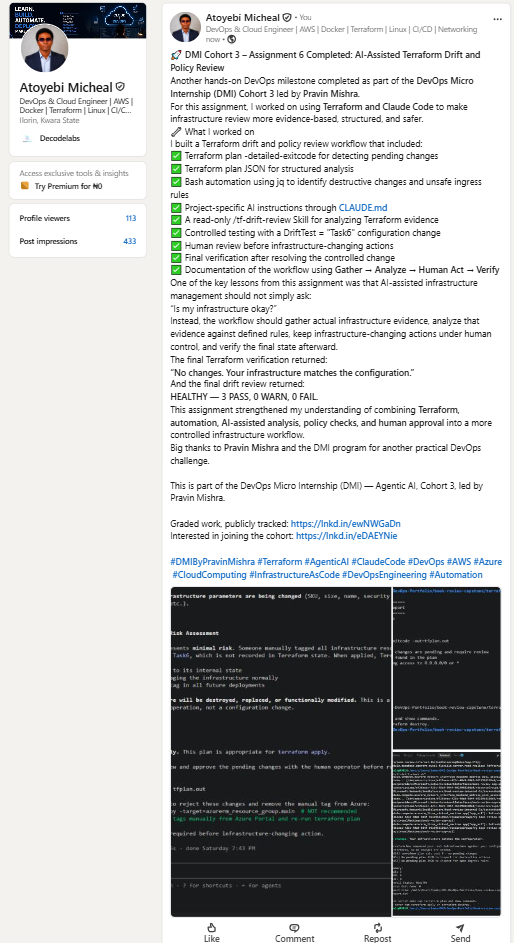

---

# Required Assignment Files

Confirm that the following files are included in your GitHub repository:

- `CLAUDE.md`
- `AI Assignment/tf-drift-check.sh`
- `.claude/skills/tf-drift-review/SKILL.md`
- `.claude/settings.json` containing the safety hook
- `reports/drift-detected-report.txt`
- `reports/resolved-report.txt`
- `drift-review-summary.md`

---

# Submission Instructions

- Complete Tasks 1–8 in sequence.
- Include Screenshots 1–19 exactly as specified.
- Answer every question under Tasks 1–8 in your own words.
- Complete all seven sections of the Terraform Drift Review Summary.
- Include the GitHub repository/folder URL containing the assignment files.
- Include your full name in the required reports and screenshots.
- Include the LinkedIn post URL and a screenshot of the published LinkedIn post.
- Do not expose access keys, passwords, tokens, account IDs, private keys, Terraform secrets, or other sensitive information.
- Review all screenshots carefully and hide or redact sensitive details where necessary.

---

# Completion Checklist

- [ ] Confirmed a clean Terraform baseline
- [ ] Created the required assignment workspace
- [ ] Created or updated `CLAUDE.md`
- [ ] Added project context and safety rules
- [ ] Created `tf-drift-check.sh`
- [ ] Added my full name to the report
- [ ] Validated the Bash script
- [ ] Made the script executable
- [ ] Used `terraform plan -detailed-exitcode`
- [ ] Used Terraform plan JSON
- [ ] Used `jq` to inspect destructive actions
- [ ] Used `jq` to inspect unsafe ingress
- [ ] Confirmed the baseline returns `HEALTHY`
- [ ] Created `/tf-drift-review`
- [ ] Restricted the Skill to appropriate tools
- [ ] Confirmed the Skill remains read-only
- [ ] Confirmed the Skill never runs `terraform apply`
- [ ] Confirmed the Skill never runs `terraform destroy`
- [ ] Introduced a controlled detectable difference
- [ ] Correctly identified whether it was true drift or a configuration change
- [ ] Saved `drift-detected-report.txt`
- [ ] Added the `PreToolUse` safety hook
- [ ] Verified the hook blocks `terraform apply` when the report is `FAIL`
- [ ] Reviewed the Terraform evidence before resolving the change
- [ ] Performed any infrastructure-changing action manually
- [ ] Ran the drift review again after resolution
- [ ] Confirmed the final status is `HEALTHY`
- [ ] Saved `resolved-report.txt`
- [ ] Completed `drift-review-summary.md`
- [ ] Mapped the workflow to `Gather --> Analyze --> Human Act --> Verify`
- [ ] Included all 19 numbered screenshots
- [ ] Answered all required questions
- [ ] Published the required LinkedIn post
- [ ] Added the LinkedIn post URL and screenshot
- [ ] Included the GitHub repository/folder URL
- [ ] Confirmed that no sensitive information is exposed

---

*This submission is part of the DevOps Micro Internship (DMI) Cohort 3 — Agentic AI Track.*
