# Assignment — Deploy EpicBook with Terraform and Ansible Roles

Part of the DevOps Micro Internship (DMI) with Agentic AI

---

## Purpose

In this assignment, you will deploy the EpicBook web application using Terraform and Ansible roles.

Terraform provisions the cloud infrastructure, including one Ubuntu VM and one managed MySQL database. Ansible roles configure the VM, install required software, deploy the EpicBook application, configure Nginx, connect the app to the managed MySQL database, and verify the deployment.

---

# Task 1 — Set Up the Project Folder Layout

## Goal

Create the project folder structure for Terraform and Ansible roles.

Terraform will be used to provision the cloud infrastructure. Ansible roles will be used to configure the VM and deploy the EpicBook application.

### Evidence

#### Screenshot 1 — Terminal showing the completed `epicbook-prod` project structure

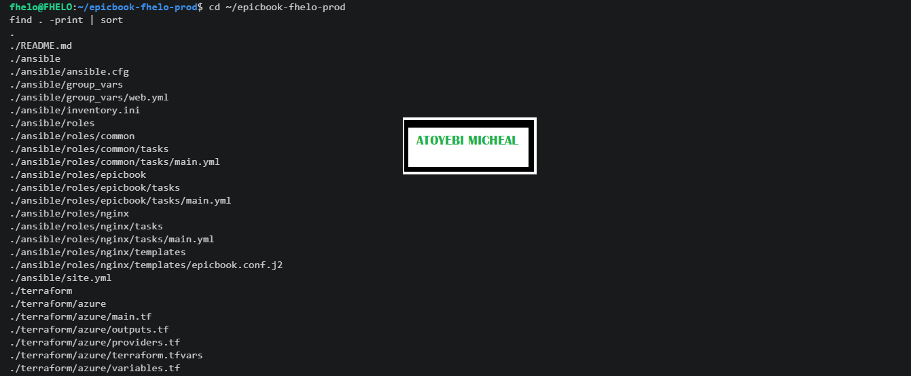

---

### Notes

Answer the following in your own words:

**1. Which cloud provider did you choose for this assignment?**

I chose Microsoft Azure as the cloud provider for this assignment. I will use Terraform to provision the required cloud infrastructure and Ansible to configure the virtual machine and deploy the EpicBook web application.

---

**2. Why is it useful to keep Terraform files and Ansible files in separate folders?**

Keeping Terraform and Ansible files in separate folders makes the project more organised and easier to manage. Terraform is responsible for creating and managing cloud resources, while Ansible configures the server, installs the required software, and deploys the application. Separating them makes troubleshooting easier, reduces confusion, and helps maintain the project as it grows.

---

**3. What is the purpose of the `roles` directory in Ansible?**

The roles directory is used to organise Ansible tasks into reusable and manageable components. Each role handles a specific responsibility. For example, the common role prepares the server, the nginx role installs and configures Nginx, and the epicbook role deploys and configures the EpicBook application. This structure makes automation easier to understand, reuse, and maintain.

---

# Task 2 — Provision the Infrastructure with Terraform

## Goal

Run Terraform to provision the cloud infrastructure for the EpicBook deployment.

Terraform will create the VM, managed MySQL database, networking, security rules, and required outputs.

### Evidence

#### Screenshot 2 — `terraform apply` completed successfully

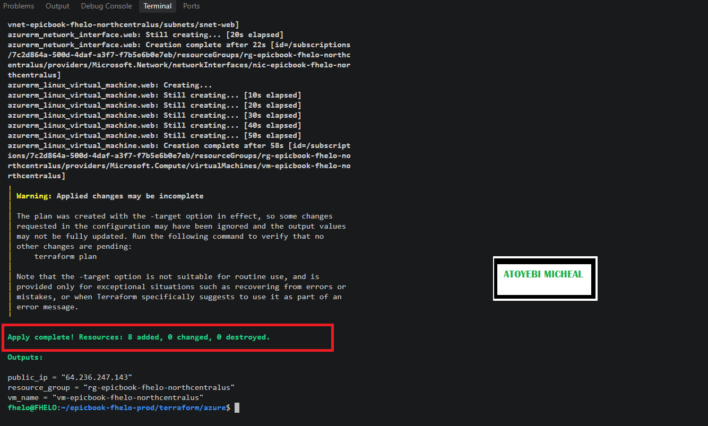

---

#### Screenshot 3 — Output of `terraform output`

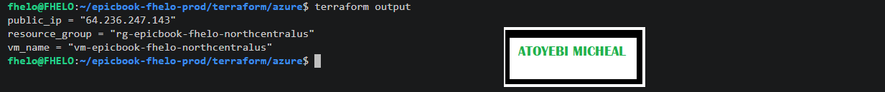

---

#### Screenshot 4 — Azure Portal or AWS Console showing the VM running

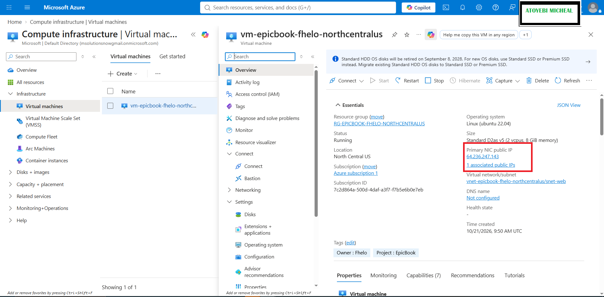

---

#### Screenshot 5 — Azure Portal or AWS Console showing the managed MySQL database created

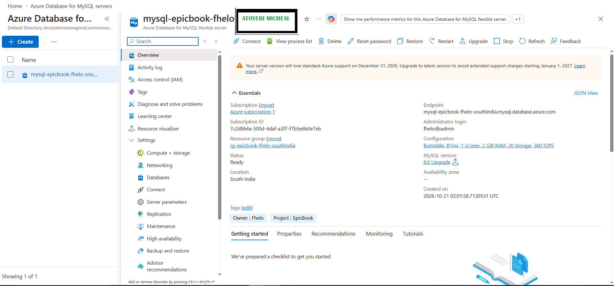

---

### Notes

Answer the following in your own words:

**1. What resources did Terraform create for this assignment?**

Terraform created the Azure resource group, virtual network, subnet, network security group (NSG), public IP address, network interface, and Linux virtual machine. These resources provide the network and server infrastructure needed to deploy the EpicBook web application.

---

**2. Why should you review `terraform plan` before running `terraform apply`?**

Reviewing terraform plan helps us understand what Terraform intends to create, modify, or delete before making changes in Azure. It helps us identify mistakes, avoid unwanted changes, control costs, and protect existing resources.

---

**3. Why should database passwords not be shown in Terraform output?**

Database passwords should not be shown in Terraform output because they are sensitive information. Exposing them could allow unauthorized people to access the database. Passwords should be handled securely using sensitive variables, environment variables, or a secrets-management solution, and should never be committed to GitHub or shared in screenshots.

---

# Task 3 — Verify SSH Key-Based Access

## Goal

Verify that the cloud VM can be accessed from the Ansible controller using SSH key-based authentication.

### Evidence

#### Screenshot 6 — Successful SSH hostname check from the Ansible controller

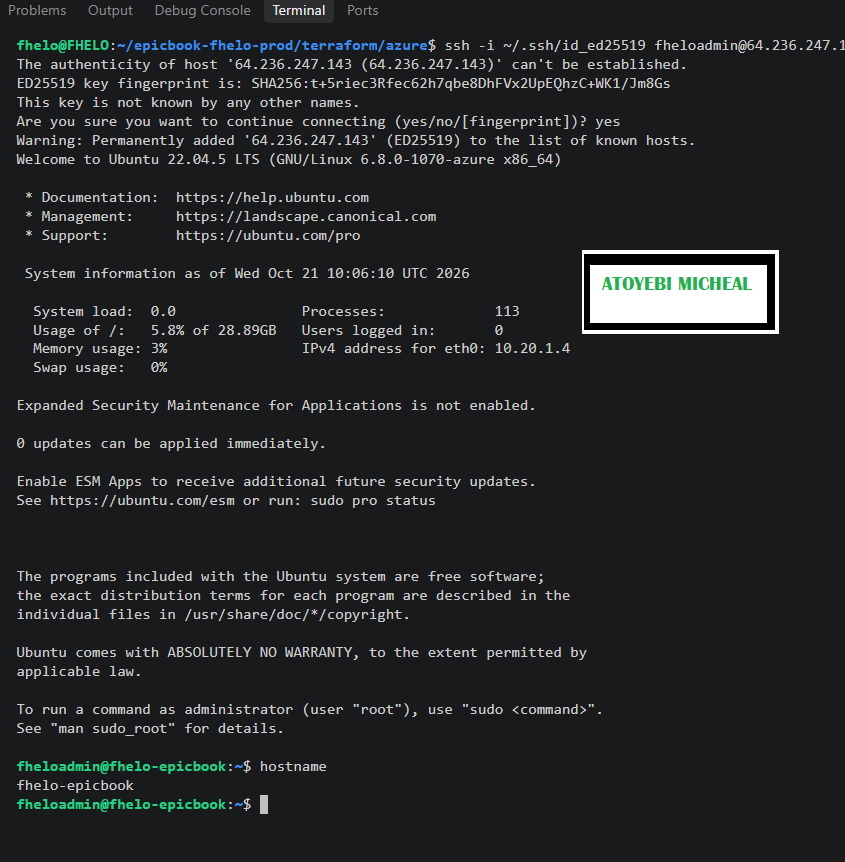

---

### Notes

Answer the following in your own words:

**1. What command did you use to verify SSH access?**

I used the following command from my Ansible controller (Ubuntu on WSL):

ssh -i ~/.ssh/id_ed25519 fheloadmin@64.236.247.143

After connecting successfully, I ran:

hostname

---

**2. What proves that SSH key-based access worked successfully?**

SSH key-based access worked successfully when I connected to the Azure virtual machine without being asked for the account password and the hostname command returned the VM's hostname. This confirmed that the SSH connection was successful and that the correct private key was being used.

---

**3. What would you check if SSH returned `Permission denied (publickey)`?**

I would check that I am using the correct private key, that the username is fheloadmin, and that the matching public key was added when the VM was created. I would also verify the private key's file path and permissions and confirm that the VM's network security group allows SSH traffic on port 22 from my controller's current public IP address.

---

# Task 4 — Create the Ansible Inventory and Configuration

## Goal

Create the Ansible inventory file and local Ansible configuration for the EpicBook VM.

The inventory tells Ansible which VM to manage and which SSH user to use.

### Evidence

#### Screenshot 7 — `inventory.ini` showing the VM under the `web` group

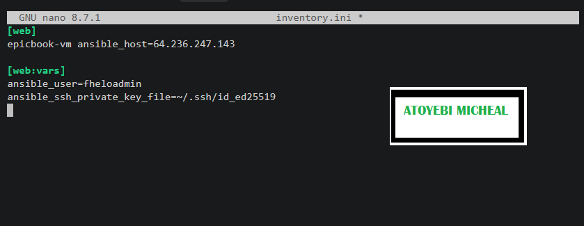

---

#### Screenshot 8 — Output of `ansible-inventory -i inventory.ini --graph`

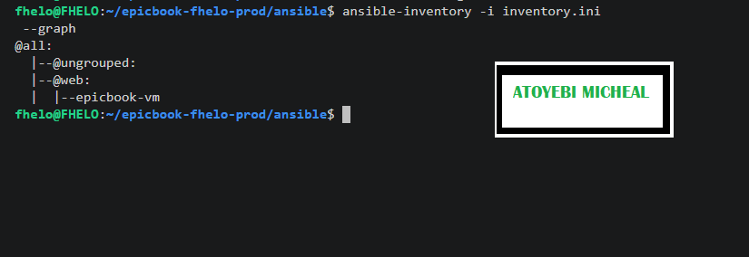

---

#### Screenshot 9 — Output of `ansible web -i inventory.ini -m ping`

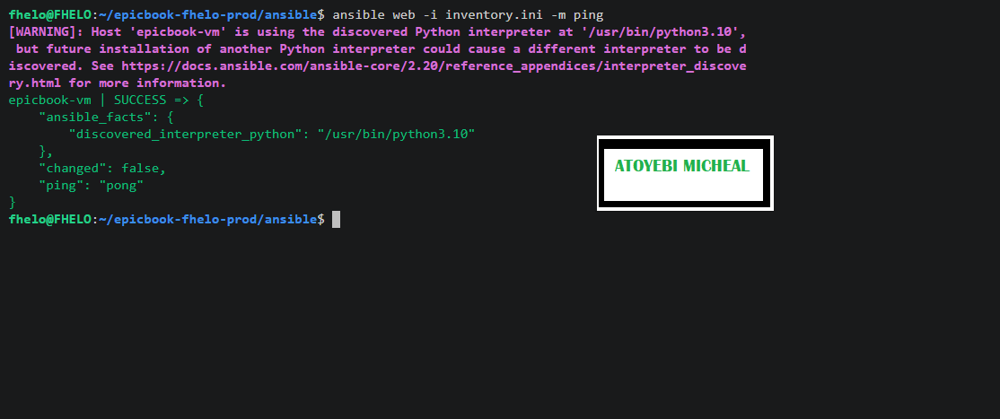

---

### Notes

Answer the following in your own words:

**1. What is the purpose of `inventory.ini`?**

The inventory.ini file tells Ansible which remote machines it needs to manage. In this assignment, it lists the EpicBook Azure virtual machine under the web group.

---

**2. What does `ansible_host` store?**

ansible_host stores the address Ansible uses to reach the target machine. In this assignment, it contains the VM's public IP address, 64.236.247.143.

---

**3. What does `ansible_ssh_private_key_file` tell Ansible?**

It tells Ansible the path to the private SSH key it should use to authenticate with the remote virtual machine.

---

**4. Why is `host_key_checking = False` used only for this temporary lab?**

It prevents Ansible from stopping to verify SSH host fingerprints, which makes initial lab connections easier. However, disabling host-key checking reduces protection against connecting to an impersonated server. For production environments, host-key checking should remain enabled and trusted host fingerprints should be verified.

---

# Task 5 — Create the Main Ansible Playbook

## Goal

Create the main Ansible playbook that runs the required roles in the correct order.

The `site.yml` file will call the `common`, `nginx`, and `epicbook` roles.

### Evidence

#### Screenshot 10 — `site.yml` showing the roles in the correct order

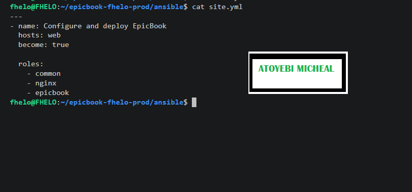

---

#### Screenshot 11 — Output of `ansible-playbook -i inventory.ini site.yml --syntax-check`

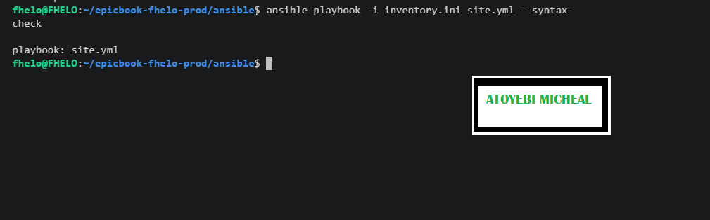

---

### Notes

Answer the following in your own words:

**1. What is the purpose of `site.yml`?**

The site.yml file is the main Ansible playbook. It tells Ansible which hosts to configure, which privileges to use, and which roles to execute when setting up the EpicBook application.

---

**2. Why should the roles run in the order `common`, `nginx`, and `epicbook`?**

The common role prepares the server by installing required packages and performing basic setup. The nginx role configures the web server and reverse proxy. Finally, the epicbook role deploys and configures the application. This order helps ensure that the server and web server are prepared before the application is deployed.

---

**3. What does `become: true` allow Ansible to do?**

become: true allows Ansible to run tasks with elevated privileges, usually through sudo. This is necessary for administrative tasks such as installing packages, managing system services, and configuring system files.

---

# Task 6 — Create the `common` Role

## Goal

Create the `common` role to prepare the Ubuntu VM with the basic packages required for the EpicBook deployment.

This role handles the common server setup before Nginx and the application are configured.

### Evidence

#### Screenshot 12 — `roles/common/tasks/main.yml` showing the common setup tasks

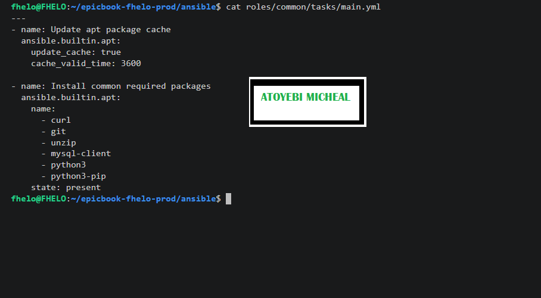

---

### Notes

Answer the following in your own words:

**1. What is the responsibility of the `common` role?**

The common role prepares the Ubuntu server for deployment by updating the package cache and installing basic utilities required by the application setup and troubleshooting process.

---

**2. Why should Nginx installation not be placed inside the `common` role?**

Nginx should be managed by its own role to keep the Ansible project organized and modular. This separation makes it easier to maintain, troubleshoot, and reuse the common server setup independently of the web server configuration.

---

**3. Why is `mysql-client` useful in this deployment?**

The mysql-client package provides command-line tools for connecting to and testing the remote MySQL database. It helps verify database connectivity and troubleshoot connection issues without installing a MySQL database server on the application VM.

---

# Task 7 — Create the `nginx` Role

## Goal

Create the `nginx` role to install Nginx and configure it as a reverse proxy for the EpicBook application.

Nginx will receive browser traffic on port `80` and forward it to the EpicBook Node.js application running on the VM.

### Evidence

#### Screenshot 13 — `roles/nginx/tasks/main.yml` showing Nginx installation and site configuration tasks

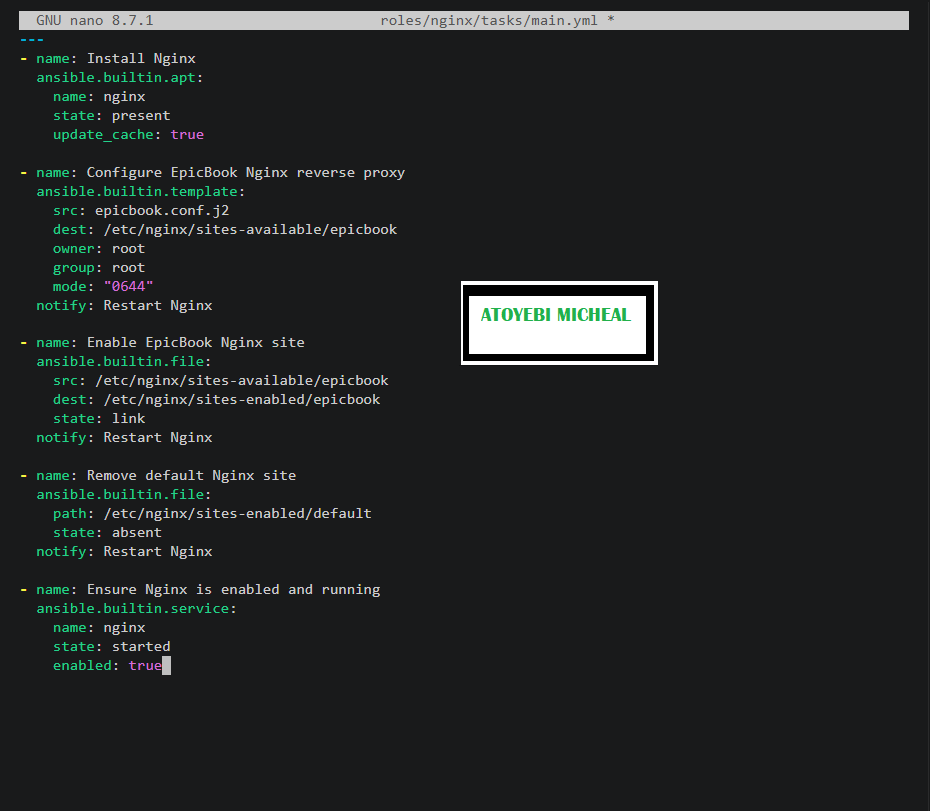

---

#### Screenshot 14 — `roles/nginx/templates/epicbook.conf.j2` showing the reverse proxy configuration

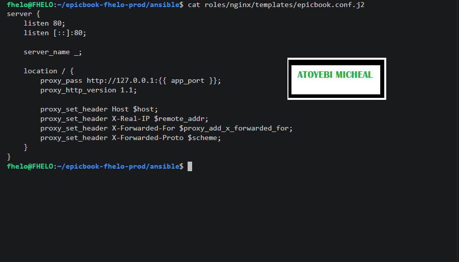

---

### Notes

Answer the following in your own words:

**1. What is the responsibility of the `nginx` role?**

The nginx role installs and configures Nginx on the Ubuntu VM. It creates the EpicBook website configuration, enables the site, and ensures that Nginx is running.

---

**2. Why is Nginx configured as a reverse proxy in this deployment?**

Nginx receives HTTP requests on port 80 and forwards them to the EpicBook Node.js application running on port 8080. This allows users to access the application through the standard web port without exposing the application's internal port directly to the internet.

---

**3. Why should the application port come from `group_vars/web.yml` instead of being hard-coded?**

Using a variable keeps the configuration flexible and easier to maintain. If the application port changes, I can update it in one place instead of editing multiple configuration files.

---

# Task 8 — Create the `epicbook` Role

## Goal

Create the `epicbook` role to deploy the EpicBook application, connect it to the managed MySQL database, and run the application on port `8080` using PM2.

### Evidence

#### Screenshot 15 — `roles/epicbook/tasks/main.yml` showing application deployment tasks

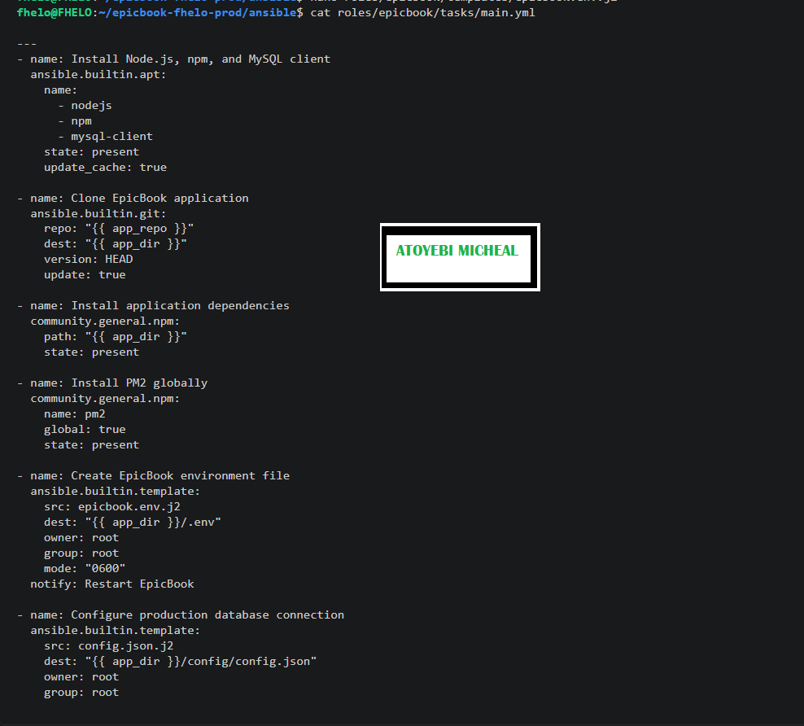

---

#### Screenshot 16 — Task or file showing how the database connection is configured, with secrets hidden

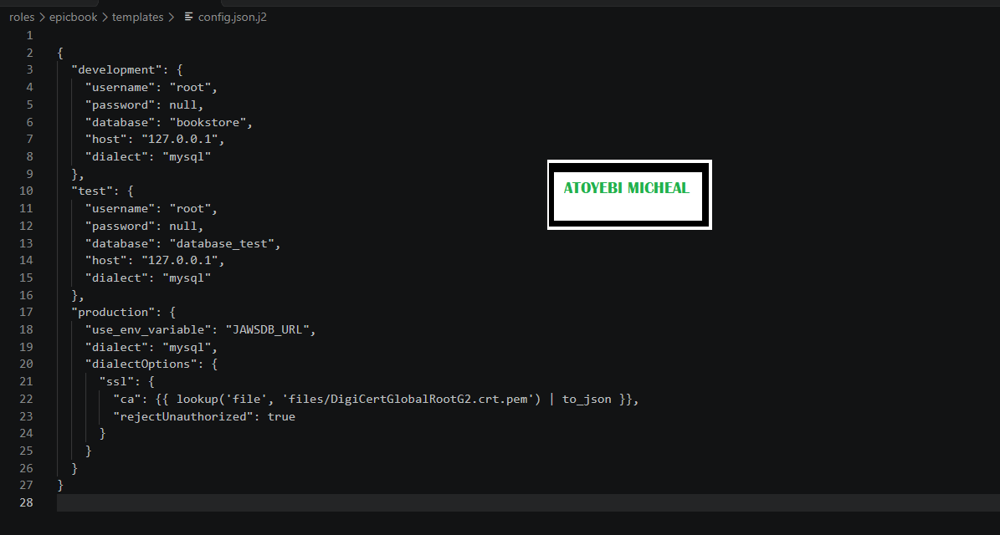

---

#### Screenshot 17 — Task or output showing the EpicBook application managed by PM2

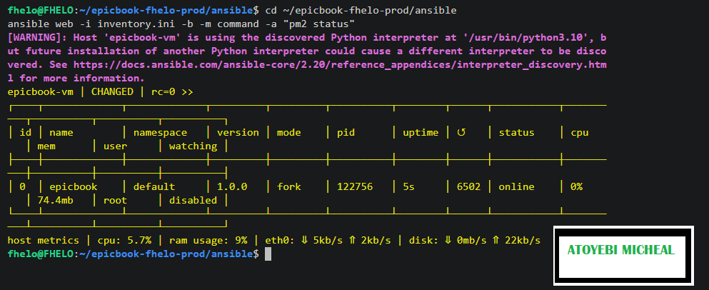

---

### Notes

Answer the following in your own words:

**1. What is the responsibility of the `epicbook` role?**

The epicbook role deploys the application by downloading its source code, installing the required Node.js packages, configuring the database connection, and preparing the application to run on the virtual machine.

---

**2. Why is PM2 used for the EpicBook Node.js application?**

PM2 manages the Node.js application process. It can restart the application if it crashes, run it in the background, and help keep it running after deployment.

---

**3. Why should database passwords not be hard-coded in public files?**

Database passwords are sensitive credentials. Keeping them out of public files, source control, and screenshots reduces the risk of unauthorized access to the database. They should be stored securely and supplied to the application at runtime.

---

**4. What does it mean for the application to run on port `8080` while Nginx listens on port `80`?**

The Node.js application listens internally on port 8080, while Nginx accepts browser requests on port 80 and forwards them to the application. Users can access the website through the normal HTTP port without directly exposing the application's port.

---

# Task 9 — Create Group Variables

## Goal

Create reusable variables for the EpicBook deployment.

The `group_vars/web.yml` file stores values that can be reused across the Ansible roles.

### Evidence

#### Screenshot 18 — `group_vars/web.yml` showing the application, PM2, and database variables, with passwords hidden or masked

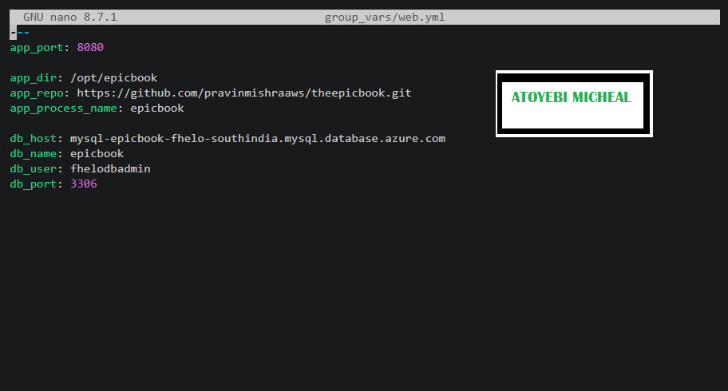

---

### Notes

Answer the following in your own words:

**1. What is the purpose of `group_vars/web.yml`?**

The group_vars/web.yml file stores variables shared by hosts in the Ansible web group. It keeps the application and database settings in one place so they can be reused across roles and updated more easily.

---

**2. Which values did you store in `group_vars/web.yml`?**

I stored the application port, application directory, Git repository URL, PM2 process name, database hostname, database name, database username, and database port.

---

**3. How did you handle the database password securely?**

I did not place the database password in group_vars/web.yml or any public source file. The password should be supplied securely at runtime or stored using Ansible Vault, and it must not be committed to GitHub or exposed in screenshots.

---

# Task 10 — Run the Ansible Playbook

## Goal

Run the Ansible playbook to configure the VM and deploy the EpicBook application.

The playbook should run the roles in this order:

1. `common`
2. `nginx`
3. `epicbook`

### Evidence

#### Screenshot 19 — Ansible playbook output showing the roles running

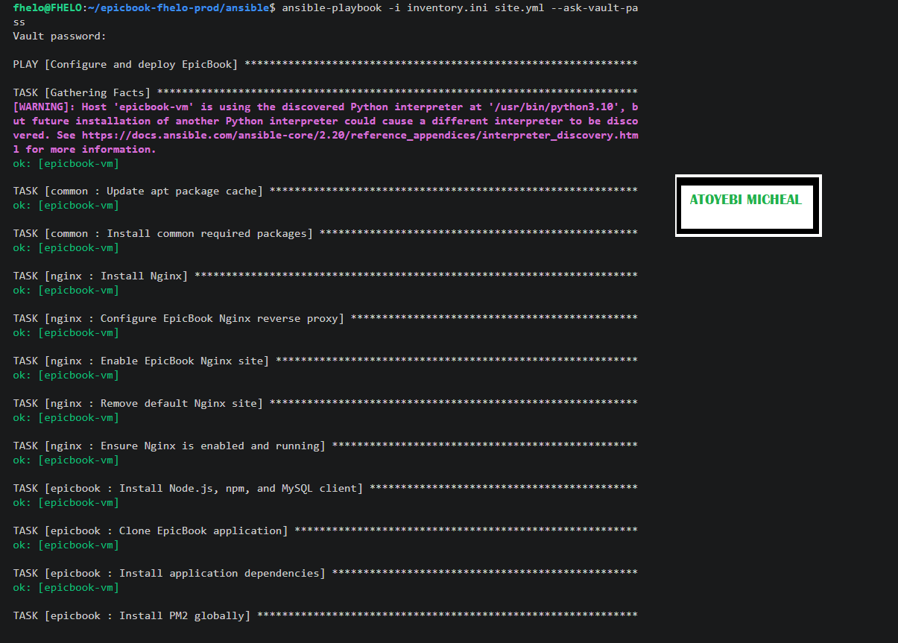

---

#### Screenshot 20 — Final Ansible recap showing `failed=0`

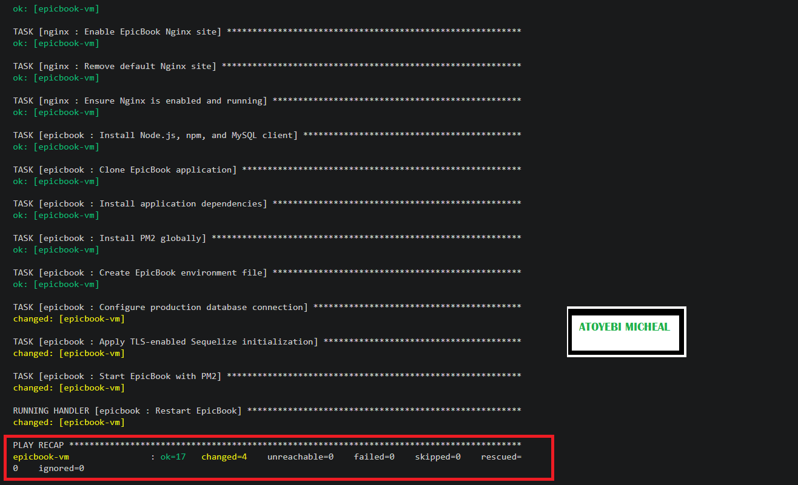

---

#### Screenshot 21 — Output of `ansible web -i inventory.ini -m command -a "systemctl is-active nginx" --become`

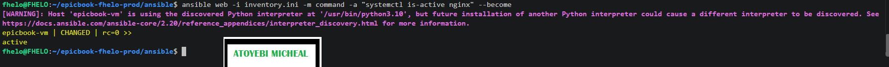

---

#### Screenshot 22 — Output of `ansible web -i inventory.ini -m command -a "pm2 status"`

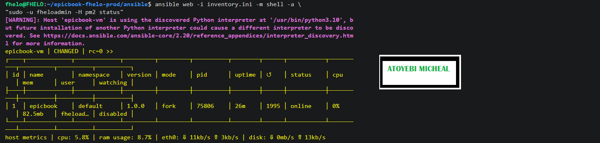

---

#### Screenshot 23 — Output of `ansible web -i inventory.ini -m command -a "curl -I http://localhost:8080"`

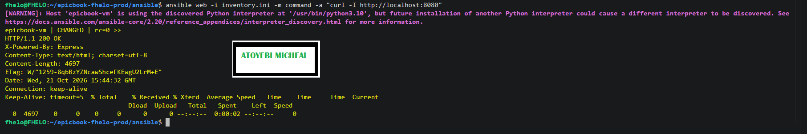

---

### Notes

Answer the following in your own words:

**1. What command did you run to execute the Ansible playbook?**

I ran the following command to execute the Ansible playbook and enter the Ansible Vault password when prompted:
ansible-playbook -i inventory.ini site.yml --ask-vault-pass

---

**2. How do you know all roles completed successfully?**

The playbook output showed that the common, nginx, and epicbook roles executed successfully. The final recap showed failed=0 and unreachable=0, meaning no tasks failed and Ansible could reach the target server.

---

**3. What proves that Nginx is active?**

The command below returned active, confirming that the Nginx service is running on the server:
ansible web -i inventory.ini -m command -a "systemctl is-active nginx" --become

---

**4. What proves that PM2 is managing the EpicBook application?**

The PM2 status command listed the epicbook application with its status as online. This confirms that PM2 is managing the application process.
ansible web -i inventory.ini -m shell -a "sudo -u fheloadmin -H pm2 status"

---

**5. What proves that the EpicBook application responds on port `8080`?**

The command below returned HTTP 200, confirming that the EpicBook application responds successfully on port 8080.
ansible web -i inventory.ini -m command -a "curl -I http://localhost:8080"

---

# Task 11 — Verify the EpicBook Deployment

## Goal

Verify that the EpicBook application is running, accessible in the browser, and connected to the managed MySQL database.

### Evidence

#### Screenshot 24 — Output of `curl -I http://<public_ip>`

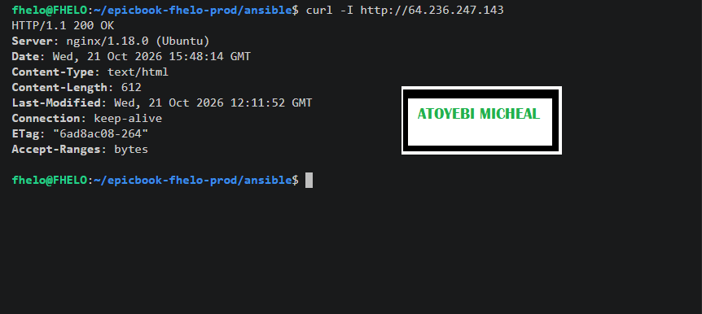

---

#### Screenshot 25 — Output of the cart API test command

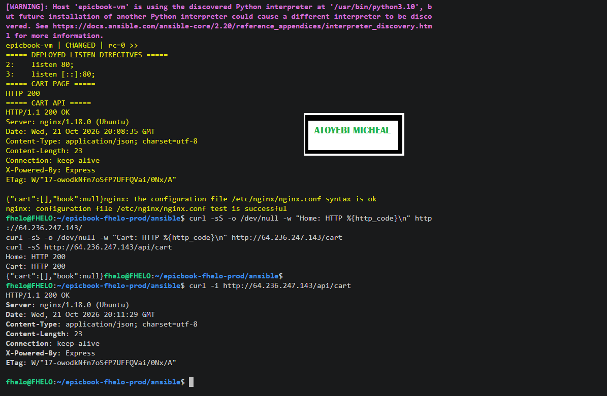

---

#### Screenshot 26 — Output of the `/cart` HTTP status check

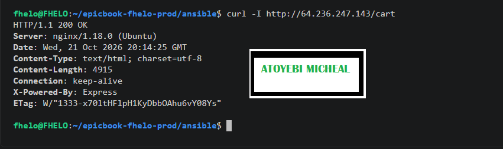

---

#### Screenshot 27 — Browser showing the EpicBook application loaded from `http://<public_ip>`

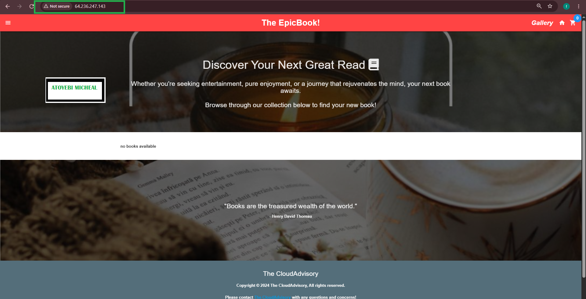

---

### Notes

Answer the following in your own words:

**1. What HTTP response did you receive from the public application URL?**

I received an HTTP 200 OK response, which confirmed that the EpicBook application was accessible through its public IP address.

---

**2. What did the cart API test prove?**

The cart API test returned an HTTP 200 OK response with JSON data showing an empty cart. This proved that the API endpoint was working and returning data correctly.

---

**3. What did the `/cart` status check return?**

The /cart status check returned HTTP 200 OK, confirming that the cart page was accessible through the public URL.

---

**4. What issue did you face during verification, and how did you fix it?**

I initially experienced routing issues when testing the application through Nginx. Some requests returned a default welcome page or a 404 error instead of the expected application response. I checked the Nginx configuration, verified that the application was running through PM2, and tested the endpoints again. The application subsequently returned the expected 200 OK responses.

---

# LinkedIn Post Required

## Evidence

#### LinkedIn Post URL

Paste your LinkedIn post URL here:

`https://www.linkedin.com/posts/aamicheal_devops-microsoftazure-terraform-ugcPost-7518773928333324288-Oy9H/?highlightedUpdateUrn=urn%3Ali%3Aactivity%3A7518773929289875457&highlightedUpdateType=SOCIAL_SHARE&origin=SOCIAL_SHARE&utm_source=social_share_send&utm_medium=member_desktop_web&rcm=ACoAADFvgDYBsnsyE66xAyq2HzH3Jfsf19WE6JA`

---

#### Screenshot — Published LinkedIn post

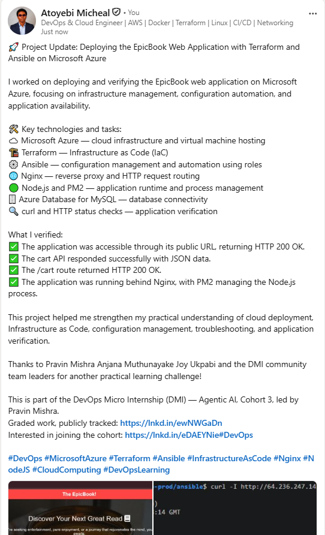

---

# Assignment Questions

Answer the following in your own words:

**1. Why is Terraform used for infrastructure provisioning?**

Terraform is used to create and manage cloud infrastructure automatically using code. It helps me provision resources consistently, reduce manual errors, and manage infrastructure changes in a repeatable way.

---

**2. Why are Ansible roles useful for production-style deployments?**

Ansible roles help organize tasks, variables, templates, and handlers into reusable sections. This makes deployments easier to maintain, troubleshoot, and reuse across different servers and environments.

---

**3. What is the purpose of `group_vars/web.yml`?**

The group_vars/web.yml file stores variables for the web server group in Ansible. In my project, it contains settings such as the application directory, application port, Git repository, database host, database name, and database username. This keeps configuration separate from the task files.

---

**4. Why should database passwords not be committed to GitHub?**

Database passwords should not be committed to GitHub because unauthorized people could access them and use them to connect to the database. This could lead to data theft, data loss, or unauthorized changes. Sensitive information should be stored securely, for example, using Ansible Vault or a cloud secrets manager.

---

**5. What is the purpose of Nginx in this deployment?**

Nginx acts as a reverse proxy between users and the EpicBook Node.js application. It receives HTTP requests on port 80 and forwards them to the application running on port 8080. It helps route requests to the application without exposing the Node.js port directly to the public internet.

---

**6. Why should the managed MySQL database not be publicly accessible?**

The managed MySQL database should not be publicly accessible because exposing it to the internet increases the risk of unauthorized access and attacks. Restricting database connectivity to trusted resources, such as the application server, reduces the attack surface and improves security.

---

**7. Why is PM2 used for the EpicBook Node.js application?**

PM2 is used to manage the Node.js application process. It helps keep the application running, allows it to be restarted when necessary, and provides tools for monitoring application status and viewing logs.

---

**8. What does idempotency mean in Ansible?**

Idempotency means that running the same Ansible playbook multiple times should leave the system in the desired state without repeatedly making unnecessary changes. This makes configuration management more reliable and predictable.

---

**9. What issue did you face during the deployment, and how did you fix it?**

I initially faced SSH connectivity and application routing issues. SSH access failed because the allowed source IP address was outdated, so I updated the Azure Network Security Group rule to allow my current public IP. I also checked the Nginx configuration and verified the application using PM2 and curl. After troubleshooting, the application and its cart API returned HTTP 200 OK responses.

---

**10. What security improvement would you make before using this setup in production?**

Before using this setup in production, I would configure HTTPS with a valid TLS certificate, restrict SSH access, and keep database credentials in a secure secrets manager. I would also ensure that the database accepts connections only from trusted sources, apply least-privilege permissions, and enable monitoring, logging, and regular security updates.

---

# Required Files

Confirm that the following files are included in your GitHub repository or assignment folder:

- [ ] `README.md`
- [ ] Terraform files under either `terraform/azure/` or `terraform/aws/`
- [ ] `ansible/ansible.cfg`
- [ ] `ansible/inventory.ini`
- [ ] `ansible/site.yml`
- [ ] `ansible/group_vars/web.yml`
- [ ] `ansible/roles/common/tasks/main.yml`
- [ ] `ansible/roles/nginx/tasks/main.yml`
- [ ] `ansible/roles/nginx/templates/epicbook.conf.j2`
- [ ] `ansible/roles/epicbook/tasks/main.yml`

---

# Submission Instructions

- Add all required screenshots in your submission.
- Full Name must be visible in required screenshots.
- Mention the cloud provider used: Azure or AWS.
- Add the VM public IP address.
- Add the final application URL.
- Add Terraform output proof.
- Add Ansible role tree proof.
- Add all required notes and assignment question answers.
- Add your LinkedIn post URL.
- Do not expose SSH private keys, passwords, cloud credentials, database credentials, Terraform state files, subscription IDs, or account IDs.

---

# Completion Checklist

- [ ] Task 1: Project folder layout created
- [ ] Task 2: Terraform infrastructure provisioned
- [ ] Task 3: SSH key-based access verified
- [ ] Task 4: Ansible inventory and configuration created
- [ ] Task 5: Main Ansible playbook created
- [ ] Task 6: `common` role created
- [ ] Task 7: `nginx` role created
- [ ] Task 8: `epicbook` role created
- [ ] Task 9: Group variables created
- [ ] Task 10: Ansible playbook run completed
- [ ] Task 11: EpicBook deployment verified
- [ ] Terraform files created under only one cloud provider folder
- [ ] One Ubuntu VM was created
- [ ] One managed MySQL database was created
- [ ] SSH port `22` is restricted to the controller public IP
- [ ] HTTP port `80` is accessible
- [ ] MySQL port `3306` is not publicly open
- [ ] `ansible web -i inventory.ini -m ping` returns `SUCCESS`
- [ ] `site.yml` calls the roles in the correct order
- [ ] Database secrets are hidden or handled securely
- [ ] Nginx is active
- [ ] PM2 shows the EpicBook application running
- [ ] EpicBook responds on port `8080`
- [ ] Public URL loads in the browser
- [ ] Cart API verification works
- [ ] Playbook completes with `failed=0`
- [ ] Screenshots 1–27 are included
- [ ] Assignment questions are answered
- [ ] LinkedIn post published
- [ ] LinkedIn post URL added
- [ ] No sensitive information is exposed

---

## About DMI & CloudAdvisory

DevOps Micro Internship (DMI) is a project-based DevOps program run by Pravin Mishra and The CloudAdvisory, focused on real-world execution, systems thinking, and career readiness.

It helps learners build strong DevOps foundations with hands-on experience.

---

## Resources

- DMI Official Website: [https://dmi.pravinmishra.com?utm_source=github&utm_medium=readme](https://dmi.pravinmishra.com?utm_source=github&utm_medium=readme)
- University: [https://university.pravinmishra.com?utm_source=github&utm_medium=readme](https://university.pravinmishra.com?utm_source=github&utm_medium=readme)
- Discord Community: [https://discord.pravinmishra.com?utm_source=github&utm_medium=readme](https://discord.pravinmishra.com?utm_source=github&utm_medium=readme)
- Blog: [https://dmi.pravinmishra.com/blog?utm_source=github&utm_medium=readme](https://dmi.pravinmishra.com/blog?utm_source=github&utm_medium=readme)
- YouTube Playlist: [https://www.youtube.com/playlist?list=PLFeSNDtI4Cho](https://www.youtube.com/playlist?list=PLFeSNDtI4Cho)
- Pravin Mishra LinkedIn: [https://www.linkedin.com/in/pravin-mishra-aws-trainer/](https://www.linkedin.com/in/pravin-mishra-aws-trainer/)
- CloudAdvisory LinkedIn: [https://www.linkedin.com/company/thecloudadvisory/](https://www.linkedin.com/company/thecloudadvisory/)

---

*This submission is part of DevOps Micro Internship (DMI) — Agentic AI Track.*