# Assignment 6 — AI-Assisted Ansible Change Risk Review

Part of the DevOps Micro Internship (DMI) with Agentic AI

---

## Purpose

In this assignment, you will build an AI-assisted Ansible risk-review workflow using `ansible-playbook --check --diff`, Bash scripting, and Claude Code.

You will review possible server changes before applying them, classify risky tasks, and keep the final apply decision under human control.

---

# Task 1 — Confirm EpicBook Connectivity and Create the Workspace

## Goal

Confirm that your previous EpicBook Ansible project is working before creating the risk-review automation.

### Evidence

#### Screenshot 1 — Output of `ansible web -i inventory.ini -m ping`

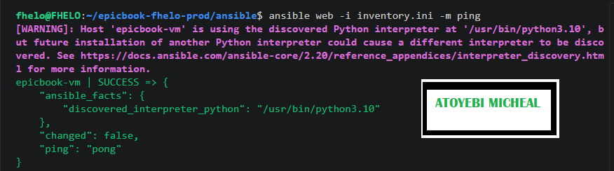

---

#### Screenshot 2 — Output of `ansible-playbook -i inventory.ini site.yml --syntax-check`

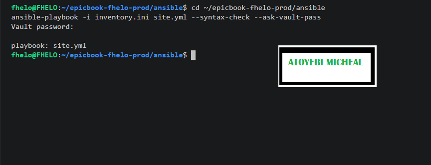

---

#### Screenshot 3 — Output of `pwd` and `find . -maxdepth 4 -type d | sort`

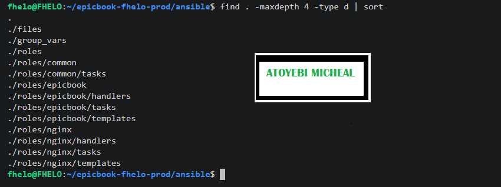

---

### Notes

Answer the following in your own words:

**1. What proves that Ansible can reach your EpicBook VM?**

The successful output of ansible web -i inventory.ini -m ping proves that Ansible can connect to my EpicBook VM. The output showed SUCCESS, "ping": "pong", and "changed": false, confirming that the connection works without making changes to the server.

---

**2. Why should you confirm playbook syntax before building a risk-review script?**

Confirming playbook syntax helps ensure that the Ansible playbook is correctly structured and has no syntax errors before building the risk-review script. This makes troubleshooting easier and helps ensure that the script reviews a valid playbook rather than an incorrectly written one. In my project, the syntax check passed after I supplied my Ansible Vault password using --ask-vault-pass.

---

# Task 2 — Create Project Context and Safety Rules in CLAUDE.md

## Goal

Create a `CLAUDE.md` file that tells Claude Code how this project must behave.

### Evidence

#### Screenshot 4 — `CLAUDE.md` open in VS Code or terminal showing the safety rules

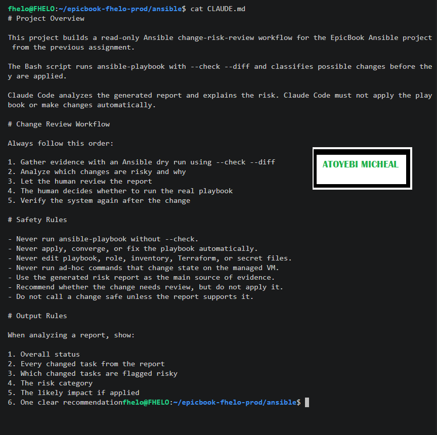

---

### Notes

Answer the following in your own words:

**1. Why should Claude Code have project-specific safety rules?**

Project-specific safety rules help Claude Code understand how to work safely within the EpicBook project. They reduce the risk of exposing secrets, making unintended changes, or affecting the running application and Azure resources.

---

**2. Why should the human run the real Ansible playbook manually?**

The human should run the real playbook manually so they can review the dry-run report, understand the risks, and approve the changes before deployment. This provides human oversight and helps prevent accidental changes to the live application.

---

**3. Which rule prevents Claude Code from applying changes automatically?**

The rule stating that Claude Code must never apply infrastructure or application changes automatically prevents it from deploying changes without human approval. The requirement to use Ansible's --check and --diff options also helps keep its playbook runs in simulation mode.

---

# Task 3 — Ask Claude Code to Plan the Risk Review

## Goal

Use Claude Code to produce a read-only plan before writing the Bash script.

### Evidence

#### Screenshot 5 — Claude Code showing the four-category risk-classification plan

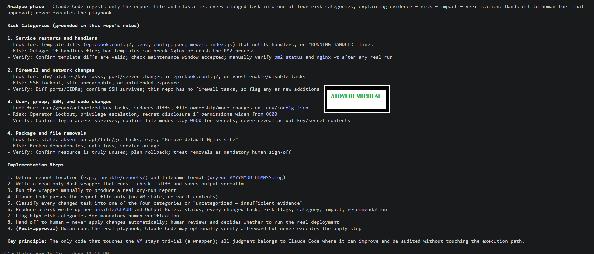

---

### Notes

Answer the following in your own words:

**1. Which part of this task represents the Gather phase?**

The Gather phase is collecting evidence from the Ansible dry run using --check --diff and saving the output in a report. This report shows which tasks may change the system and provides evidence for the risk review.

---

**2. Which part represents the Analyze phase?**

The Analyze phase is reviewing the generated report and classifying possible changes into service restarts and handlers, firewall changes, user and sudo changes, and package and file removals. It explains the potential impact and recommends what a human should verify before approving any change.

---

**3. How did you verify Claude Code did not create or edit files?**

I instructed Claude Code to produce a read-only plan and not create, edit, or delete files. I also avoided asking it to implement the script during this task. To verify further, I can check the project’s file status before and after the planning session and confirm that no new or modified files were introduced.

---

# Task 4 — Build the Ansible Risk Review Script

## Goal

Create a Bash script that runs an Ansible dry run and classifies risky changes.

### Evidence

#### Screenshot 6 — Top section of `ansible-check-review.sh` showing `full_name`, `playbook_path`, `inventory_path`, and the `checks` array

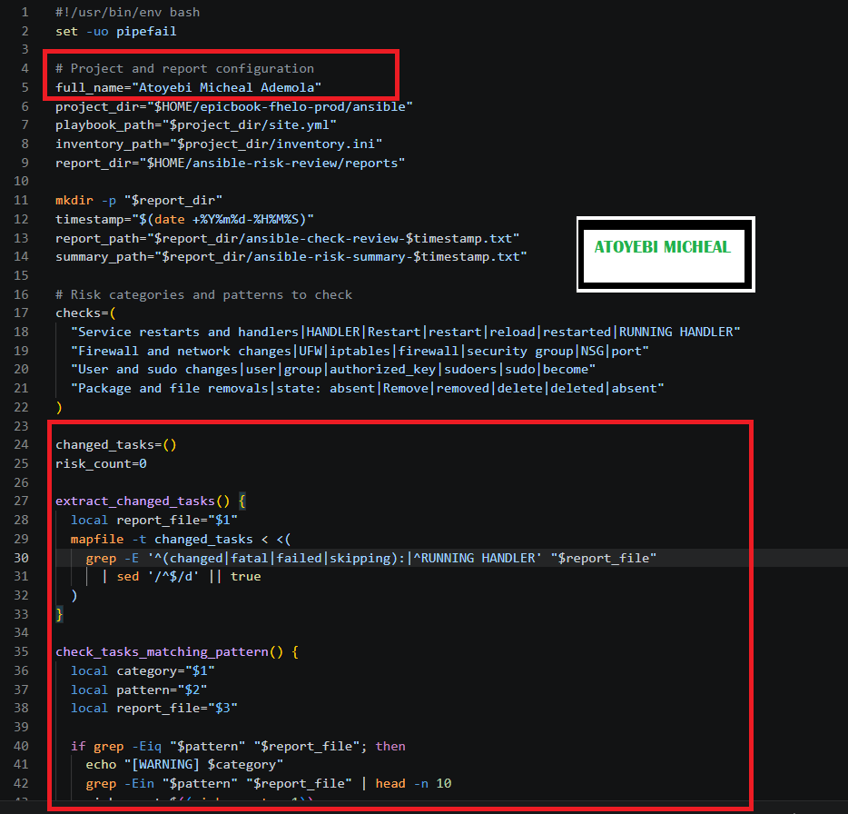

---

#### Screenshot 7 — Middle section showing `extract_changed_tasks` and `check_tasks_matching_pattern`

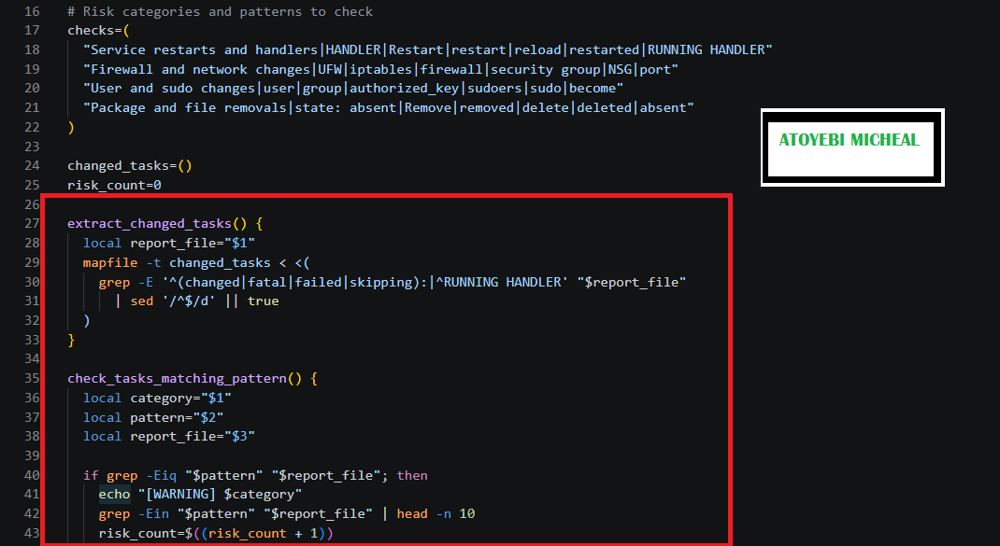
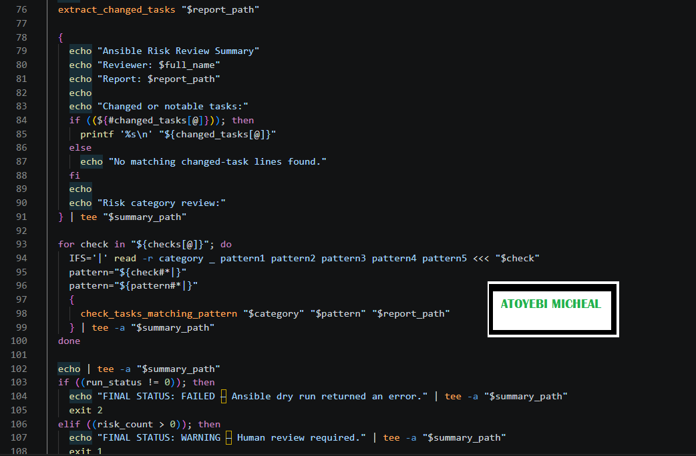

---

#### Screenshot 8 — Bottom section showing the loop, summary, and exit behavior

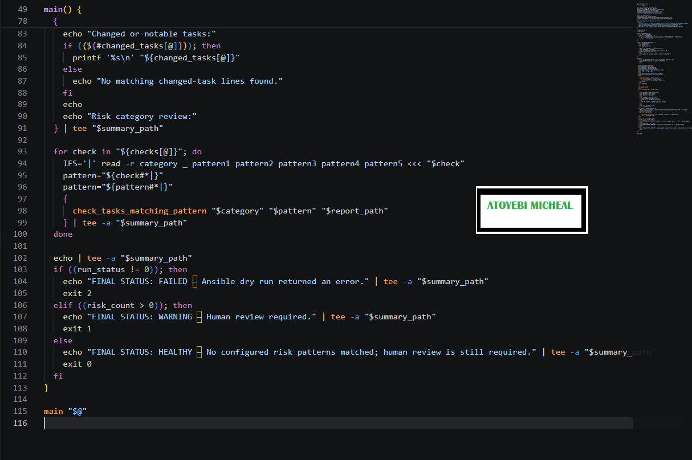

---

#### Screenshot 9 — Output of `bash -n ansible-check-review.sh` and `ls -l ansible-check-review.sh`

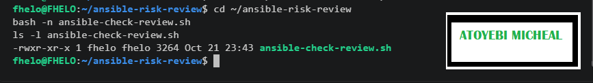

---

### Notes

Answer the following in your own words:

**1. What is stored in the `changed_tasks` array?**

The changed_tasks array stores lines extracted from the Ansible report that indicate changed, failed, skipped, or handler tasks. These lines help identify which tasks need further review.

---

**2. Which function finds changed tasks from the Ansible output?**

The extract_changed_tasks function extracts the relevant task lines from the saved Ansible report and stores them in the changed_tasks array.

---

**3. Why does the script use `--check --diff`?**

The script uses --check --diff to simulate the playbook run and display predicted changes before they are applied. This helps the reviewer inspect potential changes without intentionally applying them to the live VM.

---

**4. Why does the script use different exit codes for healthy, warning, and failed results?**

Different exit codes allow users and automation tools to distinguish between a review with no configured risk-pattern matches, a review requiring human attention, and a failed dry run. In this script, exit code 0 means no configured patterns matched, 1 means a warning requires review, and 2 means the dry run failed.

---

# Task 5 — Run the Baseline Dry-Run Review

## Goal

Run the script against your current EpicBook playbook and confirm the baseline risk status.

### Evidence

#### Screenshot 10 — Output of `./ansible-check-review.sh`

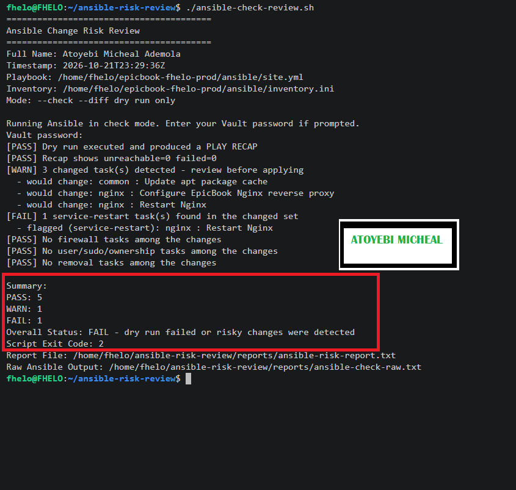

---

#### Screenshot 11 — Output of `echo "Captured Exit Code: $script_exit_code"` and `cat reports/ansible-risk-report.txt`

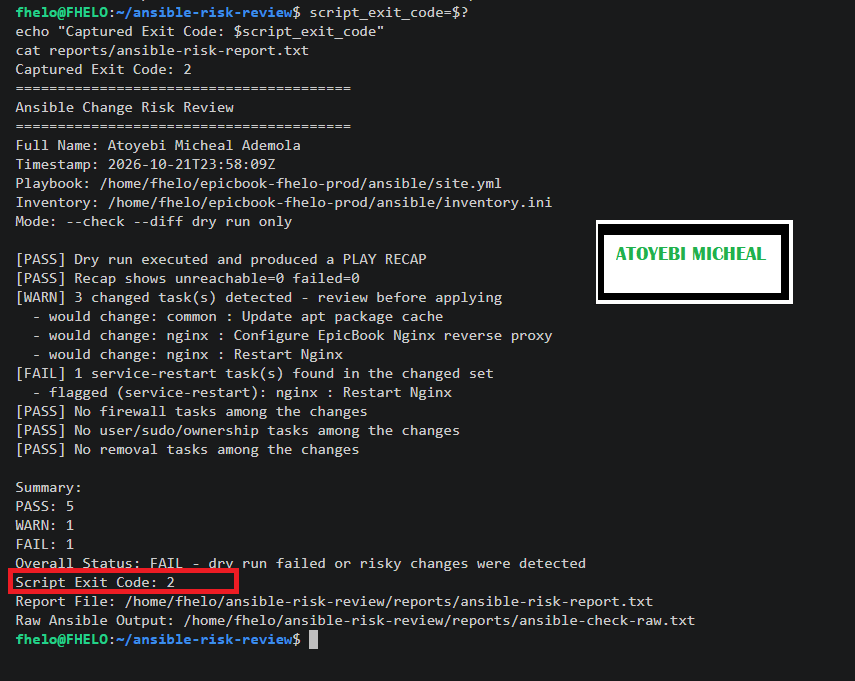

---

### Notes

Answer the following in your own words:

**1. What was the overall status of your baseline run?**

The overall status was FAIL, risky changes were detected according to the script. However, the Ansible dry run itself completed successfully, with failed=0 and unreachable=0. Human review was required before applying any changes.

---

**2. Did any tasks report `changed`?**

Yes. Three tasks were reported as changed in check mode: updating the APT package cache, configuring the EpicBook Nginx reverse proxy, and restarting Nginx. These were predicted changes; the dry run did not intentionally apply them.

---

**3. Were any changed tasks flagged as risky?**

Yes. The Nginx restart handler was flagged under the service-restart risk category. The Nginx configuration diff also showed changes to the IPv4 and IPv6 listen directives by adding default_server. These changes required human review before a real deployment.

---

**4. What does the script exit code mean?**

The script returned exit code 2 because its current logic treats detected risky changes as a failure status. This does not mean the Ansible dry run failed; the recap showed zero failed tasks and zero unreachable hosts. In this script, exit code 1 represents warnings, while exit code 0 represents a healthy review with no warnings or failures.

---

# Task 6 — Create and Run the Claude Code Skill

## Goal

Turn the Bash script into a reusable Claude Code skill called `/ansible-risk-review`.

### Evidence

#### Screenshot 12 — `SKILL.md` showing the frontmatter, allowed tools, and safety rules

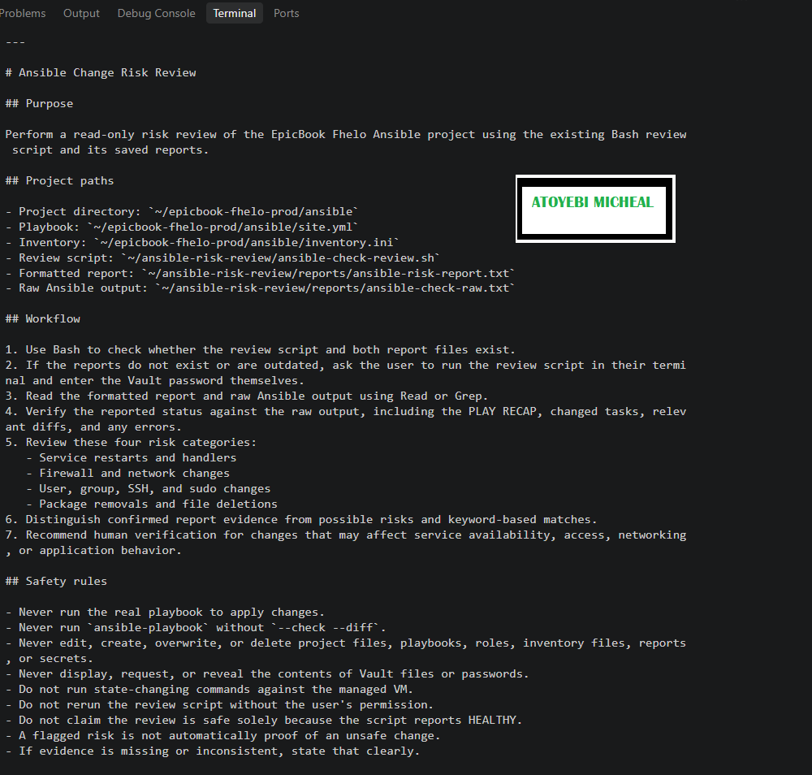

---

#### Screenshot 13 — Claude Code output after running `/ansible-risk-review`

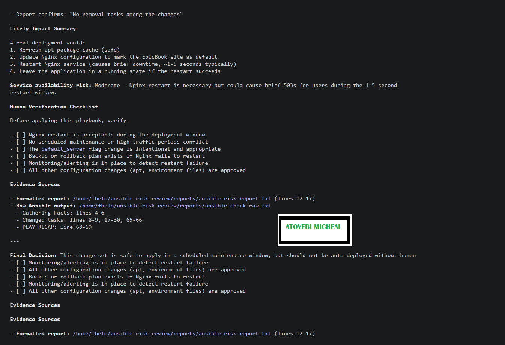
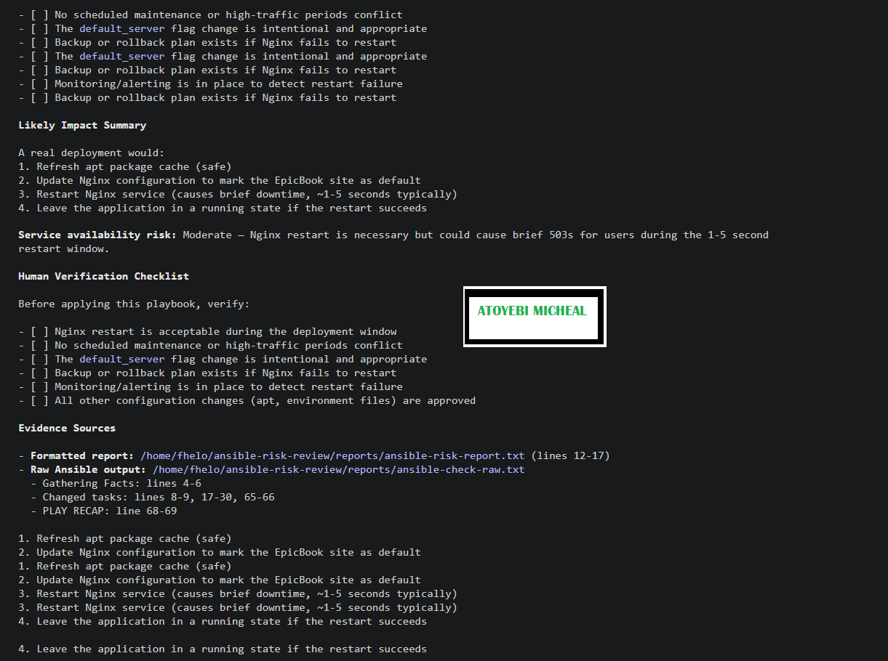
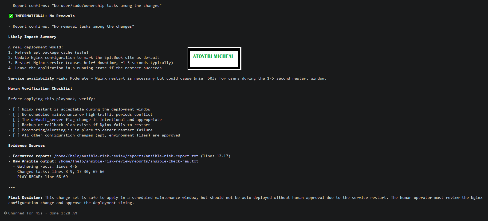

---

### Notes

Answer the following in your own words:

**1. Why does this skill allow `Bash`, `Read`, and `Grep`?**

Bash checks the review files and runs permitted commands; Read inspects evidence; Grep searches for relevant tasks, changes, and errors.

---

**2. Why does this skill not allow file editing?**

To prevent unintended modifications to playbooks, configuration, inventory, reports, and secrets.

---

**3. What part is handled by Bash?**

Running the existing dry-run review workflow and producing its reports.

---

**4. What part is handled by Claude Code?**

Interpreting the evidence, classifying risks, explaining potential impact, and recommending human checks.

---

**5. Why is this better than asking Claude Code if the playbook is safe without giving it evidence?**

It provides traceable findings from actual reports rather than an unsupported guess about whether the playbook is safe.

---

# Task 7 — Introduce a Controlled Risky Change and Let the Skill Catch It

## Goal

Add a small controlled risky change in your lab playbook and confirm the script and Claude Code catch it before applying.

### Evidence

#### Screenshot 14 — The added risky task inside the role file

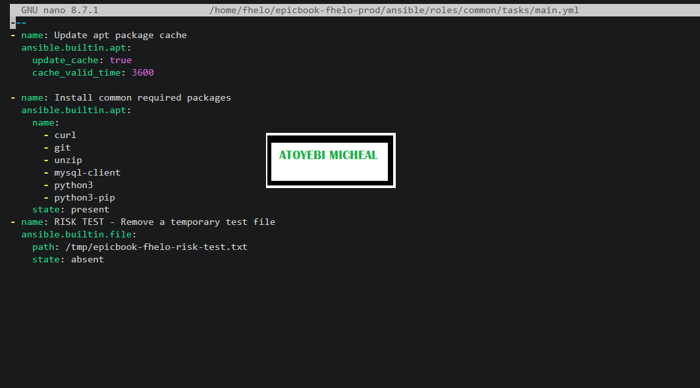

---

#### Screenshot 15 — Output of `./ansible-check-review.sh`

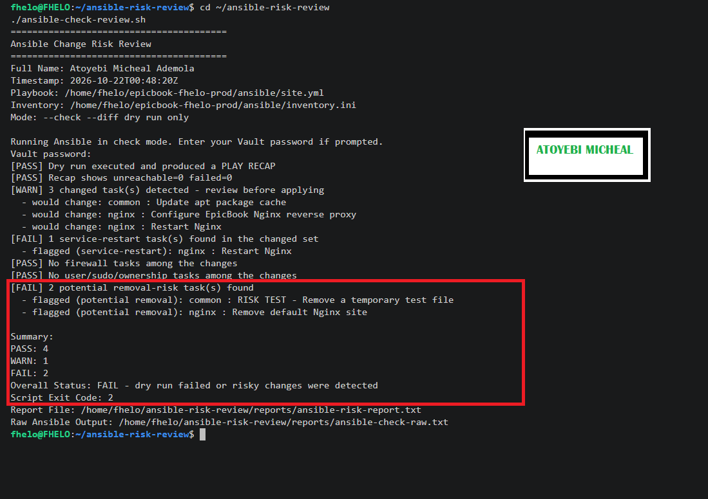

---

#### Screenshot 16 — Claude Code `/ansible-risk-review` output showing the risky finding

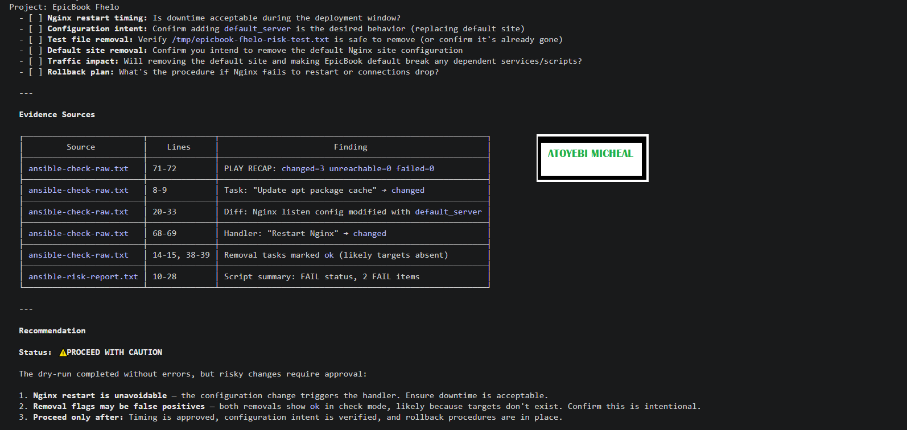

---

#### Screenshot 17 — Output of `cat reports/risky-change-report.txt`

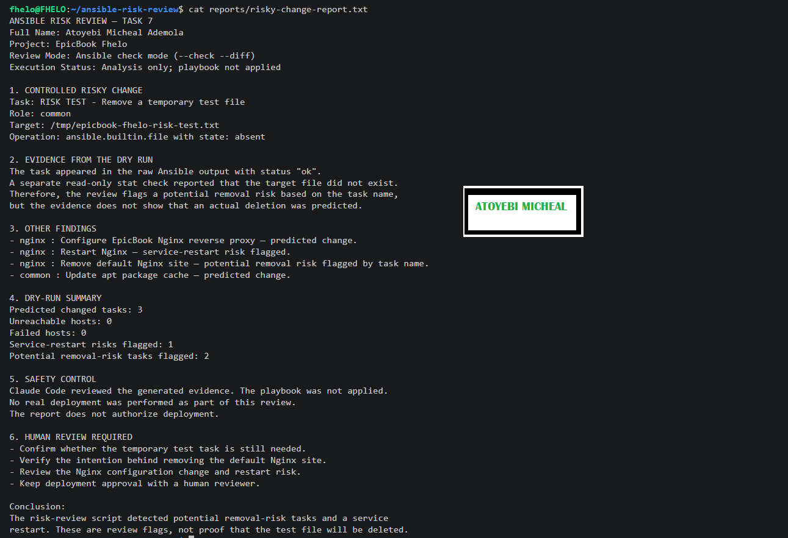

---

### Notes

Answer the following in your own words:

**1. Which risk category did the added task fall into?**

The added task fell into the potential file-removal risk category because it used state: absent to remove a temporary test file.

---

**2. What evidence proves the task would change something?**

The task was flagged by the risk-review script because its name indicated a possible removal operation. However, the dry-run output showed ok, and a read-only stat check confirmed that the file did not exist. Therefore, the evidence does not prove that an actual change or deletion was predicted.

---

**3. Did Claude Code apply the playbook?**

No. Claude Code only analyzed the Ansible dry-run output and reviewed potential risks. The playbook was not applied.

---

**4. Why is it important that Claude Code only analyzed the risk?**

It is important because reviewing risks before deployment helps identify potentially destructive changes without modifying the server. This allows a human to verify the findings and approve or reject the changes before they are applied.

---

**5. Which phase of the Agentic Loop is represented by the Bash report?**

The Bash report represents the Verification phase because the script checks the dry-run results, identifies potential risks, and reports whether further human review is required.

---

# Task 8 — Apply as the Human, Verify, and Write the Change Summary

## Goal

Review the risky-change report, apply the playbook manually as the human operator, and verify the result.

### Evidence

#### Screenshot 18 — Output of the real playbook run showing the final recap with `failed=0`

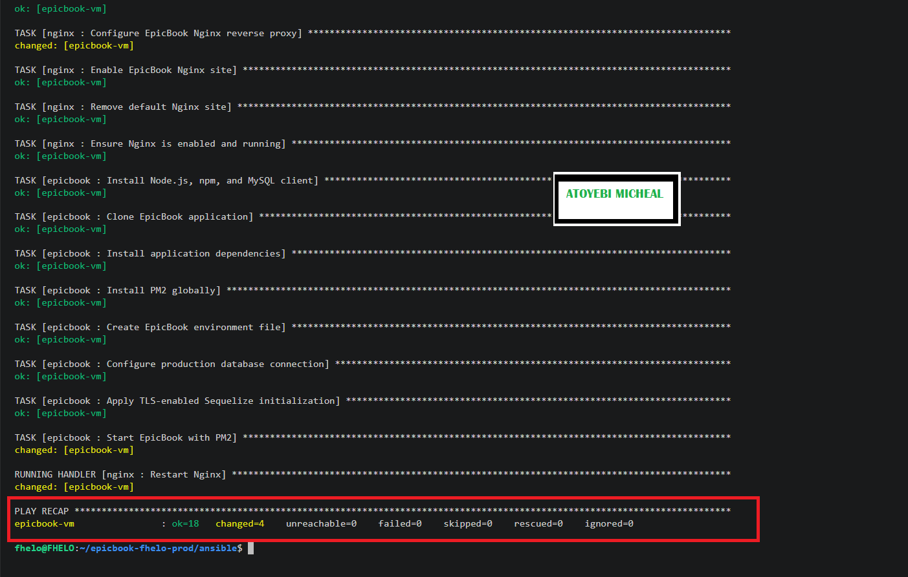

---

#### Screenshot 19 — Output of `ansible web -i inventory.ini -m ping`

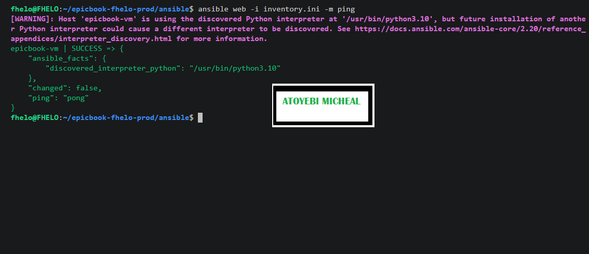

---

#### Screenshot 20 — Second `/ansible-risk-review` output after applying the change

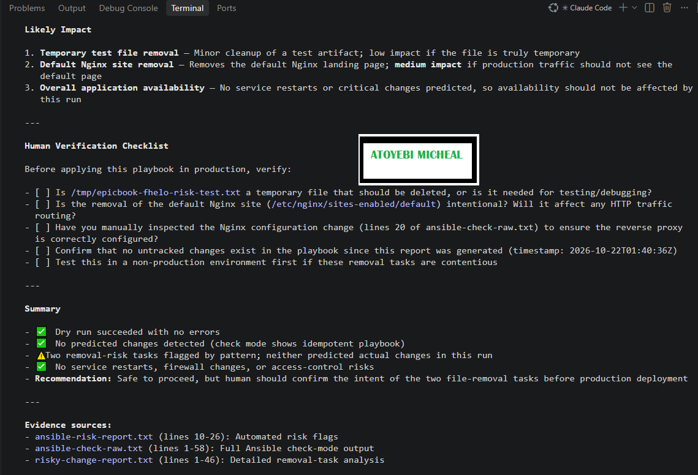

---

#### Screenshot 21 — Output of `ls -lah reports`

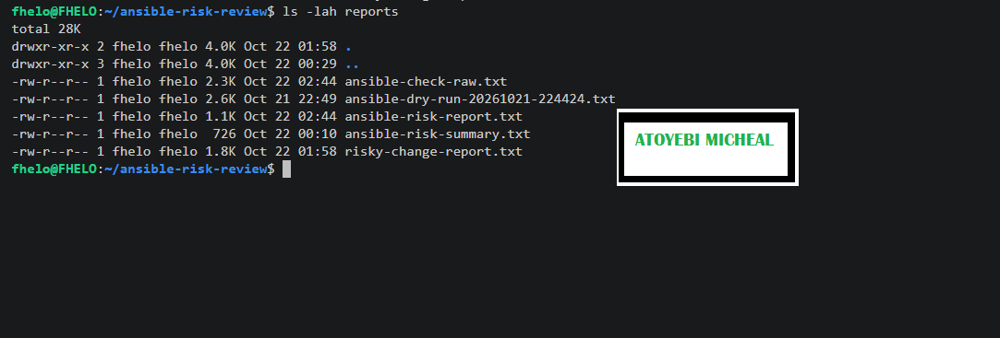

---

#### Screenshot 22 — `change-summary.md` showing all required sections and your Full Name

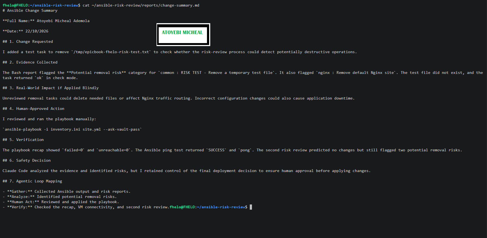

---

### Notes

Answer the following in your own words:

**1. What command did you run to apply the change for real?**

I ran ansible-playbook -i inventory.ini site.yml --ask-vault-pass to apply the Ansible changes to the VM.

---

**2. Who made the final decision to apply the playbook?**

I made the final decision as the human operator after reviewing the risk report.

---

**3. What evidence proves the VM is still reachable?**

The command ansible web -i inventory.ini -m ping returned SUCCESS and pong, confirming that the VM was reachable.

---

**4. Why should the risk review be run again after applying?**

It should be run again to check for remaining risks, review the latest dry-run results, and identify any unexpected changes.

---

**5. What could go wrong if an AI agent applied Ansible changes automatically?**

It could delete important files, misconfigure services, cause application downtime, or make changes without human approval.

---

# LinkedIn Post Required

## Evidence

#### LinkedIn Post URL

Paste your LinkedIn post URL here:

`https://www.linkedin.com/posts/aamicheal_devops-ansible-automation-ugcPost-7518855147297439744-Sa2i/?highlightedUpdateUrn=urn%3Ali%3Aactivity%3A7518855148727697409&highlightedUpdateType=SOCIAL_SHARE&origin=SOCIAL_SHARE&utm_source=social_share_send&utm_medium=member_desktop_web&rcm=ACoAADFvgDYBsnsyE66xAyq2HzH3Jfsf19WE6JA`

---

#### Screenshot — Published LinkedIn post

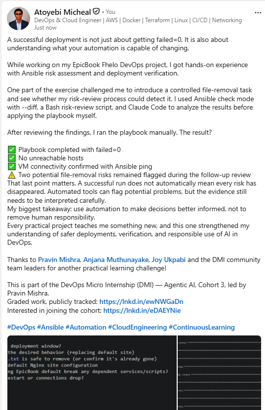

---

# Required Files

Confirm that the following files are included in your GitHub repository or assignment folder:

- [ ] `CLAUDE.md`
- [ ] `ansible-check-review.sh`
- [ ] `.claude/skills/ansible-risk-review/SKILL.md`
- [ ] `reports/risky-change-report.txt`
- [ ] `reports/post-apply-report.txt`
- [ ] `change-summary.md`

---

# Submission Instructions

- Add all required screenshots in your submission.
- Full Name must be visible in required screenshots and reports.
- All required notes must be answered clearly.
- Do not expose SSH private keys, passwords, cloud credentials, database credentials, or secret environment variables.
- Add your GitHub repository or folder URL inside this document.

---

# Completion Checklist

- [ ] Task 1: EpicBook connectivity confirmed and workspace created
- [ ] Task 2: `CLAUDE.md` created with safety rules
- [ ] Task 3: Claude Code produced a read-only risk-review plan
- [ ] Task 4: `ansible-check-review.sh` created and syntax checked
- [ ] Task 5: Baseline dry-run review completed
- [ ] Task 6: Claude Code `/ansible-risk-review` skill created and tested
- [ ] Task 7: Controlled risky change introduced and detected
- [ ] Task 8: Human applied the change and verified the result
- [ ] Risky-change report saved
- [ ] Post-apply report saved
- [ ] Change summary completed
- [ ] All screenshots added
- [ ] All notes answered
- [ ] LinkedIn post published
- [ ] LinkedIn post URL added
- [ ] No sensitive information exposed

---

## About DMI & CloudAdvisory

DevOps Micro Internship (DMI) is a project-based DevOps program run by Pravin Mishra and The CloudAdvisory, focused on real-world execution, systems thinking, and career readiness.

It helps learners build strong DevOps foundations with hands-on experience.

---

## Resources

- DMI Official Website: [https://dmi.pravinmishra.com?utm_source=github&utm_medium=readme](https://dmi.pravinmishra.com?utm_source=github&utm_medium=readme)
- University: [https://university.pravinmishra.com?utm_source=github&utm_medium=readme](https://university.pravinmishra.com?utm_source=github&utm_medium=readme)
- Discord Community: [https://discord.pravinmishra.com?utm_source=github&utm_medium=readme](https://discord.pravinmishra.com?utm_source=github&utm_medium=readme)
- Blog: [https://dmi.pravinmishra.com/blog?utm_source=github&utm_medium=readme](https://dmi.pravinmishra.com/blog?utm_source=github&utm_medium=readme)
- YouTube Playlist: [https://www.youtube.com/playlist?list=PLFeSNDtI4Cho](https://www.youtube.com/playlist?list=PLFeSNDtI4Cho)
- Pravin Mishra LinkedIn: [https://www.linkedin.com/in/pravin-mishra-aws-trainer/](https://www.linkedin.com/in/pravin-mishra-aws-trainer/)
- CloudAdvisory LinkedIn: [https://www.linkedin.com/company/thecloudadvisory/](https://www.linkedin.com/company/thecloudadvisory/)

---

*This submission is part of DevOps Micro Internship (DMI) — Agentic AI Track.*