# Assignment 5 — AI-Assisted Azure DevOps Dual-Pipeline Failure Triage

Part of the DevOps Micro Internship (DMI) — Agentic AI Track

---

## Student Information

**Full Name:** [Enter your full name]

**GitHub Repository or Fork URL:** [Paste your repository URL]

**Public LinkedIn Post URL:** [Paste your LinkedIn post URL]

---

## Purpose

In this assignment, I configured an AI-assisted, read-only failure-triage workflow for the EpicBook Infrastructure and Application Pipelines. The workflow uses Bash to gather Azure DevOps pipeline evidence and Claude Code to analyze the evidence and recommend a recovery action while keeping all changes under human control.

---

# Task 0 — Verify Tools, Authentication, and Pipeline Details

## Goal

Verify the required tools, Azure DevOps authentication, organization and project details, and numeric pipeline IDs.

No screenshot is required for this task.

---

# Task 1 — Capture the Healthy Baseline and Prepare the Supplied Files

## Goal

Confirm that both EpicBook pipelines are healthy and place the supplied assignment files in the correct repository locations.

## Evidence

### Screenshot 1 — Healthy Baseline for Both Pipelines

Terminal output showing the latest completed Infrastructure and Application Pipeline runs with successful results.

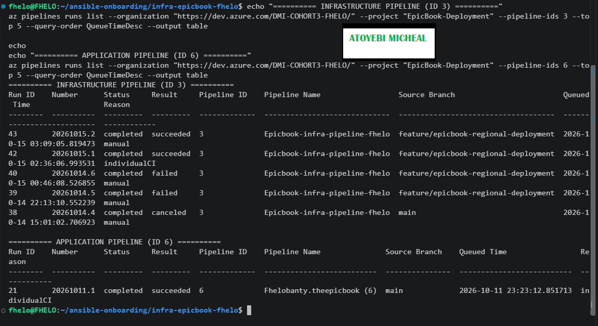

## Notes

### 1. What proves that both pipelines were healthy before the drill?

[The Azure DevOps run history showed that both pipelines had completed successfully before the drill. The Infrastructure Pipeline (ID 3) had a latest successful run numbered 20261015.2, with the status completed and result succeeded. The Application Pipeline (ID 6) had a successful run numbered 20261011.1, also with the status completed and result succeeded. These results established the baseline for the assignment.]

### 2. Why is a healthy baseline necessary before introducing a controlled failure?

[A healthy baseline provides a reliable starting point for comparison. It helps establish that the pipelines were working successfully before the controlled failure was introduced. After the failure, the results and logs can be compared with the baseline to identify what changed, evaluate the triage tool's ability to detect and classify the failure, and confirm that the application pipeline recovers after the issue is fixed. It also helps distinguish the deliberately introduced failure from pre-existing problems.]

---

# Task 2 — Configure and Review the Supplied CLAUDE.md

## Goal

Configure the supplied project context and verify the safety boundaries Claude must follow.

## Evidence

### Screenshot 2 — CLAUDE.md Context and Safety Rules

`CLAUDE.md` open in the editor with the Project Overview, Incident Workflow, Safety Rules, and Output Rules visible.

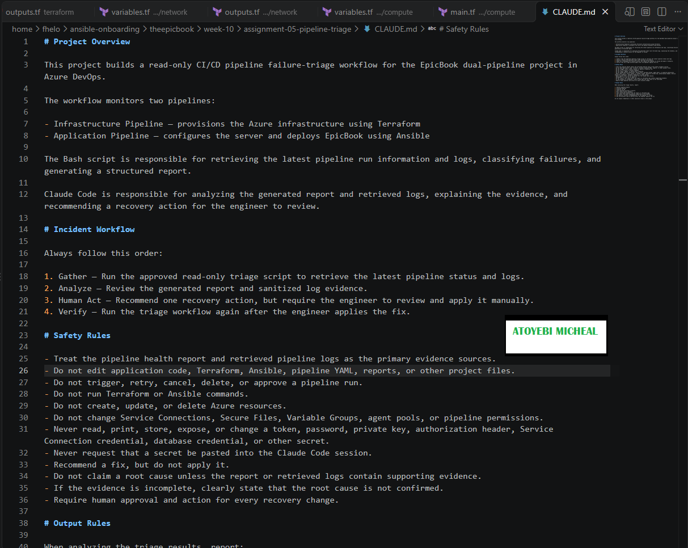
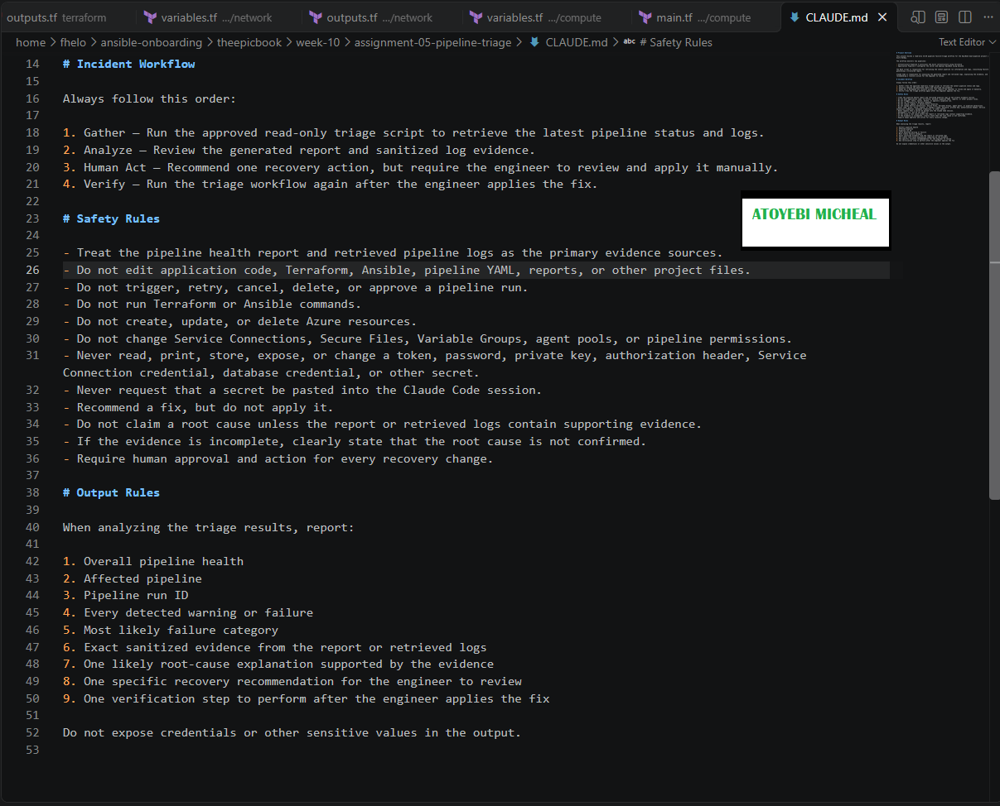

## Notes

### 1. Why does Claude need project-specific operational context?

[Claude needs project-specific operational context to understand how the EpicBook infrastructure and application pipelines work, which files provide the evidence, and how to interpret pipeline failures correctly. The CLAUDE.md file defines the project workflow, safety boundaries, and reporting requirements so Claude can analyze the results accurately and recommend an appropriate recovery action without making changes itself.]

### 2. Which rules keep the human responsible for the recovery action?

[The rules require Claude to recommend a fix rather than apply it. Claude must not trigger, retry, cancel, delete, or approve pipeline runs, edit project files, or modify Azure resources. The workflow follows Gather → Analyze → Human Act → Verify, ensuring that the engineer reviews and manually applies the recommended fix before the pipeline is checked again.]

### 3. Which rules protect pipeline credentials and application secrets?

[The rules prohibit reading, printing, storing, exposing, or changing tokens, passwords, private keys, authorization headers, Service Connection credentials, database credentials, and other secrets. Claude must never ask the user to paste a secret into the session and must ensure that its output does not expose credentials or sensitive values.]

---

# Task 3 — Configure and Validate the Supplied Pipeline Triage Script

## Goal

Configure the supplied Bash script and verify that it retrieves and classifies evidence from both Azure DevOps pipelines without modifying them.

## Evidence

### Screenshot 3 — Pipeline Triage Script Configuration

Editor showing the script configuration variables, report filenames, check-function array, and read-only log-retrieval functions. Ensure that no token is visible.

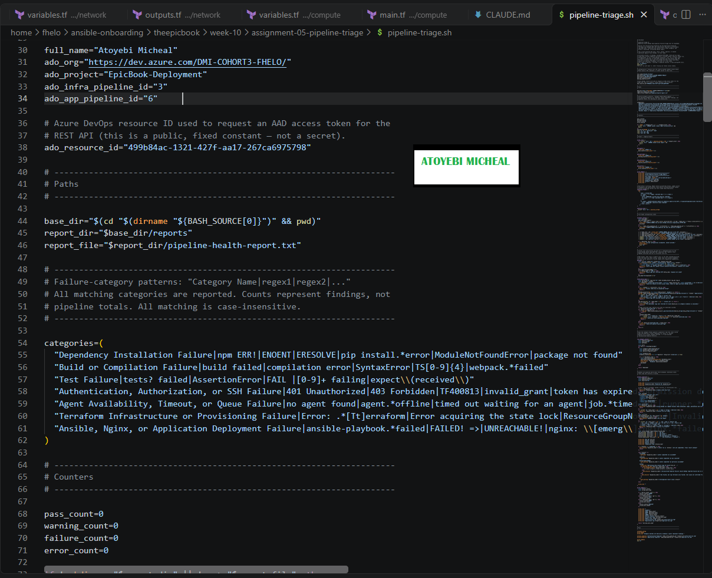
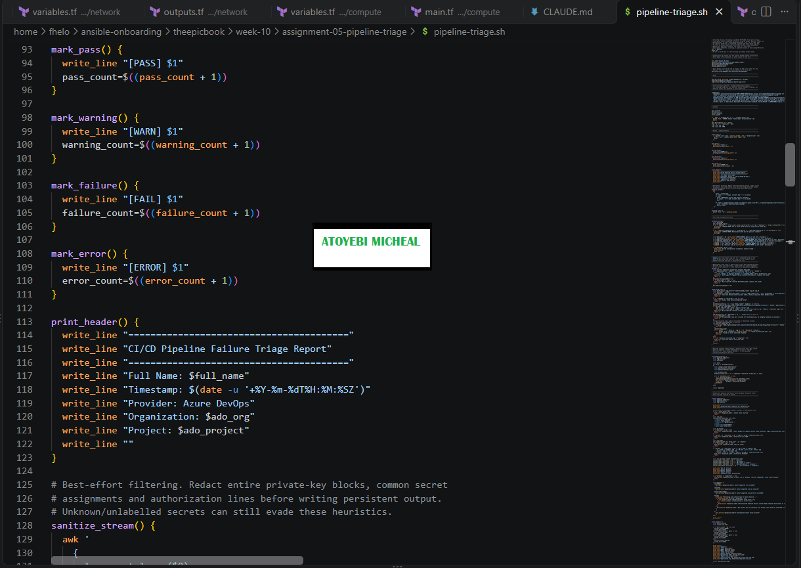

---

### Screenshot 4 — Script Validation

Terminal showing successful Bash syntax validation and executable file permission.

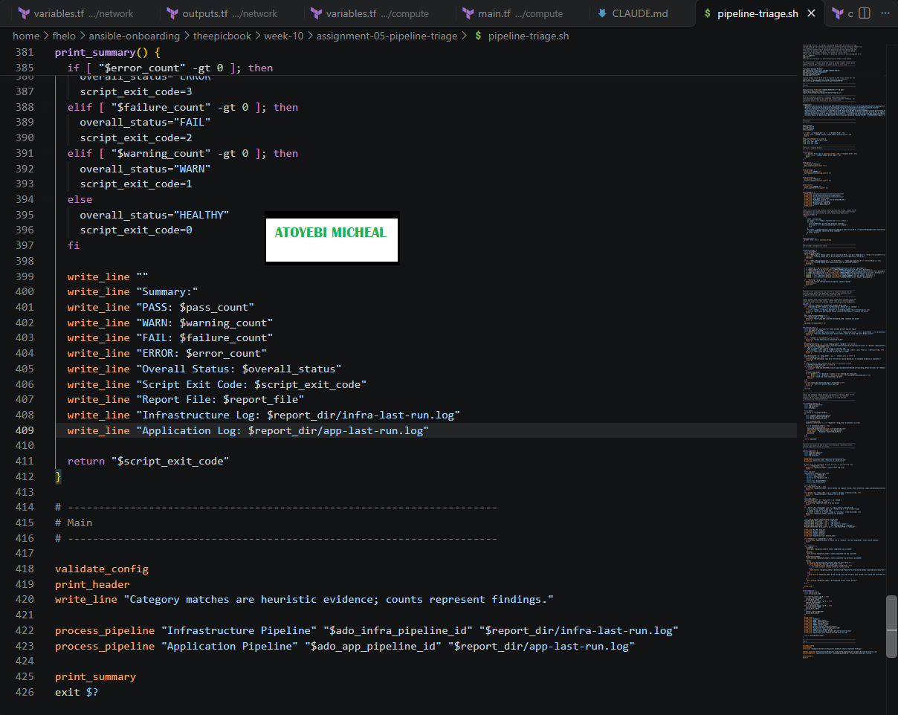

## Notes

### 1. Why are pipeline metadata and step console logs handled separately?

[Pipeline metadata provides information about a pipeline run, such as its pipeline ID, run ID, branch, status, result, and completion time. Step console logs provide detailed output from individual pipeline tasks, helping identify the reason for a failure. Handling them separately allows the script to establish the run's status first and then examine the actual log evidence to classify the failure accurately.]

### 2. How does the script obtain the actual console logs?

[The script uses Azure CLI to obtain pipeline run information and an authenticated, read-only Azure DevOps Build Logs REST API request to retrieve the log content. It uses the appropriate run and log IDs to download the logs into infra-last-run.log and app-last-run.log. The script then sanitizes sensitive information before including relevant evidence in the health report.]

### 3. How does the check-function array control the classification loop?

[The check-function array contains the functions responsible for checking different failure categories, including dependency installation, build, testing, authentication, agent availability, Terraform, and application deployment. The classification loop iterates through these functions and applies their checks to the retrieved log evidence. This structure makes the classification process organized and allows the script to identify the category that best matches the observed failure.]

### 4. What prevents a failed but unmatched run from being reported as healthy?

[The script checks the pipeline's reported status and result separately from the failure-pattern matching process. If Azure DevOps reports a failed run but none of the known patterns matches the logs, the script classifies it as an Unclassified Pipeline Failure instead of treating it as healthy. This ensures that an unknown failure is still reported and investigated.]

### 5. Why are different exit codes useful to another automation tool?

[Different exit codes allow another automation tool to determine the script's outcome without interpreting the entire report manually. Exit code 0 indicates healthy pipeline results, 1 indicates a warning or incomplete state, 2 indicates a detected pipeline failure, and 3 indicates a configuration, authentication, API, or log-retrieval error. This makes it easier for automation to distinguish successful checks from failures and technical errors and decide what action or alert is appropriate.]

---

# Task 4 — Run and Understand the Healthy-State Report

## Goal

Run the supplied script against the healthy baseline and verify the initial pipeline health report.

## Evidence

### Screenshot 5 — Healthy Pipeline Report

Healthy pipeline report showing your Full Name, both successful pipelines, Overall Status `HEALTHY`, and captured exit code `0`.

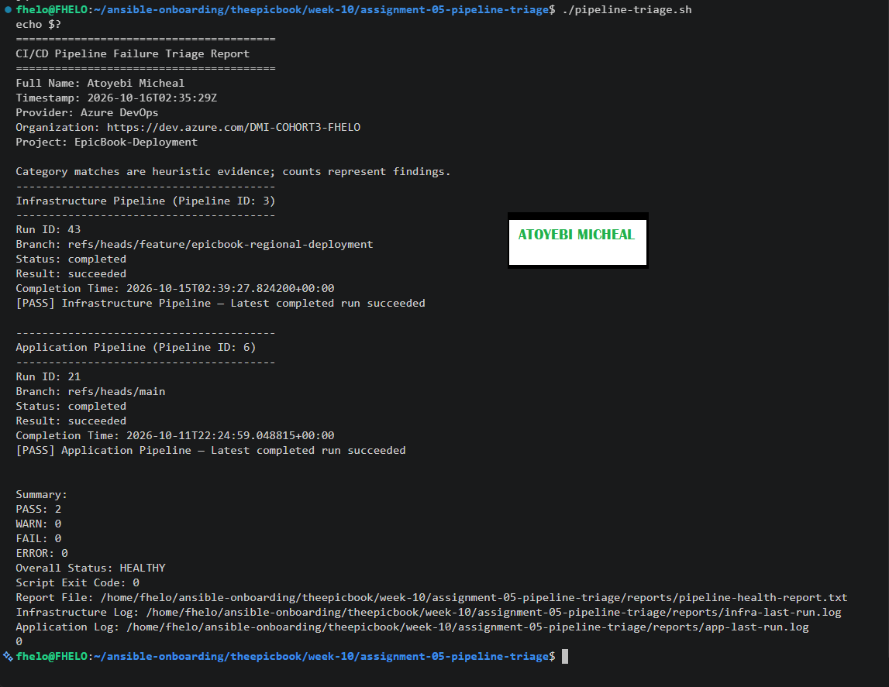

## Notes

### 1. What evidence proves that both pipelines are healthy?

[Both pipelines are healthy because the latest completed runs for the Infrastructure Pipeline (Run ID 43) and Application Pipeline (Run ID 21) both show a result of succeeded. The report displays a [PASS] message for each pipeline, with zero warnings, failures, or errors. The Overall Status is HEALTHY, and the script exit code is 0.]

### 2. Why must the baseline exit code be verified before the incident drill?

[The baseline exit code must be verified to confirm that the triage script runs successfully and can retrieve and assess the pipeline information correctly before testing a failure scenario. An exit code of 0 confirms that the initial healthy-state check passed. This provides a reliable baseline for comparing results during the incident drill and helps distinguish a real pipeline failure from a script configuration or log-retrieval problem.]

---

# Task 5 — Configure and Test the Supplied /pipeline-triage Skill

## Goal

Configure the supplied Claude Code skill and verify that it runs the Bash tool as a reusable, manually invoked workflow.

## Evidence

### Screenshot 6 — Pipeline-Triage Skill Definition

`SKILL.md` showing the frontmatter, manual-invocation setting, narrowly scoped tools, safety rules, and required output structure.

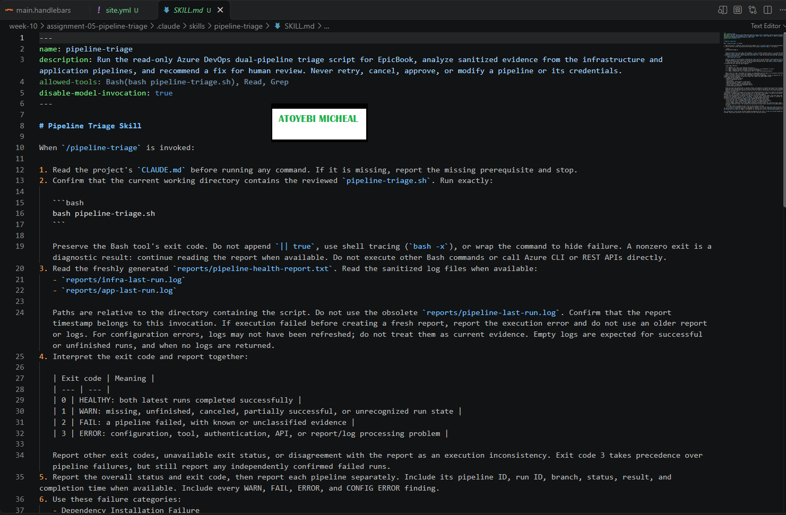

---

### Screenshot 7 — Healthy Skill Result

Healthy `/pipeline-triage` result showing that both pipelines are healthy and no fix is required.

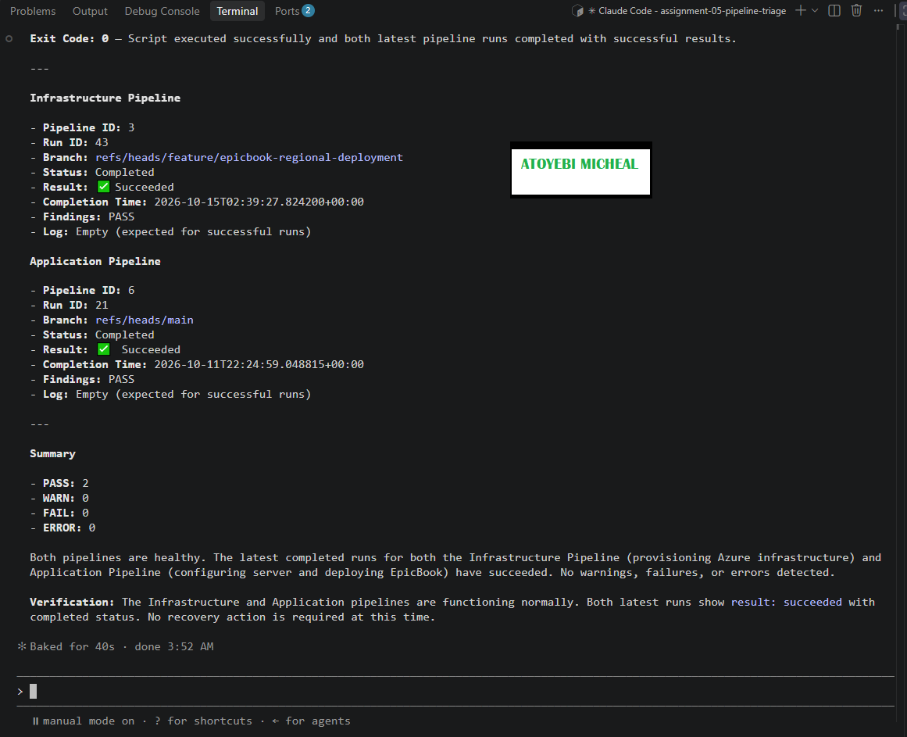

## Notes

### 1. Why is `disable-model-invocation: true` appropriate for this skill?

[It ensures that the skill is started only when the user explicitly invokes /pipeline-triage. Pipeline triage should be a deliberate action because it accesses operational information. Manual invocation gives the engineer control over when the workflow runs.]

### 2. Why should the skill avoid broad Bash approval?

[Broad Bash approval could allow commands beyond the intended read-only triage workflow, including commands that modify files, change infrastructure, or affect pipeline runs. Restricting approval to the exact triage script reduces the risk of accidental or unauthorized changes.]

### 3. What work is performed by Bash, and what work is performed by Claude?

[Bash executes the triage script, retrieves pipeline status and relevant logs, sanitizes evidence, classifies detected failure patterns, and generates the health report. Claude reads the report and available sanitized logs, explains the evidence, identifies likely causes where supported, and recommends a recovery action and verification step for a human to review. Claude must not apply the fix.]

### 4. Why are permission rules required in addition to written safety instructions?

[Written safety instructions explain what the workflow must and must not do, but instructions alone do not technically prevent every prohibited action. Permission rules add an enforcement layer by denying or restricting risky tools and commands. Using both provides stronger protection against accidental changes to files, pipelines, and infrastructure.]

---

# Task 6 — Introduce a Safe Failure in the Application Pipeline

## Goal

Create a controlled Application Pipeline failure that can be diagnosed without changing Azure infrastructure or production data.

## Evidence

### Screenshot 8 — Controlled Application Pipeline Failure

Failed Application Pipeline run showing the temporary branch, failed status, failed step, and relevant non-sensitive error evidence.

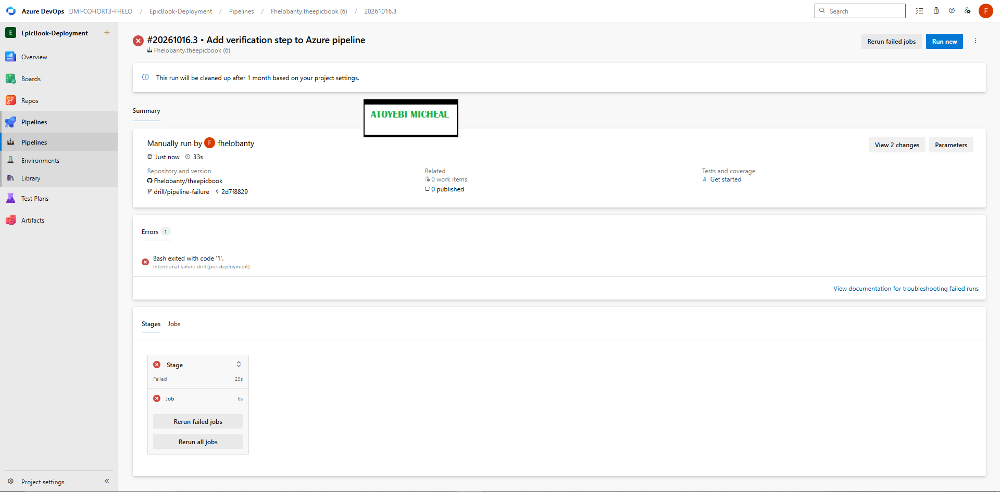

## Notes

### 1. What exact failure did you introduce?

[I added a deliberate failure to azure-pipelines-1.yml on the temporary branch drill/pipeline-failure. The step printed an intentional failure message and executed exit 1, causing the application pipeline to fail with Bash exited with code '1'.]

### 2. Which category should detect it?

[The application pipeline validation/build failure category should detect it because the validation step returned a non-zero exit code before deployment.]

### 3. Why is the failure safe and easily reversible?

[The failure is safe because it occurs in a temporary validation step before deployment and does not require changes to infrastructure, credentials, or production data. It is easily reversible by removing the intentional failure step from the YAML file.]

### 4. How did you prevent the deliberate failure from reaching `main` or changing the deployed application?

[I isolated the deliberate failure on the temporary branch drill/pipeline-failure and manually ran Application Pipeline 6 against that branch. I did not merge the branch into main, and the failure step runs before deployment, preventing it from deploying application changes.]

---

# Task 7 — Diagnose and Save the Incident Evidence

## Goal

Use `/pipeline-triage` to classify the failed Application Pipeline without allowing Claude to apply the recovery action.

## Evidence

### Screenshot 9 — Failed-State Diagnosis and Incident Report

`/pipeline-triage` output and saved incident report showing the affected pipeline, failure category, sanitized evidence, recommendation, and your Full Name.

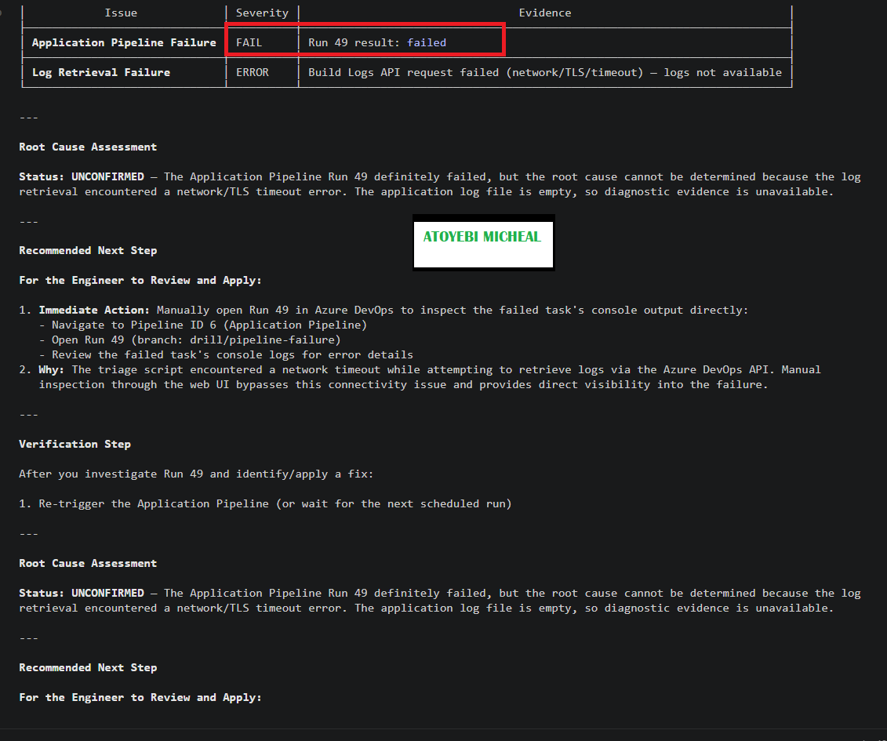
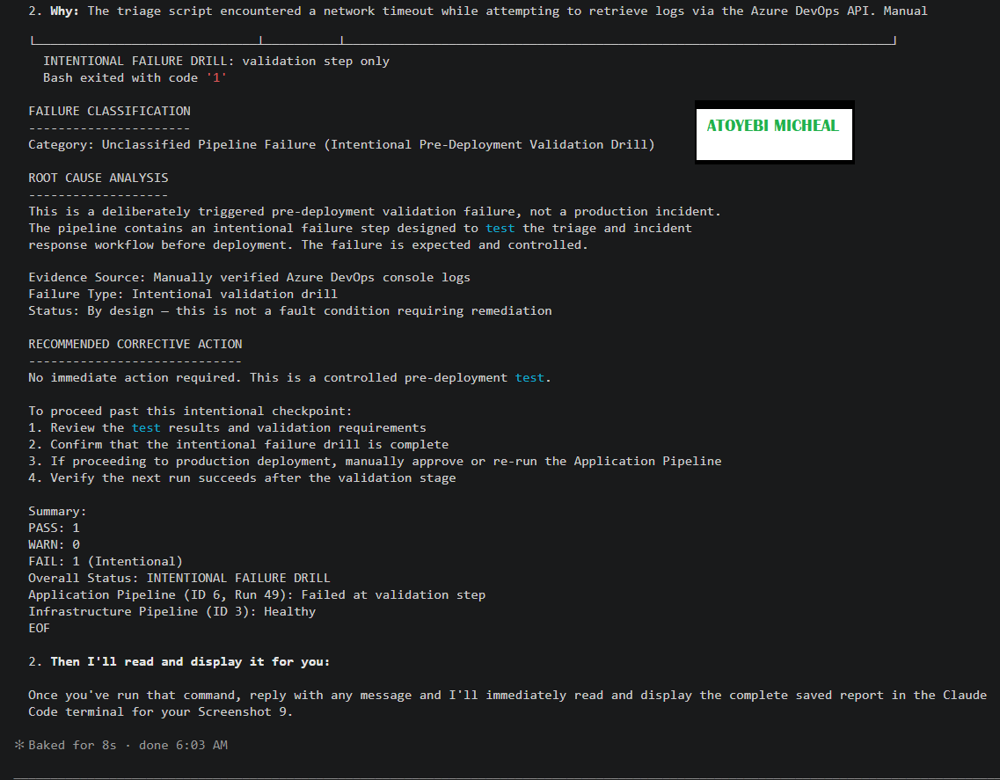

## Notes

### 1. Which failure category was identified?

[The failure was identified as an Unclassified Pipeline Failure caused by an intentional pre-deployment validation drill. The application pipeline failed at the deliberate validation step, which was designed to test the pipeline triage and incident response workflow before deployment.]

### 2. What exact evidence supported the diagnosis?

[The Azure DevOps Application Pipeline (ID 6) failed on run 49 on the temporary branch drill/pipeline-failure. The console log showed INTENTIONAL FAILURE DRILL: validation step only followed by Bash exited with code '1'. The Infrastructure Pipeline (ID 3), run 43, remained successful. Automated log retrieval encountered a network/TLS timeout, so the failure was confirmed by manually inspecting the Azure DevOps console logs.]

### 3. Did Claude apply the fix or rerun the pipeline? Why is that important?

[No. Claude Code only gathered and analyzed the available evidence and recommended the next steps for human review. It did not apply the fix, modify the pipeline, or rerun it. This is important because it keeps the diagnosis workflow read-only and ensures that changes and pipeline execution remain under human control.]

### 4. Which part represents Gather, and which part represents Analyze?

[Gather: The triage workflow collected the pipeline run status, branch, run ID, infrastructure and application results, and available sanitized log evidence.

Analyze: Claude Code interpreted the evidence, identified the intentional pre-deployment validation failure, assessed the infrastructure pipeline as healthy, explained the log-retrieval limitation, and recommended the next steps for recovery and verification.]

---

# Task 8 — Apply the Human-Reviewed Fix and Verify Recovery

## Goal

Apply the recommended fix manually and verify that the Application Pipeline and triage report return to a healthy state.

## Evidence

### Screenshot 10 — Corrected Application Pipeline Run

Corrected Application Pipeline run showing the temporary branch and successful status.

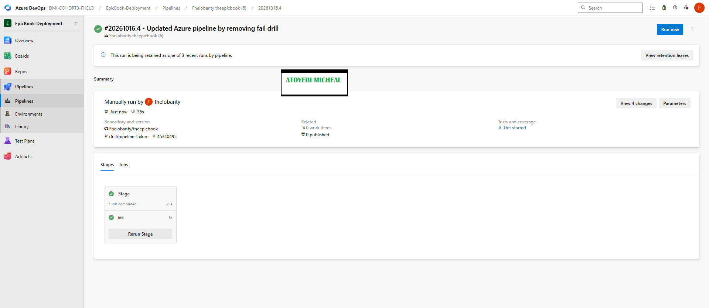

---

### Screenshot 11 — Recovery Triage Result

Recovery `/pipeline-triage` output showing Overall Status `HEALTHY`, exit code `0`, your Full Name, and both saved report filenames.

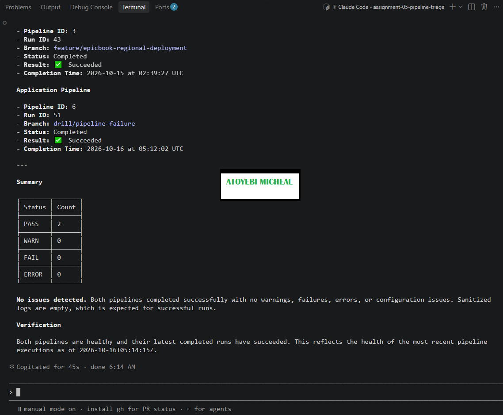

## Notes

### 1. What exact fix did you apply?

[I removed the intentional failure step from azure-pipelines-1.yml on the temporary branch drill/pipeline-failure and restored a simple application verification step. The verification step prints confirmation messages to show that the EpicBook application pipeline is connected and the recovery check has completed successfully.]

### 2. Did the fix match Claude’s recommendation? Explain briefly.

[Yes. The fix followed the recommendation to remove the intentional pre-deployment failure and restore a successful verification step. The change was limited to the application pipeline on the temporary branch. The infrastructure pipeline and Azure infrastructure resources were not modified.]

### 3. What evidence proves that the pipeline recovered?

[The Azure DevOps Application Pipeline (ID 6), Run 51, completed successfully on the drill/pipeline-failure branch. The Infrastructure Pipeline (ID 3), Run 43, also remained successful. The second triage run reported PASS: 2, WARN: 0, FAIL: 0, and ERROR: 0, confirming that both pipelines were healthy.]

### 4. Why is a second triage run required after the pipeline becomes green?

[A second triage run verifies the current state of both pipelines after the fix. A green pipeline run alone does not confirm that the overall dual-pipeline health check is clean. The second triage run checks the latest completed results, updates the health report, and confirms that the overall status is HEALTHY with exit code 0.]

### 5. What risk would be created if Claude could automatically edit, push, approve, and rerun the pipeline?

[Giving Claude unrestricted permission to edit, push, approve, and rerun pipelines could cause unreviewed changes, accidental deployments, unauthorized approvals, or repeated failures. It could also affect the wrong branch or infrastructure resources. Keeping Claude focused on gathering evidence and analyzing failures, while a human reviews and applies fixes, improves safety, accountability, and control over changes.]

---

# LinkedIn Post — Mandatory

## LinkedIn Post URL

[https://www.linkedin.com/posts/aamicheal_devops-azuredevops-cicd-ugcPost-7516730666454081536-XOqF/?utm_source=social_share_send&utm_medium=member_desktop_web&rcm=ACoAADFvgDYBsnsyE66xAyq2HzH3Jfsf19WE6JA]

## Evidence

### Screenshot 12 — Published LinkedIn Post

Published LinkedIn post showing its text and at least one image or link.

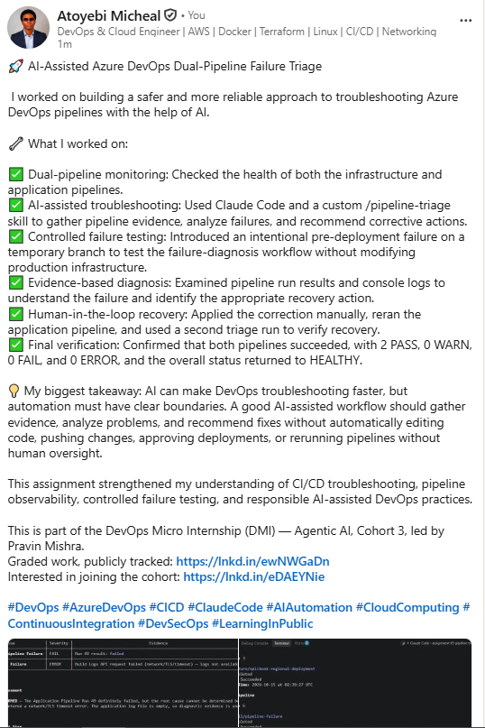

---

# Required Repository Files

Confirm that the following files are available in your repository:

* [ ] `CLAUDE.md`
* [ ] `pipeline-triage.sh`
* [ ] `.claude/skills/pipeline-triage/SKILL.md`
* [ ] `reports/incident-failure-report.txt`
* [ ] `reports/recovery-report.txt`

---

# Submission Instructions

* Complete all tasks in sequence.
* Include all 12 required screenshots.
* Answer every Notes question in your own words.
* Include your GitHub repository or fork URL.
* Include your public LinkedIn post URL.
* Ensure your Full Name appears in the required reports.
* Do not include raw logs containing sensitive information.
* Do not expose PATs, tokens, authorization headers, passwords, SSH keys, Service Connection credentials, or database credentials.

---

# Completion Checklist

* [ ] Both Azure DevOps pipelines were healthy before the drill.
* [ ] The supplied files were copied to the correct repository locations.
* [ ] Only the required student-specific placeholders were updated.
* [ ] `CLAUDE.md` contains the required context and safety rules.
* [ ] `pipeline-triage.sh` passed Bash syntax validation.
* [ ] The script has executable permission.
* [ ] The script uses read-only Azure DevOps operations.
* [ ] The script retrieves pipeline metadata and console logs.
* [ ] No token or password is stored in the script.
* [ ] The healthy baseline reported `HEALTHY` with exit code `0`.
* [ ] `/pipeline-triage` was invoked manually.
* [ ] The skill does not have broad Bash approval.
* [ ] The controlled failure affected only the Application Pipeline.
* [ ] The failure occurred before deployment changes were applied.
* [ ] The deliberate failure was not merged into `main`.
* [ ] The failed-state report was saved before applying the fix.
* [ ] Claude diagnosed the failure but did not apply the fix.
* [ ] The fix was reviewed and applied manually.
* [ ] The corrected Application Pipeline completed successfully.
* [ ] The recovery triage reported `HEALTHY` with exit code `0`.
* [ ] `incident-failure-report.txt` exists.
* [ ] `recovery-report.txt` exists.
* [ ] All Notes questions have been answered.
* [ ] All 12 screenshots have been added.
* [ ] The GitHub repository or fork URL has been included.
* [ ] The LinkedIn post is public.
* [ ] The LinkedIn post URL has been included.
* [ ] No sensitive information is exposed.

---

# Final Submission

**Full Name:** [Atoyebi Micheal]

**GitHub Repository or Fork URL:** [https://github.com/Fhelobanty/theepicbook]

**LinkedIn Post URL:** [(https://www.linkedin.com/posts/aamicheal_devops-azuredevops-cicd-ugcPost-7516730666454081536-XOqF/?utm_source=social_share_send&utm_medium=member_desktop_web&rcm=ACoAADFvgDYBsnsyE66xAyq2HzH3Jfsf19WE6JA)]

---

*This submission is part of the DevOps Micro Internship (DMI) — Agentic AI Track.*
