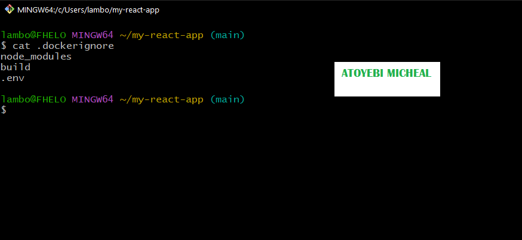
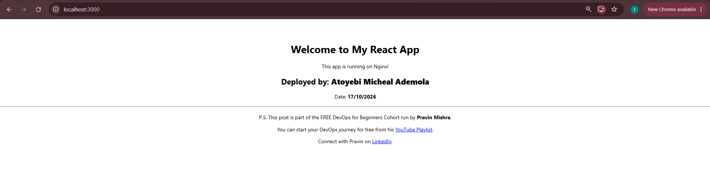
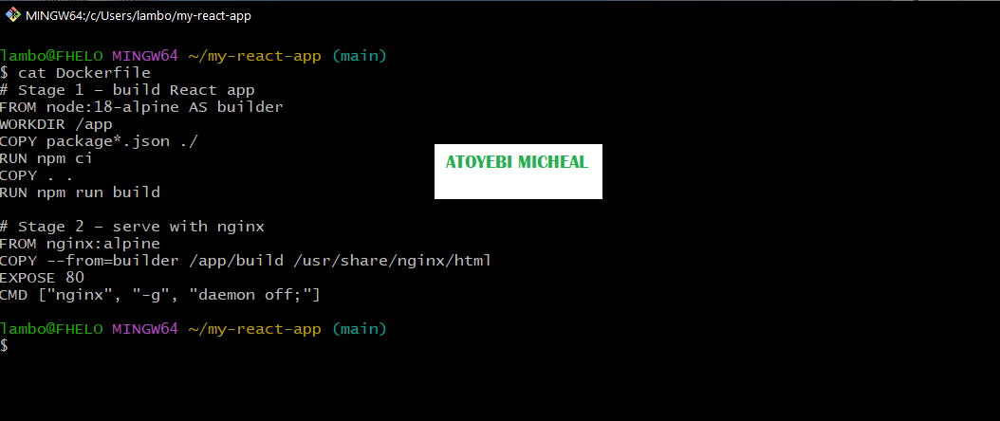
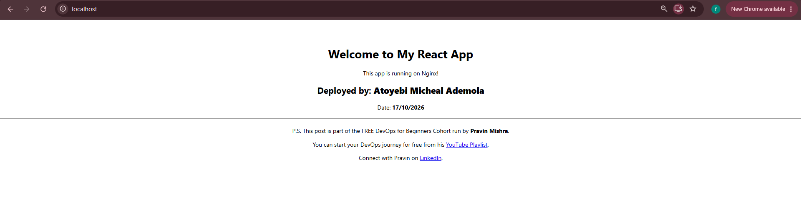
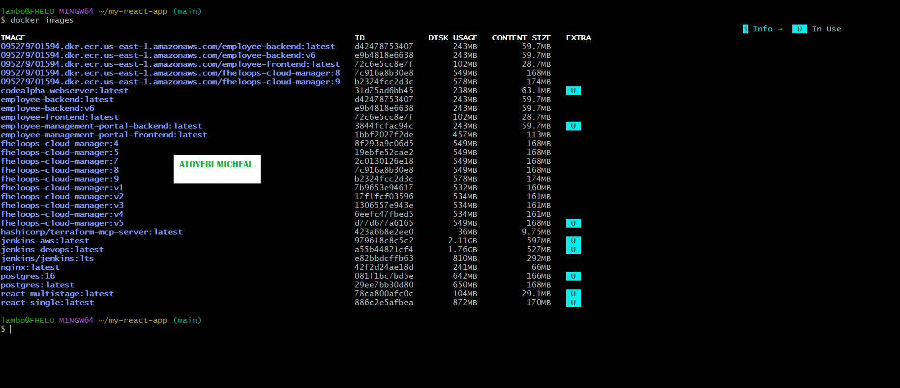
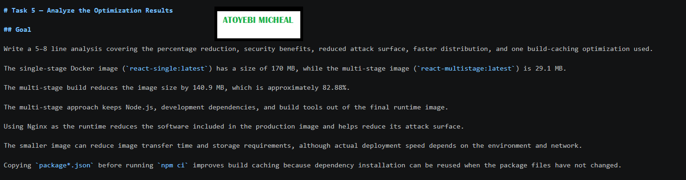
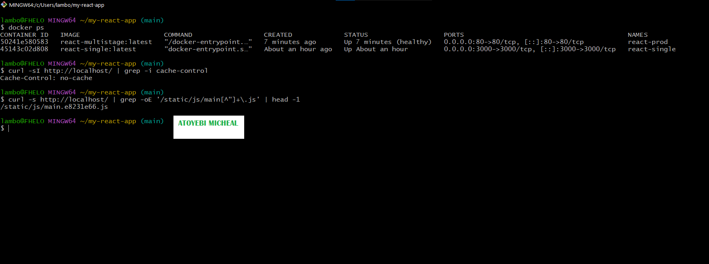
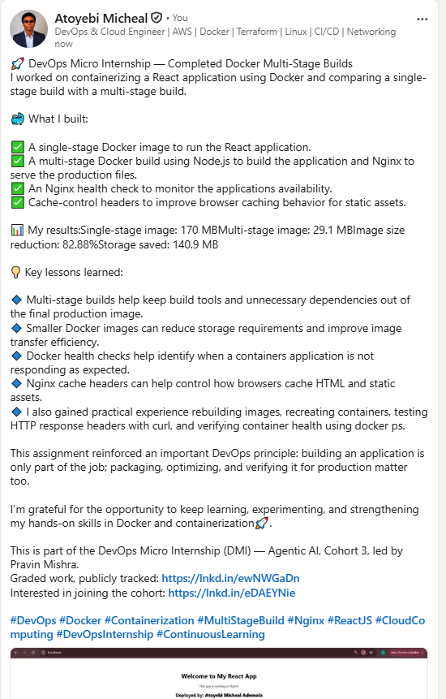

# Assignment 2 — Multi-Stage Docker Build for a React Application

Part of the DevOps Micro Internship (DMI) with Agentic AI

---

## Purpose

In this assignment, you will build both a single-stage and an optimized multi-stage Docker image for a React application, compare the resulting image sizes, and deploy the optimized version using a production-ready Nginx runtime container.

---

# Task 1 — Prepare the Project

## Goal

Clone `https://github.com/pravinmishraaws/my-react-app.git` and create a `.dockerignore` excluding `node_modules`, `build`, and `.env`.

### Evidence

#### Screenshot 1 — Contents of the `.dockerignore` file

---

# Task 2 — Create a Single-Stage Docker Image

## Goal

Create `Dockerfile.single`, build `react-single`, and run it on port 3000.

### Evidence

#### Screenshot 2 — Contents of `Dockerfile.single`

---

#### Screenshot 3 — Browser displaying the application running from the single-stage container

---

# Task 3 — Create a Multi-Stage Docker Build

## Goal

Create a multi-stage Dockerfile with separate build and Nginx runtime stages, build `react-multistage`, and run it on port 80.

### Evidence

#### Screenshot 4 — Contents of the multi-stage Dockerfile

---

#### Screenshot 5 — Browser displaying the application running from the multi-stage container

---

# Task 4 — Compare Docker Image Sizes

## Goal

Compare the single-stage and multi-stage image sizes and calculate the percentage reduction.

### Evidence

#### Screenshot 6 — Docker image list showing both image sizes

---

# Task 5 — Analyze the Optimization Results

## Goal

Write a 5–8 line analysis covering the percentage reduction, security benefits, reduced attack surface, faster distribution, and one build-caching optimization used.

The single-stage Docker image (`react-single:latest`) has a size of 170 MB, while the multi-stage image (`react-multistage:latest`) is 29.1 MB.

The multi-stage build reduces the image size by 140.9 MB, which is approximately 82.88%.

The multi-stage approach keeps Node.js, development dependencies, and build tools out of the final runtime image.

Using Nginx as the runtime reduces the software included in the production image and helps reduce its attack surface.

The smaller image can reduce image transfer time and storage requirements, although actual deployment speed depends on the environment and network.

Copying `package*.json` before running `npm ci` improves build caching because dependency installation can be reused when the package files have not changed.

### Evidence

#### Screenshot 7 — Analysis included in your submission document

---

### Notes

**Image sizes**

| **Image** | **Size (DISK USAGE)** |
|---|---:|
| `react-single:latest` | 170 MB |
| `react-multistage:latest` | 29.1 MB |

**Percentage reduction** = ((170 − 29.1) ÷ 170) × 100 = (140.9 ÷ 170) × 100 = **82.88%**

**Answer**
The multi-stage Docker build is more efficient than the single-stage build because it reduces the image size from 170 MB to 29.1 MB, an 82.88% reduction. It saves 140.9 MB and makes the final image smaller and easier to distribute. Using Nginx as the runtime excludes Node.js and build tools from the final image, reducing the attack surface. Docker build caching is improved by copying `package*.json` before running `npm ci`, allowing dependencies to be reused when the package files have not changed. Overall, the multi-stage approach provides a smaller production image with fewer unnecessary components.

---

# Task 6 — Explore Additional Production Optimizations (Optional)

## Goal

Optionally configure an Nginx health check, cache headers, parameterized ports via environment variables, or a lighter runtime image, and compare results.

> Screenshot optional.

---

# LinkedIn Post (Optional)

## Goal

Create a LinkedIn post describing what you built, what a multi-stage Docker build is, the image size reduction achieved, and key learnings.

## Evidence

#### LinkedIn Post URL

Paste your LinkedIn post URL here:

`https://www.linkedin.com/posts/aamicheal_devops-docker-containerization-share-7517257888441028608-HsuM/?utm_source=social_share_send&utm_medium=member_desktop_web&rcm=ACoAADFvgDYBsnsyE66xAyq2HzH3Jfsf19WE6JA`

---

#### Screenshot — Published LinkedIn post

---

# Submission Instructions

- Add all required screenshots in your submission
- Full name must be visible in required screenshots
- Do not expose sensitive information

---

# Completion Checklist

- [ ] Task 1: `.dockerignore` created (Screenshot 1)
- [ ] Task 2: Single-stage image built and verified (Screenshots 2–3)
- [ ] Task 3: Multi-stage image built and verified (Screenshots 4–5)
- [ ] Task 4: Image sizes compared (Screenshot 6)
- [ ] Task 5: Analysis written (Screenshot 7 & Notes)
- [ ] Task 6: Optional production optimizations explored
- [ ] No sensitive information exposed

---

## 📌 About DMI & CloudAdvisory

DevOps Micro Internship (DMI) is a project-based DevOps program run by Pravin Mishra (The CloudAdvisory) focused on real-world execution, systems thinking, and career readiness.

It helps learners build strong DevOps foundations with hands-on experience.

---

## 📌 Resources

- 🌐 DMI Official Website: https://dmi.pravinmishra.com?utm_source=github&utm_medium=readme  
- 🎓 University: https://university.pravinmishra.com?utm_source=github&utm_medium=readme  
- 💬 Discord Community: https://discord.pravinmishra.com?utm_source=github&utm_medium=readme  
- 📝 Blog: https://dmi.pravinmishra.com/blog?utm_source=github&utm_medium=readme  
- ▶️ YouTube Playlist: https://www.youtube.com/playlist?list=PLFeSNDtI4Cho  
- 🔗 Pravin Mishra (LinkedIn): https://www.linkedin.com/in/pravin-mishra-aws-trainer/  
- 🏢 CloudAdvisory (LinkedIn): https://www.linkedin.com/company/thecloudadvisory/

---

*This submission is part of DevOps Micro Internship (DMI) — Agentic AI Track.*
