# Assignment 4 — Auto-Scaling & Auto-Healing: Let Kubernetes React for You

Part of the DevOps Micro Internship (DMI) with Agentic AI

---

## Purpose

Create Deployments, test Pod auto-healing, configure CPU requests and limits, verify Metrics Server, and create a Horizontal Pod Autoscaler.

Optionally generate CPU load to observe how the HPA responds.

---

# Task 0 — Check the Existing Cluster Resources

## Goal

Confirm that you are connected to your learning cluster and inspect existing Deployments and HPAs.

### Evidence

No screenshots required.

---

# Task 1 — Set Up Your Lab Directory

## Goal

Create and enter a dedicated directory for the auto-scaling lab.

### Evidence

#### Screenshot 1 — Terminal showing that you are working inside `~/k8s-labs/autoscaling`

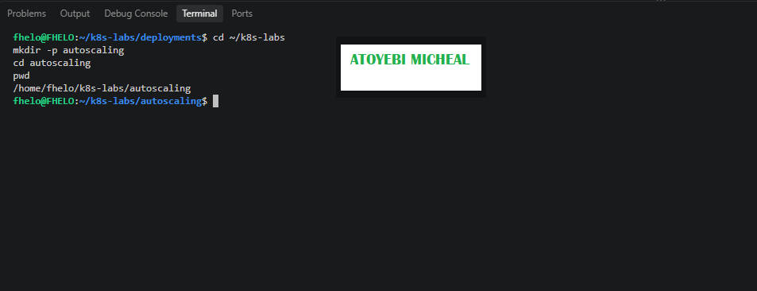

---

### Notes

**1. What is the difference between auto-healing and auto-scaling?**

Auto-healing automatically replaces failed or deleted Pods to maintain the desired number of replicas. Auto-scaling adjusts the number of Pods according to workload demand.

---

**2. Which Kubernetes feature will you use for CPU-based auto-scaling?**

I will use the Horizontal Pod Autoscaler (HPA), which adjusts the number of Pod replicas based on CPU utilization.

---

# Task 2 — Test Auto-Healing with a Deployment

## Goal

Create a Deployment with two replicas, delete one Pod, and observe Kubernetes create a replacement Pod.

### Evidence

#### Screenshot 2 — Completed `autohealing-deployment.yaml` manifest

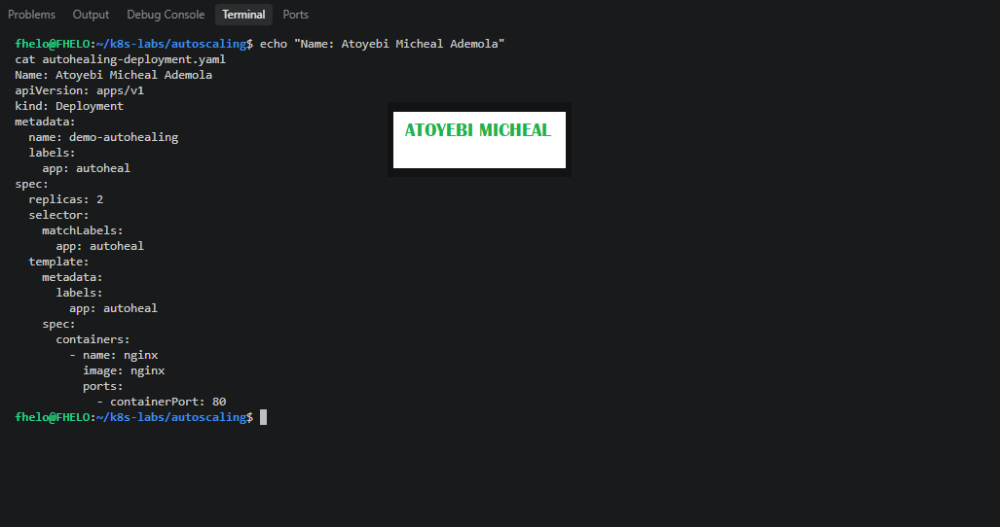

---

#### Screenshot 3 — Output of `kubectl get pods` showing two running Pods before deletion

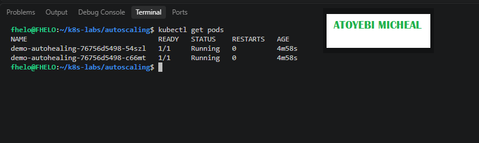

---

#### Screenshot 4 — Output of the `kubectl delete pod` command

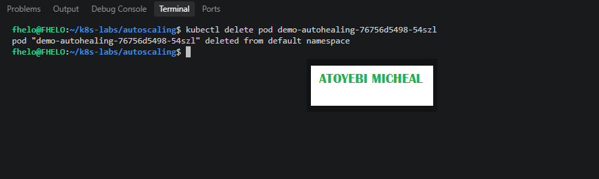

---

#### Screenshot 5 — Output of `kubectl get pods` showing the replacement Pod and two running Pods

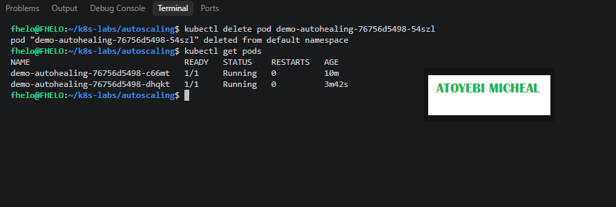

---

### Notes

**1. What happened after you deleted one Pod?**

After I deleted one Pod, Kubernetes automatically created a replacement Pod to maintain the desired number of two replicas. The replacement Pod had a different name from the deleted Pod.

---

**2. What Kubernetes resource maintains the desired replica count for this Deployment?**

The ReplicaSet maintains the desired number of Pod replicas for the Deployment. The Deployment manages the ReplicaSet.

---

**3. What proves that auto-healing worked?**

Auto-healing worked because Kubernetes created a replacement Pod after I deleted one. The kubectl get pods command confirmed that two Pods were running again, each with a 1/1 Ready status.

---

# Task 3 — Create a Deployment for HPA

## Goal

Create a Deployment with CPU resource requests and limits so that HPA can calculate CPU utilization.

### Evidence

#### Screenshot 6 — Completed `hpa-deployment.yaml` manifest showing CPU requests and limits

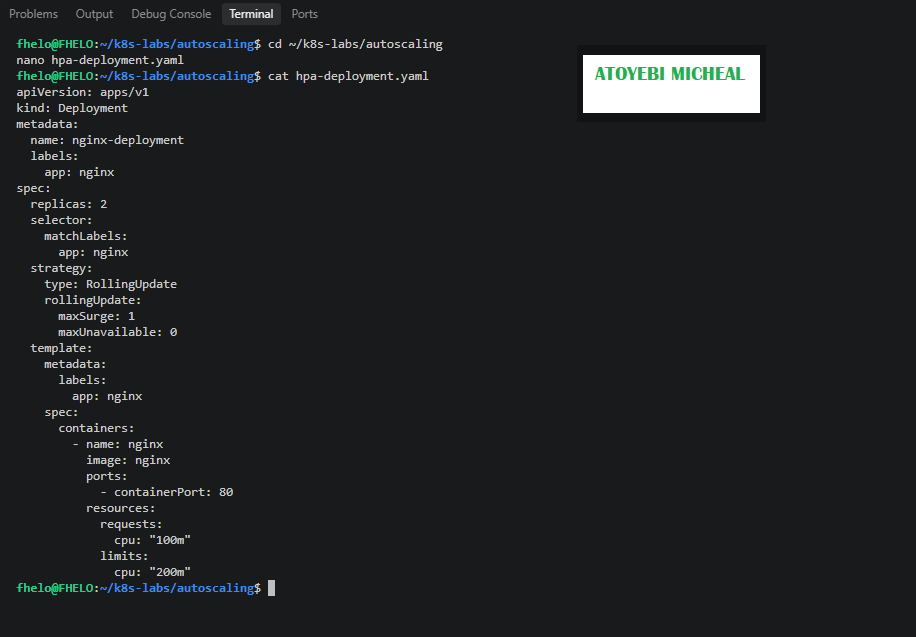

---

#### Screenshot 7 — Output showing `nginx-deployment` and its running Pods

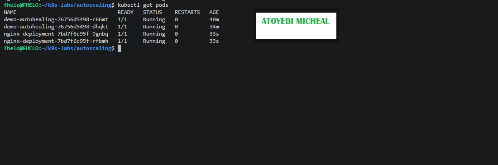

---

### Notes

**1. What does `cpu: "100m"` mean?**

It means the container requests 100 millicores of CPU, equivalent to one-tenth of a CPU core.

---

**2. What is the difference between a CPU request and a CPU limit?**

A CPU request specifies the amount of CPU allocated for scheduling and used as the baseline for CPU utilization calculations. A CPU limit sets the maximum CPU time the container can use.

---

**3. Why does CPU-based HPA require CPU requests?**

CPU-based HPA uses CPU usage as a percentage of the requested CPU to calculate utilization. Without CPU requests defined for the relevant containers, it cannot correctly calculate CPU utilization for scaling decisions.

---

# Task 4 — Enable and Verify Metrics Server

## Goal

Ensure the cluster can collect resource metrics for the HPA.

### Evidence

#### Screenshot 8 — Output showing Metrics Server running, or `kubectl top pods` displaying Pod metrics

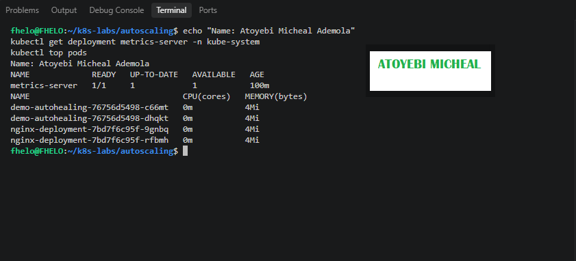

---

### Notes

**1. Why does HPA need Metrics Server?**

HPA needs Metrics Server to obtain CPU and memory usage metrics so it can make scaling decisions based on resource utilization.

---

**2. What issue can occur if Metrics Server is not working?**

HPA may display unknown CPU utilization values and may not scale Pods correctly because the required resource metrics are unavailable.

---

**3. What does `kubectl top pods` help you check?**

The kubectl top pods command displays the current CPU and memory usage of Pods, helping me verify that Metrics Server is collecting resource metrics.

---

# Task 5 — Create a Horizontal Pod Autoscaler

## Goal

Create an HPA that keeps at least two Pods running and can scale up to five Pods when average CPU utilization exceeds 50%.

### Evidence

#### Screenshot 9 — The imperative command output OR completed `hpa-nginx.yaml` manifest

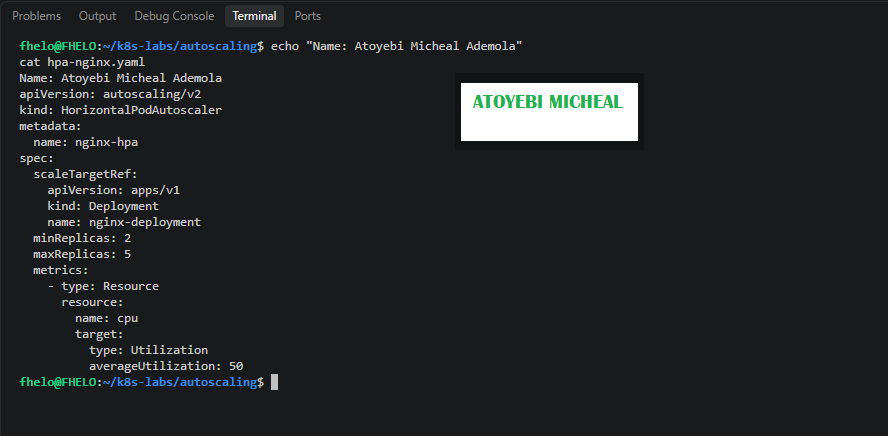

---

#### Screenshot 10 — Output of `kubectl get hpa` and the relevant `kubectl describe hpa` command

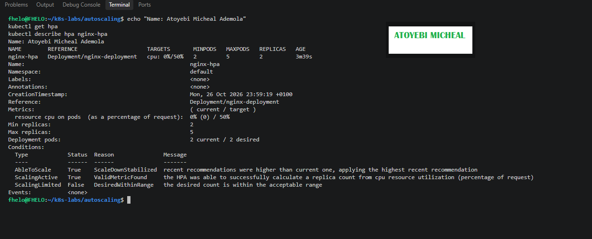

---

### Notes

**1. What does `minReplicas: 2` mean?**

It means the HPA will maintain at least two Pod replicas for the Deployment.

---

**2. What does `maxReplicas: 5` mean?**

It means the HPA can scale the Deployment up to a maximum of five Pod replicas.

---

**3. What does `averageUtilization: 50` mean?**

It sets the target average CPU utilization to 50% of the CPU requested by the containers. The HPA uses this target to decide whether to increase or decrease the number of replicas.

---

**4. Why should only one HPA manage a Deployment at a time?**

Only one HPA should manage a Deployment at a time to avoid competing autoscalers trying to control the same replica count, which can cause unpredictable scaling behavior.

---

# Task 6 — Optional: Generate CPU Load and Observe Scaling

## Goal

Generate CPU load in one NGINX Pod and observe how HPA responds.

### Evidence

If you skip this task, write “Not completed — optional” and leave the remaining Task 6 placeholders blank.

Task status: Add your status here.

#### Screenshot 11 — Terminal showing the CPU-load command running inside the selected Pod

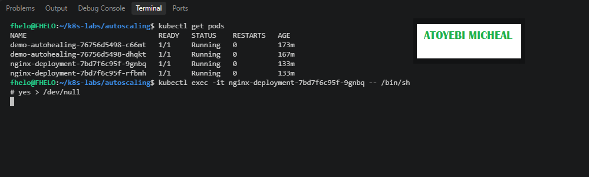

---

#### Screenshot 12 — Output of `kubectl get hpa` and `kubectl get pods` while HPA evaluates or changes the replica count

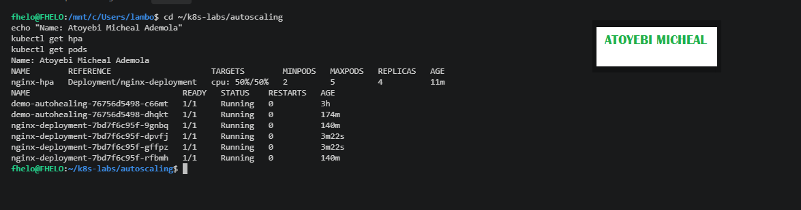

---

### Notes

Complete these answers only if you perform the optional test.

**1. Did the HPA change the number of Pods? Explain what you observed.**

Yes. During the CPU-load test, the Horizontal Pod Autoscaler increased the Nginx Deployment from 2 replicas to 4 replicas. The HPA showed CPU utilization at its target of 50%/50%, and all four Nginx Pods were running.

---

**2. If scaling did not happen, what are two possible reasons?**

Scaling occurred successfully in this test. In general, scaling may be delayed if CPU metrics are unavailable, the workload is insufficient, or the HPA has not yet completed its evaluation cycle.

---

**3. Why is automatic scale-down useful after traffic decreases?**

Scaling down reduces unnecessary resource consumption when application demand decreases. The HPA can reduce the number of replicas toward the configured minimum of two, helping use cluster resources efficiently while maintaining the desired baseline availability.

---

# LinkedIn Requirement

### Evidence

#### Screenshot 13 — Published LinkedIn post showing your name, the required explanation, and the attached Kubernetes screenshot

Add your screenshot here.

#### Linkedin Post Link

Add your link here

---

# Submission Instructions

- Include required Screenshots 1–10 and Screenshot 13.
- Include Screenshots 11–12 only if you complete Task 6.
- Full Name must be visible in required screenshots.
- Ensure screenshots are clear and readable.
- Include the completed `autohealing-deployment.yaml` and `hpa-deployment.yaml` files.
- Include `hpa-nginx.yaml` if you selected the declarative HPA method.
- Complete the Notes sections for Tasks 1–5 in your own words.
- Complete Task 6 notes only if you perform the optional test.
- Do not expose passwords, tokens, private keys, kubeconfig files, or account IDs.

---

# Completion Checklist

- [ ] Checked the active context and existing cluster resources
- [ ] Created the autoscaling working directory (Screenshot 1)
- [ ] Created `autohealing-deployment.yaml` (Screenshot 2)
- [ ] Confirmed two auto-healing Pods were running (Screenshot 3)
- [ ] Deleted one managed Pod (Screenshot 4)
- [ ] Confirmed that the Pod was automatically replaced (Screenshot 5)
- [ ] Created `hpa-deployment.yaml` with CPU requests and limits (Screenshot 6)
- [ ] Verified `nginx-deployment` and its running Pods (Screenshot 7)
- [ ] Verified Metrics Server and confirmed Pod metrics are available (Screenshot 8)
- [ ] Created one HPA using the selected method (Screenshot 9)
- [ ] Verified minimum replicas of 2, maximum replicas of 5, and a CPU target of 50% (Screenshot 10)
- [ ] Completed Notes for Tasks 1–5
- [ ] Completed Task 6 evidence and notes, or marked it “Not completed — optional”
- [ ] Stopped the CPU-load command and exited the container shell, if Task 6 was completed
- [ ] Published the LinkedIn post with the required explanation and attached screenshot (Screenshot 13)
- [ ] Included the required manifest files
- [ ] No sensitive data exposed

---

## 📌 About DMI & CloudAdvisory

DevOps Micro Internship (DMI) is a project-based DevOps program run by Pravin Mishra (The CloudAdvisory) focused on real-world execution, systems thinking, and career readiness.

It helps learners build strong DevOps foundations with hands-on experience.

---

## 📌 Resources

- 🌐 DMI Official Website: https://dmi.pravinmishra.com?utm_source=github&utm_medium=readme  
- 🎓 University: https://university.pravinmishra.com?utm_source=github&utm_medium=readme  
- 💬 Discord Community: https://discord.pravinmishra.com?utm_source=github&utm_medium=readme  
- 📝 Blog: https://dmi.pravinmishra.com/blog?utm_source=github&utm_medium=readme  
- ▶️ YouTube Playlist: https://www.youtube.com/playlist?list=PLFeSNDtI4Cho  
- 🔗 Pravin Mishra (LinkedIn): https://www.linkedin.com/in/pravin-mishra-aws-trainer/  
- 🏢 CloudAdvisory (LinkedIn): https://www.linkedin.com/company/thecloudadvisory/

---

*This submission is part of DevOps Micro Internship (DMI) — Agentic AI Track.*
