# Assignment 5 — Kubernetes Health Probes (Readiness)

Part of the DevOps Micro Internship (DMI) with Agentic AI

---

## Purpose

In this assignment, you will configure and test a Kubernetes readiness probe. You will create a baseline NGINX Deployment, add an HTTP readiness probe, intentionally break it, observe a stalled rollout, and restore the working configuration.

You will also demonstrate how readiness probes protect rolling updates.

---

# Task 0 — Prepare the Lab Environment

## Goal

Confirm that you are connected to your learning cluster and remove the previous assignment’s HPA and NGINX Deployment before starting this lab.

No screenshot or written notes are required for this pre-check.

---

# Task 1 — Set Up Your Lab Directory

## Goal

Create and enter a dedicated directory for the readiness-probe lab.

### Evidence

#### Screenshot 1 — Terminal showing that you are working inside `~/k8s-labs/health-probes-readiness`

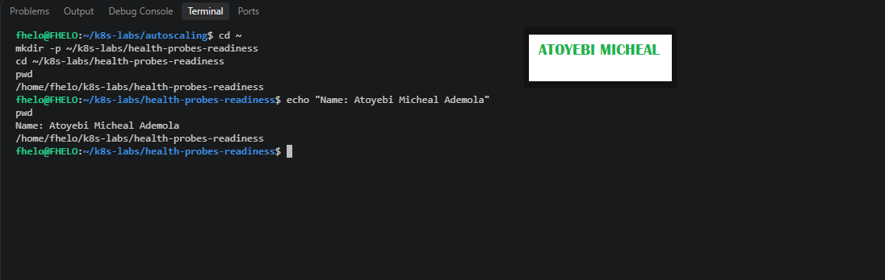

---

### Notes

**1. What is the purpose of a readiness probe?**

A readiness probe checks whether a Pod is ready to accept application traffic. Kubernetes uses the result to determine whether the Pod should be considered ready.

**2. Why is a Pod being Running not always enough to confirm it can serve traffic?**

AA container may be running while its application is still starting, loading configuration, or waiting for a dependency. Therefore, the Running status alone does not guarantee that the application is ready to handle requests.

---

# Task 2 — Create a Baseline Deployment Without Probes

## Goal

Create a baseline NGINX Deployment with two replicas and no readiness probe.

### Evidence

#### Screenshot 2 — Completed `00-nginx-deploy-baseline.yaml` manifest

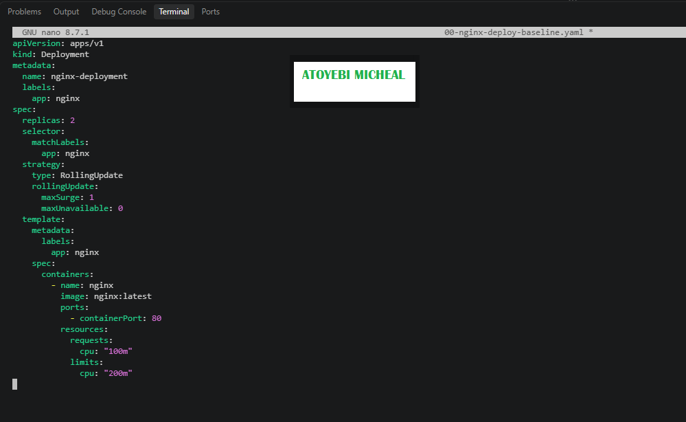

---

#### Screenshot 3 — Output showing a successful rollout and two running NGINX Pods

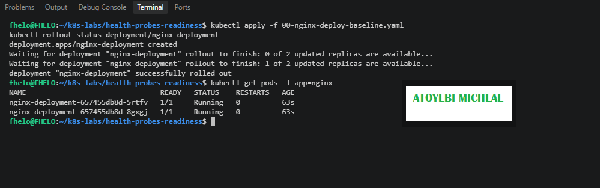

---

#### Screenshot 4 — Relevant output from `kubectl describe deployment nginx-deployment`

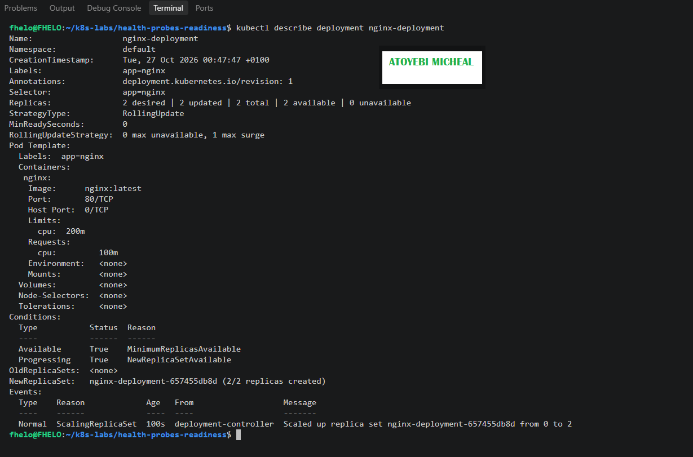

---

### Notes

**1. How many replicas does this Deployment maintain?**

The Deployment maintains two replicas of the NGINX application.

**2. What does `maxUnavailable: 0` mean during a rolling update?**

It means Kubernetes should not allow the number of unavailable replicas to exceed zero during a rolling update. This helps keep the existing application available while new Pods are being updated and become ready.

**3. Is a readiness probe configured in this baseline Deployment?**

No. The baseline Deployment does not contain a readiness probe. Kubernetes has not yet been configured to perform a specific HTTP readiness check for these containers.

---

# Task 3 — Add a Readiness Probe

## Goal

Add an HTTP readiness probe so Kubernetes checks whether each NGINX container is ready to accept requests.

### Evidence

#### Screenshot 5 — Completed `01-nginx-deploy-readiness.yaml` manifest showing the readiness probe

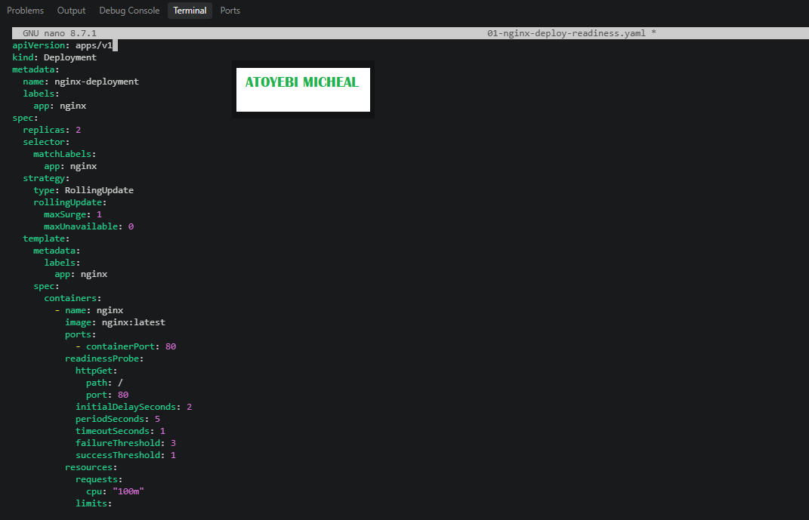

---

#### Screenshot 6 — Output of the successful rollout and ready Pods

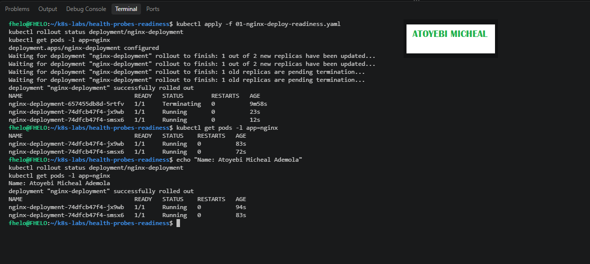

---

#### Screenshot 7 — Pod description showing readiness conditions and readiness probe details

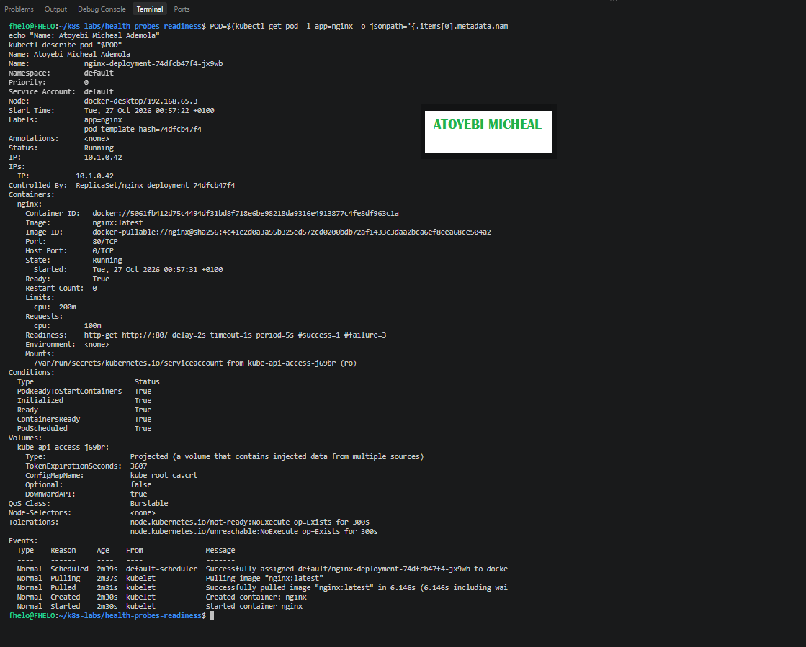

---

### Notes

**1. What path and port does the readiness probe check?**

The readiness probe sends an HTTP request to the root path / on port 80 of the NGINX container.

**2. What does `initialDelaySeconds: 2` do?**

It tells Kubernetes to wait two seconds after the container starts before performing the first readiness check.

**3. What does `periodSeconds: 5` do?**

It configures Kubernetes to perform a readiness check every five seconds.

**4. What must happen before Kubernetes considers this Pod ready?**

The readiness probe must succeed by receiving a successful HTTP response from the configured path and port. Kubernetes can then mark the Pod as Ready.

---

# Task 4 — Break and Restore Readiness

## Goal

Intentionally fail the readiness probe, observe the NotReady behavior, and then restore the working probe configuration.

### Evidence

#### Screenshot 8 — `02-nginx-readiness-broken.yaml` showing `/does-not-exist`

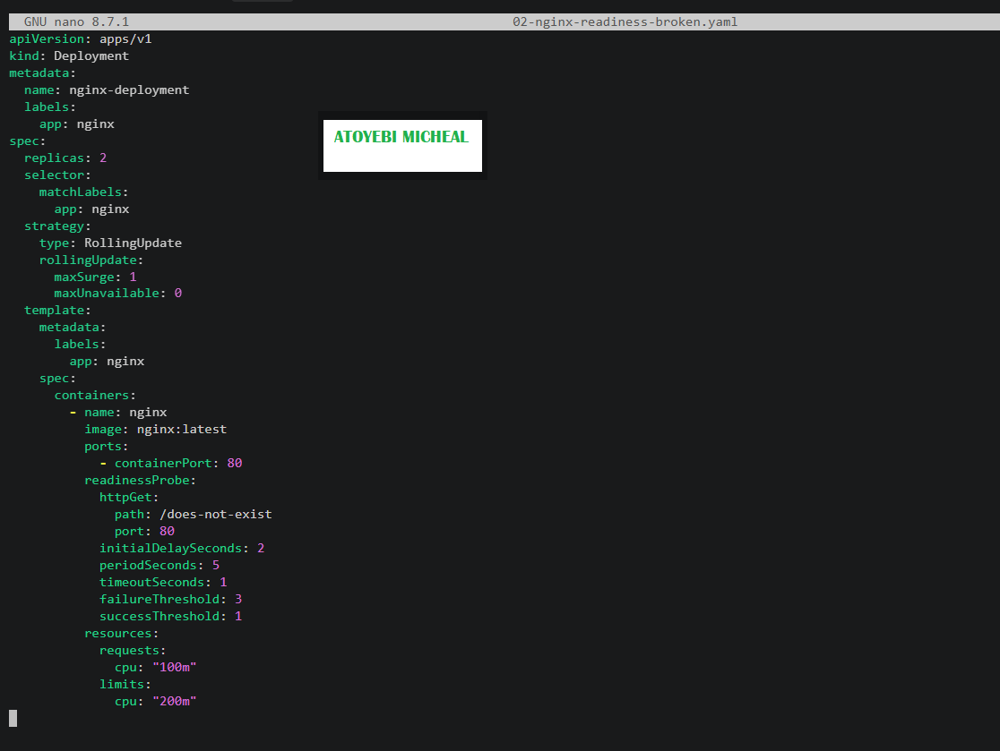

---

#### Screenshot 9 — Output showing the rollout timeout or incomplete rollout

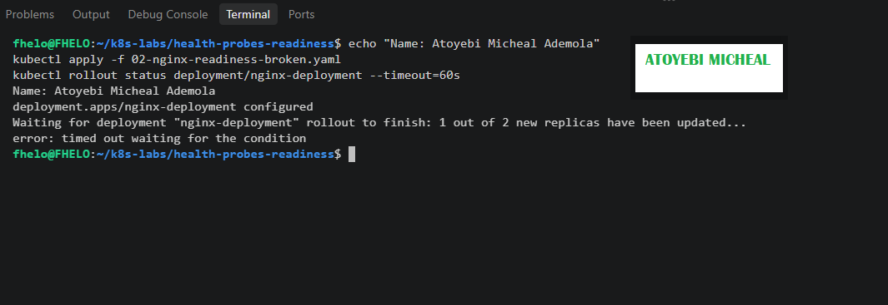

---

#### Screenshot 10 — Pod details showing `Ready: False` or readiness-probe failure events

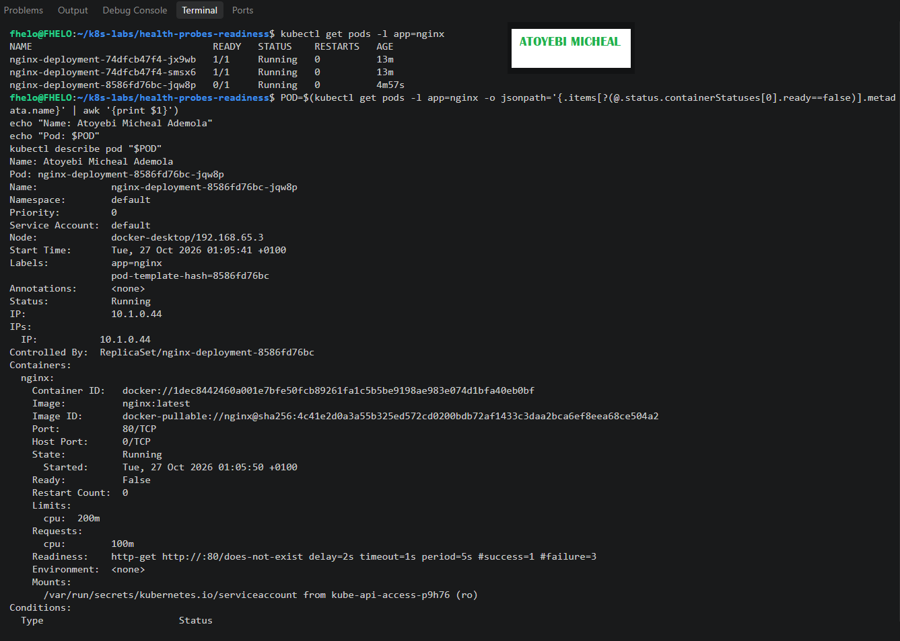
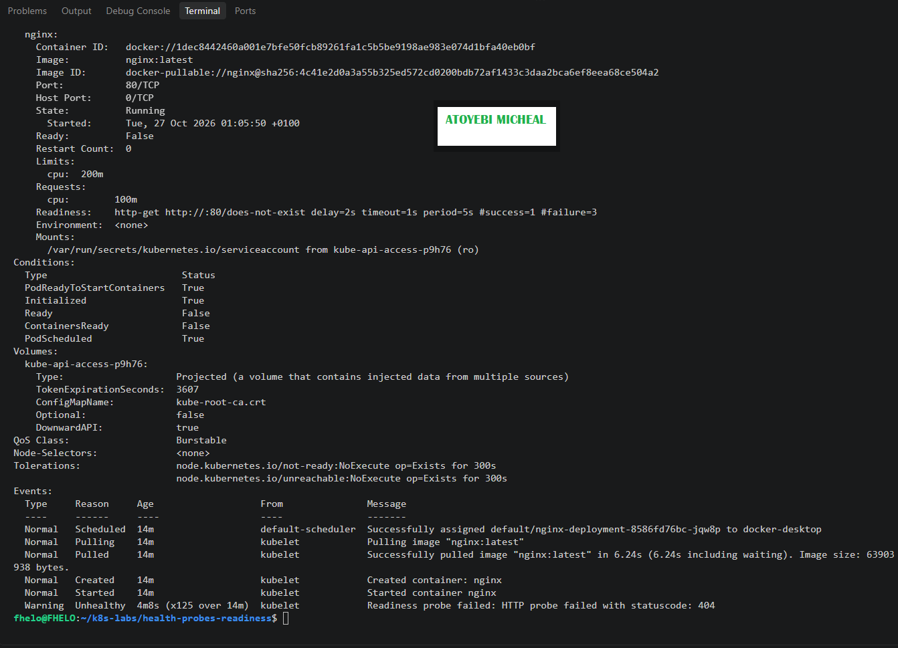

---

#### Screenshot 11 — Output showing successful rollout and ready Pods after the fix

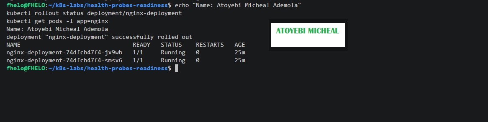

---

### Notes

**1. Why did the readiness probe fail?**

The readiness probe failed because it was configured to check /does-not-exist, a path that NGINX does not serve. The HTTP request returned status code 404.

**2. What happened to the Pod readiness status?**

The affected Pod remained in the Running state but became NotReady. Its container showed Ready: False and ContainersReady: False.

**3. Why did the rollout fail to complete?**

The new Pods could not pass their readiness checks, so Kubernetes could not mark them as available. The rollout timed out while waiting for the new replicas to become ready.

**4. How did you restore the Deployment successfully?**

I copied the original working readiness manifest into 03-nginx-readiness-fixed.yaml and applied it. This restored the probe path to /, allowing the new Pods to pass readiness checks and the Deployment rollout to complete successfully.

---

# Task 5 — See How Readiness Protects Rolling Updates

## Goal

Observe how readiness prevents a bad new Pod from replacing healthy Pods during a rolling update.

### Evidence

#### Screenshot 12 — Successful update command and rollout status

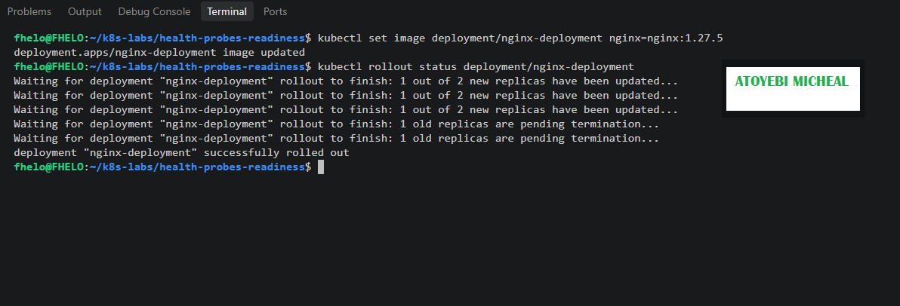

---

#### Screenshot 13 — ReplicaSets and Pods after the successful rolling update

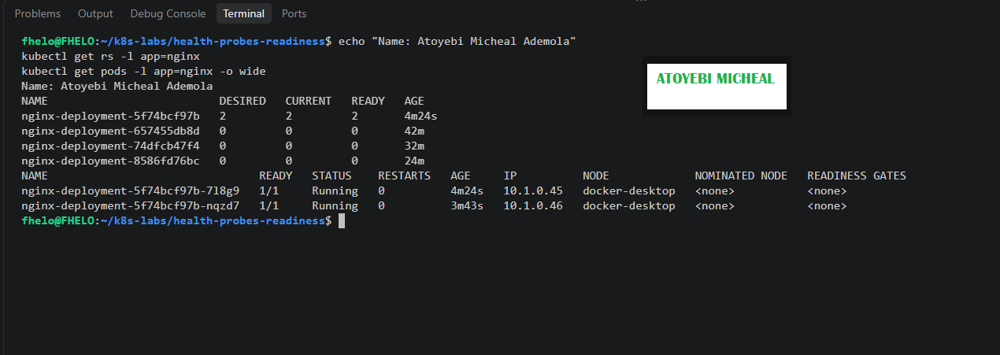

---

#### Screenshot 14 — Completed `04-readiness-broken-patch.yaml`

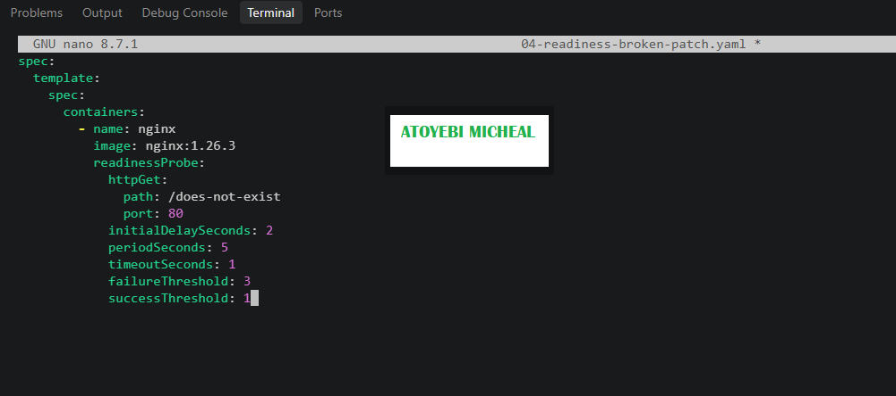

---

#### Screenshot 15 — Output showing the expected stalled rollout or timeout

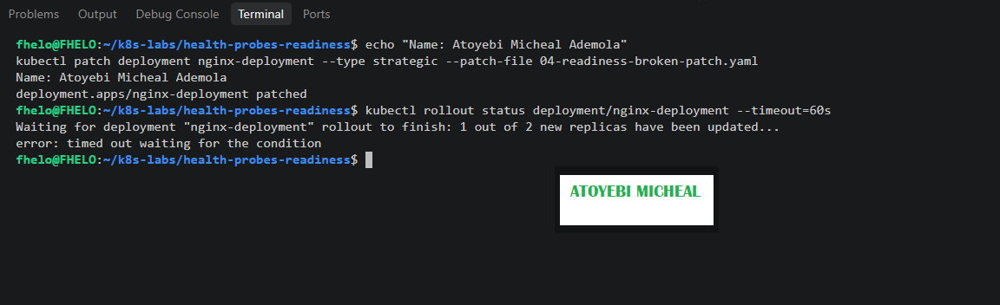

---

#### Screenshot 16 — Deployment or Pod output showing the effect of the broken readiness probe

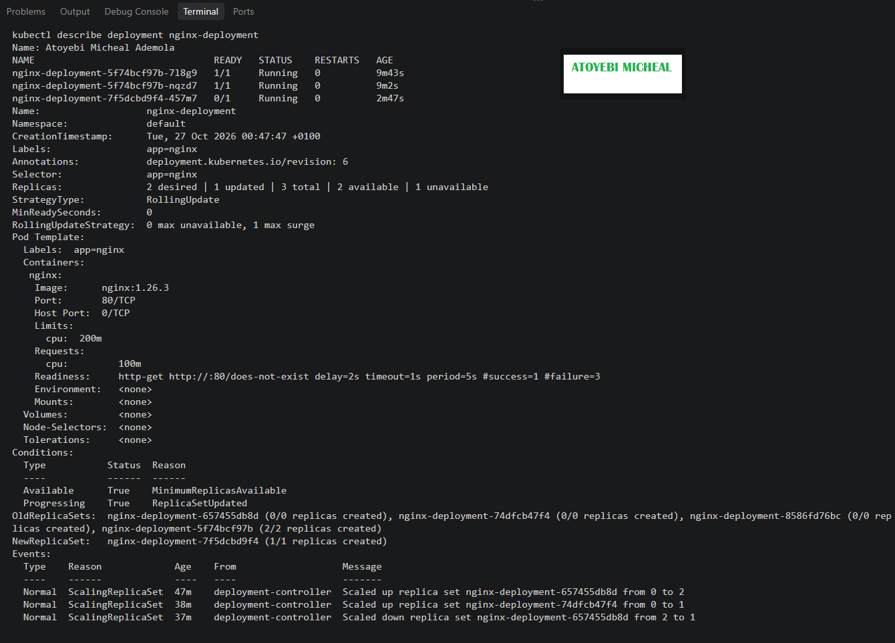
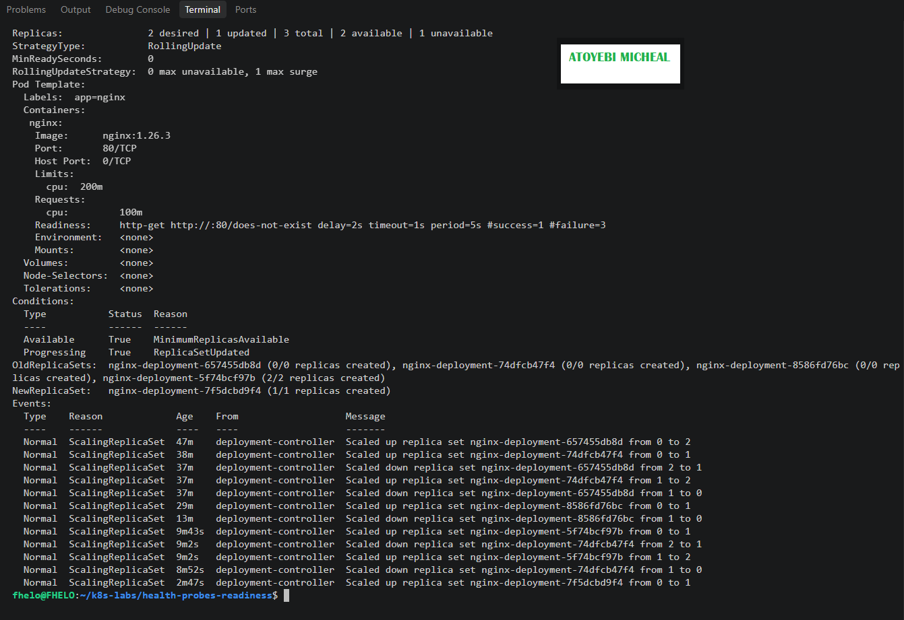

---

#### Screenshot 17 — Successful rollout status after restoring the fixed configuration

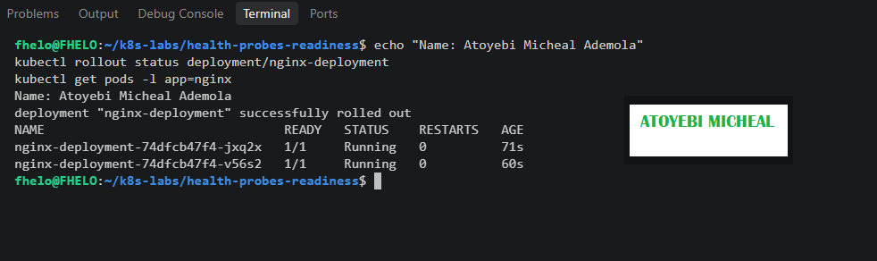

---

### Notes

**1. What happened during the successful rolling update?**

Kubernetes updated the NGINX image from nginx:latest to nginx:1.27.5. It created a new ReplicaSet, started new Pods, and waited for them to become ready before removing the old Pods. The rollout completed successfully.

**2. Why did Kubernetes create a new ReplicaSet?**

A new ReplicaSet was created because the Deployment's Pod template changed when the container image was updated. The ReplicaSet manages Pods that match that specific version of the template.

**3. Why were the new Pods unable to replace the existing healthy Pods after readiness was broken?**

The new Pods used the invalid readiness path /does-not-exist, which returned HTTP 404. They remained NotReady, so Kubernetes could not count them as available. The existing healthy Pods were retained while the rollout remained incomplete.

**4. How does `maxUnavailable: 0` protect availability during this rollout?**

It prevents Kubernetes from intentionally reducing the number of available replicas below the desired count during the rolling update. This helps preserve the two healthy Pods while the new Pods fail their readiness checks.

---

# Task 6 — Share Your Readiness-Probe Learning on LinkedIn

## Goal

Share what you learned about Kubernetes readiness probes and how they protect rolling updates.

### Evidence

#### Screenshot 18 — Published LinkedIn post

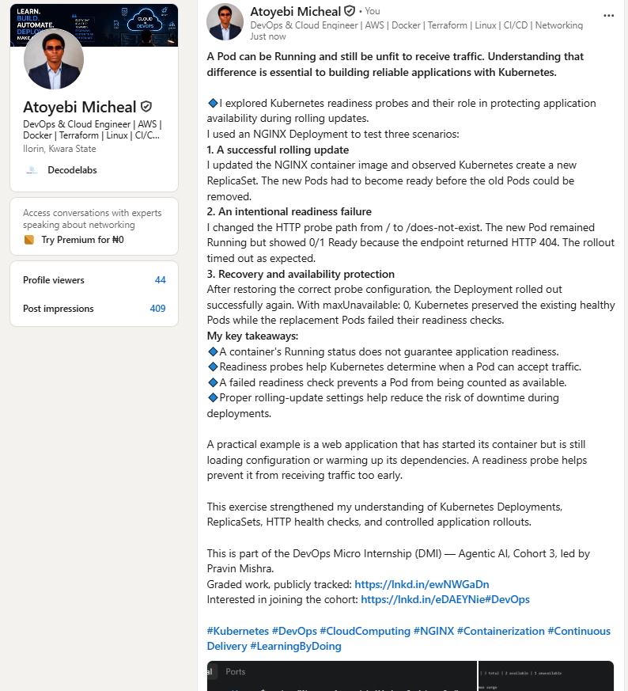

#### Linkedin post link

https://www.linkedin.com/posts/aamicheal_kubernetes-devops-cloudcomputing-ugcPost-7520647651260821504-w9Z8/?highlightedUpdateUrn=urn%3Ali%3Aactivity%3A7520647654276517888&highlightedUpdateType=SOCIAL_SHARE&origin=SOCIAL_SHARE&utm_source=social_share_send&utm_medium=member_desktop_web&rcm=ACoAADFvgDYBsnsyE66xAyq2HzH3Jfsf19WE6JA

---

# Submission Instructions

- Add all required screenshots numbered 1–18.
- Ensure your full name is visible in required screenshots.
- Use clear, readable screenshots showing the relevant manifest or output.
- Include the completed baseline and readiness-probe manifests in your repository.
- Answer all Notes questions for Tasks 1–5 in your own words.
- Include evidence of the intentional readiness failure and successful recovery.
- Do not expose tokens, passwords, kubeconfig files, account IDs, or other sensitive information.

---

# Completion Checklist

- [ ] Learning cluster confirmed and previous assignment resources removed where applicable
- [ ] Readiness-probe lab directory created (Screenshot 1)
- [ ] Baseline Deployment created successfully (Screenshot 2)
- [ ] Two baseline Pods running and successful rollout verified (Screenshot 3)
- [ ] Baseline Deployment details reviewed (Screenshot 4)
- [ ] Readiness probe added successfully (Screenshot 5)
- [ ] Successful readiness rollout verified (Screenshot 6)
- [ ] Pod readiness conditions and probe details inspected (Screenshot 7)
- [ ] Broken readiness configuration created (Screenshot 8)
- [ ] Stalled rollout or timeout observed (Screenshot 9)
- [ ] NotReady status or readiness-probe failure events captured (Screenshot 10)
- [ ] Working readiness configuration restored (Screenshot 11)
- [ ] Successful image update completed (Screenshot 12)
- [ ] ReplicaSets and Pods inspected after the update (Screenshot 13)
- [ ] Broken-readiness patch created (Screenshot 14)
- [ ] Stalled rollout observed after the patch (Screenshot 15)
- [ ] Effect of broken readiness captured (Screenshot 16)
- [ ] Final recovery completed (Screenshot 17)
- [ ] LinkedIn post published (Screenshot 18)
- [ ] Notes for Tasks 1–5 completed
- [ ] Required manifests included
- [ ] All screenshots are clear and readable
- [ ] No sensitive data exposed

---

## 📌 About DMI & CloudAdvisory

DevOps Micro Internship (DMI) is a project-based DevOps program run by Pravin Mishra (The CloudAdvisory) focused on real-world execution, systems thinking, and career readiness.

It helps learners build strong DevOps foundations with hands-on experience.

---

## 📌 Resources

- 🌐 DMI Official Website: https://dmi.pravinmishra.com?utm_source=github&utm_medium=readme  
- 🎓 University: https://university.pravinmishra.com?utm_source=github&utm_medium=readme  
- 💬 Discord Community: https://discord.pravinmishra.com?utm_source=github&utm_medium=readme  
- 📝 Blog: https://dmi.pravinmishra.com/blog?utm_source=github&utm_medium=readme  
- ▶️ YouTube Playlist: https://www.youtube.com/playlist?list=PLFeSNDtI4Cho  
- 🔗 Pravin Mishra (LinkedIn): https://www.linkedin.com/in/pravin-mishra-aws-trainer/  
- 🏢 CloudAdvisory (LinkedIn): https://www.linkedin.com/company/thecloudadvisory/

---

*This submission is part of DevOps Micro Internship (DMI) — Agentic AI Track.*
