# Assignment 6 — Kubernetes Health Probes (Liveness)

Part of the DevOps Micro Internship (DMI) with Agentic AI

---

## Purpose

In this assignment, you will configure and test a Kubernetes liveness probe. You will create a baseline NGINX Deployment, add an HTTP liveness probe, intentionally make it fail, observe container restarts, and restore the working configuration.

---

# Task 0 — Prepare the Lab Environment

## Goal

Confirm that you are connected to your learning cluster and remove the previous HPA and NGINX Deployment before starting this lab.

No screenshot or written notes are required for this pre-check.

---

# Task 1 — Set Up Your Lab Directory

## Goal

Create and enter a dedicated directory for the liveness-probe lab.

### Evidence

#### Screenshot 1 — Terminal showing that you are working inside `~/k8s-labs/health-probes-liveness`

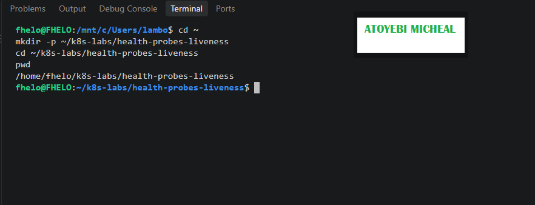

---

### Notes

**1. What problem does a liveness probe solve?**

A liveness probe helps Kubernetes detect when a container is no longer functioning correctly. If repeated liveness checks fail, Kubernetes can restart the unhealthy container automatically.

**2. What is the key difference between a readiness probe and a liveness probe?**

A readiness probe determines whether a Pod is ready to receive traffic, while a liveness probe determines whether a container should be restarted because it is unhealthy.

---

# Task 2 — Create a Baseline Deployment Without Probes

## Goal

Create a baseline NGINX Deployment with two replicas and no health probes.

### Evidence

#### Screenshot 2 — Completed `00-nginx-deploy-baseline.yaml` manifest

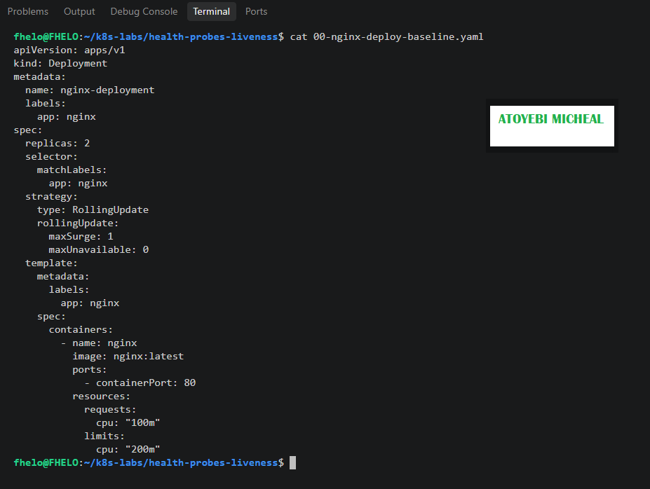

---

#### Screenshot 3 — Output showing a successful rollout and two running NGINX Pods

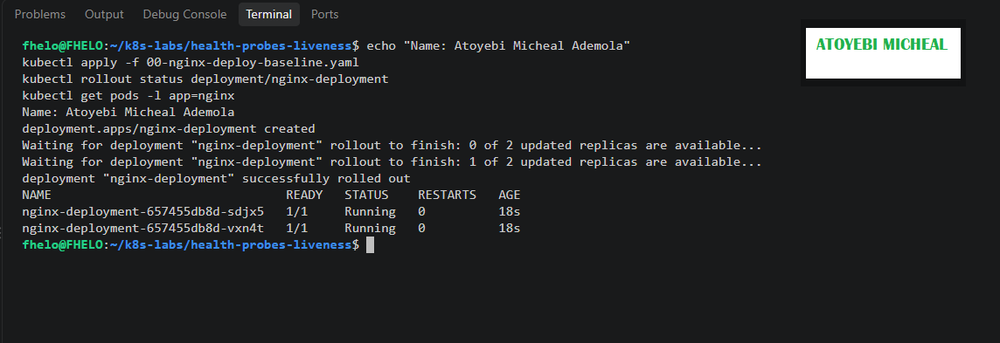

---

#### Screenshot 4 — Relevant output from `kubectl describe deployment nginx-deployment`

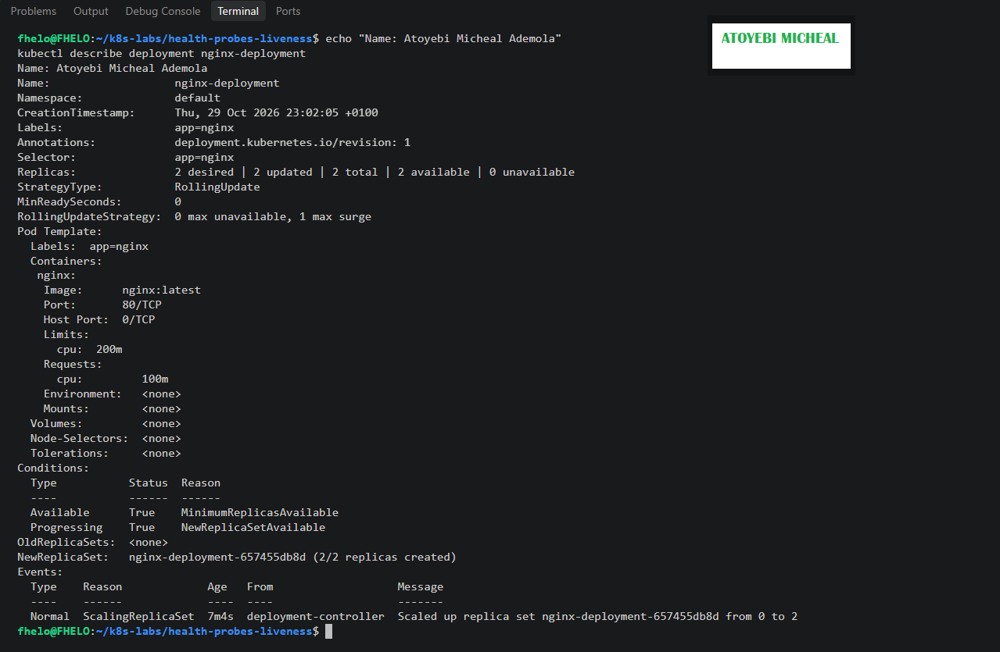

---

### Notes

**1. How many replicas does this Deployment maintain?**

This Deployment maintains 2 replicas of the NGINX application. Both Pods are running and available.

**2. Are any health probes configured in the baseline Deployment?**

No, the baseline Deployment does not have any health probes configured. Neither a liveness probe nor a readiness probe is defined.

**3. Why is a baseline useful before adding a liveness probe?**

A baseline provides a starting point for comparison. It helps us observe how the Deployment behaves without health probes and understand the effect of adding a liveness probe, including how Kubernetes detects an unhealthy container and restarts it when necessary.

---

# Task 3 — Add a Liveness Probe

## Goal

Add an HTTP liveness probe so Kubernetes can periodically check whether the NGINX container is still responsive.

### Evidence

#### Screenshot 5 — Completed `01-nginx-deploy-liveness.yaml` manifest showing the liveness probe

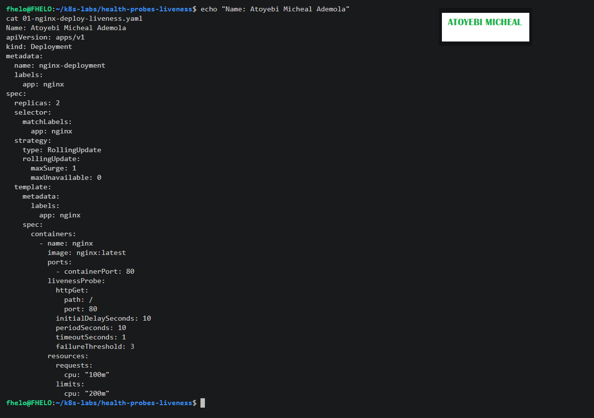

---

#### Screenshot 6 — Output showing successful rollout and running Pods

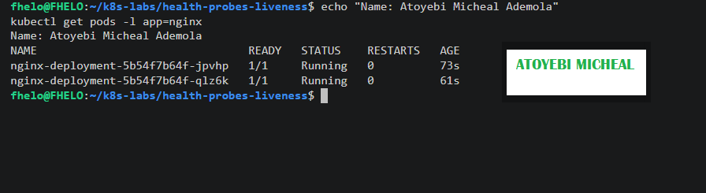

---

#### Screenshot 7 — Pod description showing liveness-probe details

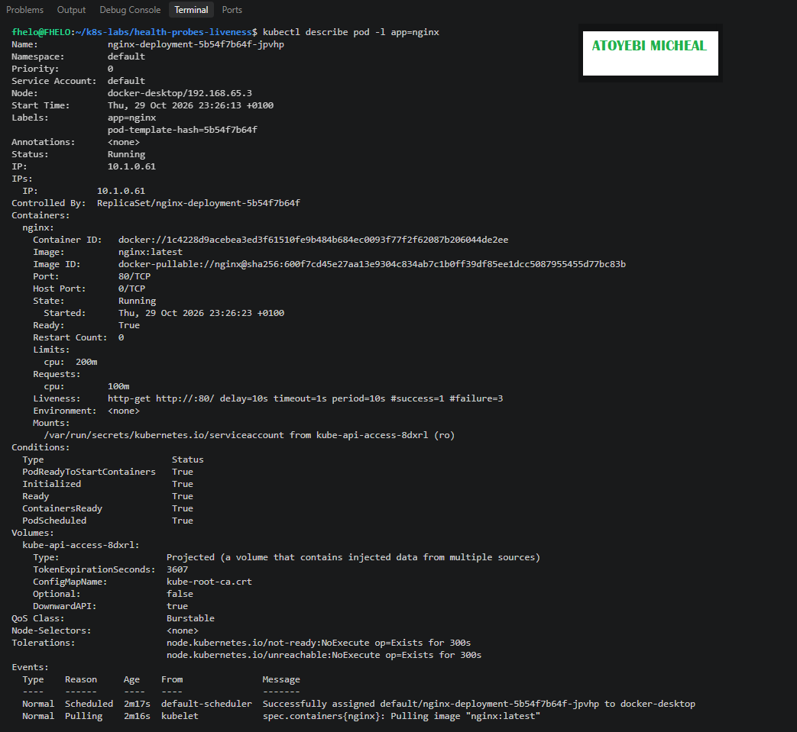
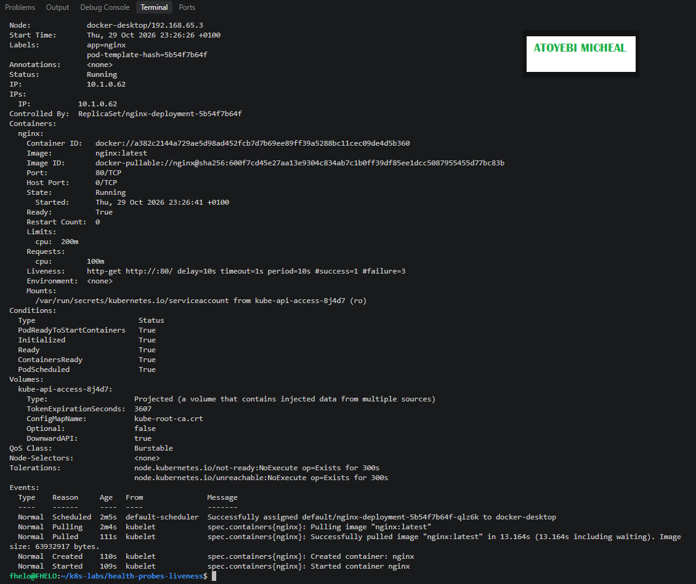

---

### Notes

**1. What path and port does the liveness probe check?**

The liveness probe sends an HTTP GET request to path / on port 80.

**2. What does `initialDelaySeconds: 10` do?**

Kubernetes waits 10 seconds after the container starts before beginning liveness checks.

**3. What does `failureThreshold: 3` mean?**

Kubernetes treats the container as unhealthy after three consecutive liveness probe failures and restarts it.Add your answer here.

**4. Does a successful liveness probe control whether a Pod receives traffic? Explain briefly.**

No. A liveness probe checks whether a container is alive and should be restarted if unhealthy. A readiness probe determines whether a Pod is ready to receive traffic.

---

# Task 4 — Trigger and Observe a Liveness Restart

## Goal

Intentionally make the liveness probe fail and observe Kubernetes restart the unhealthy container.

### Evidence

#### Screenshot 8 — `02-nginx-liveness-broken.yaml` showing `/does-not-exist`

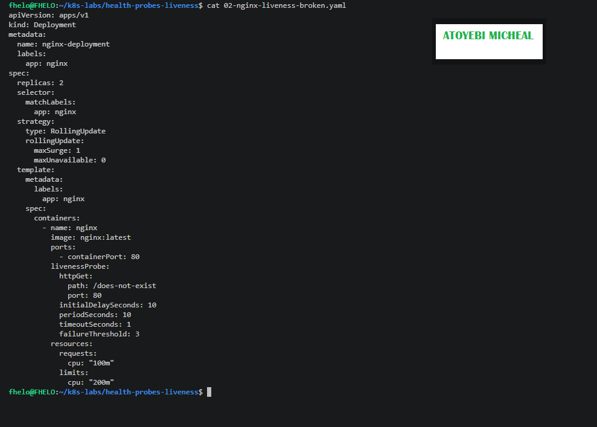

---

#### Screenshot 9 — Pod output showing an increased RESTARTS count

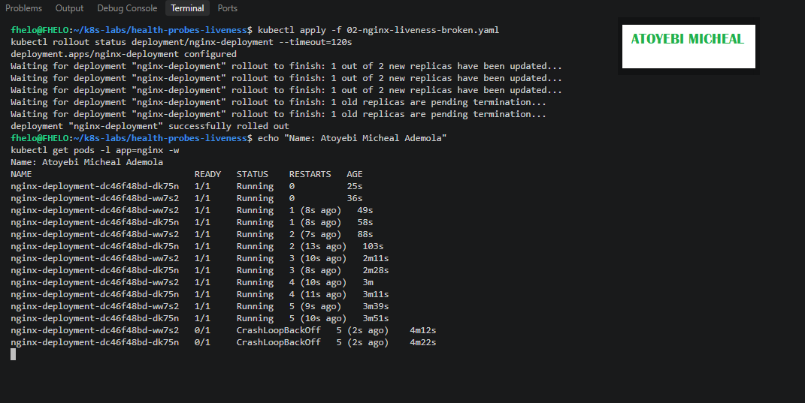

---

#### Screenshot 10 — Pod description showing liveness-probe failure events or restart details

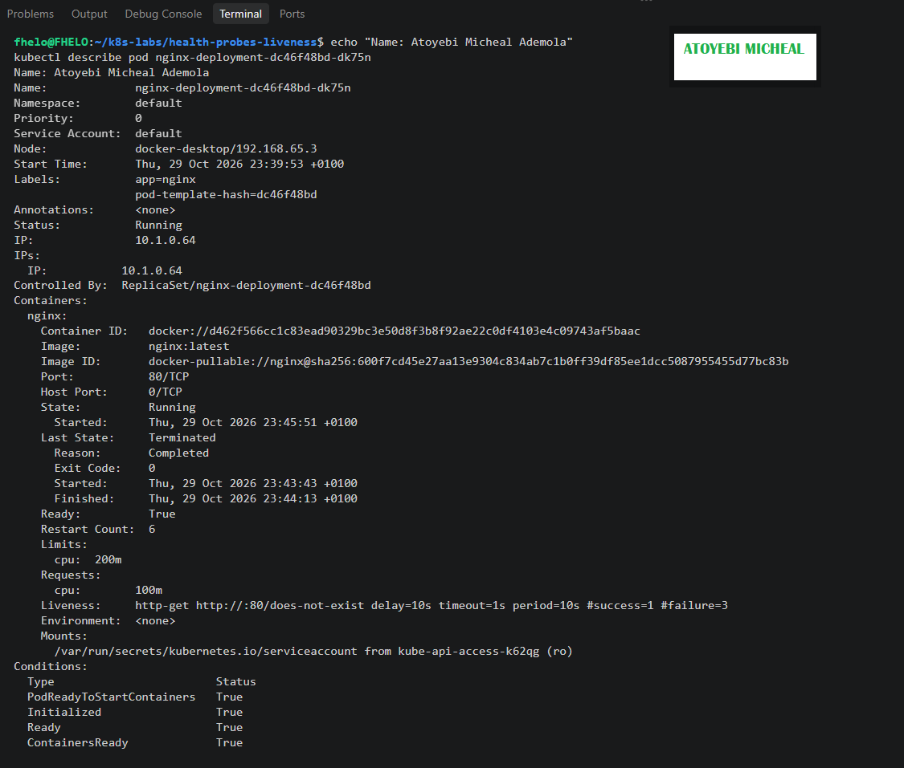
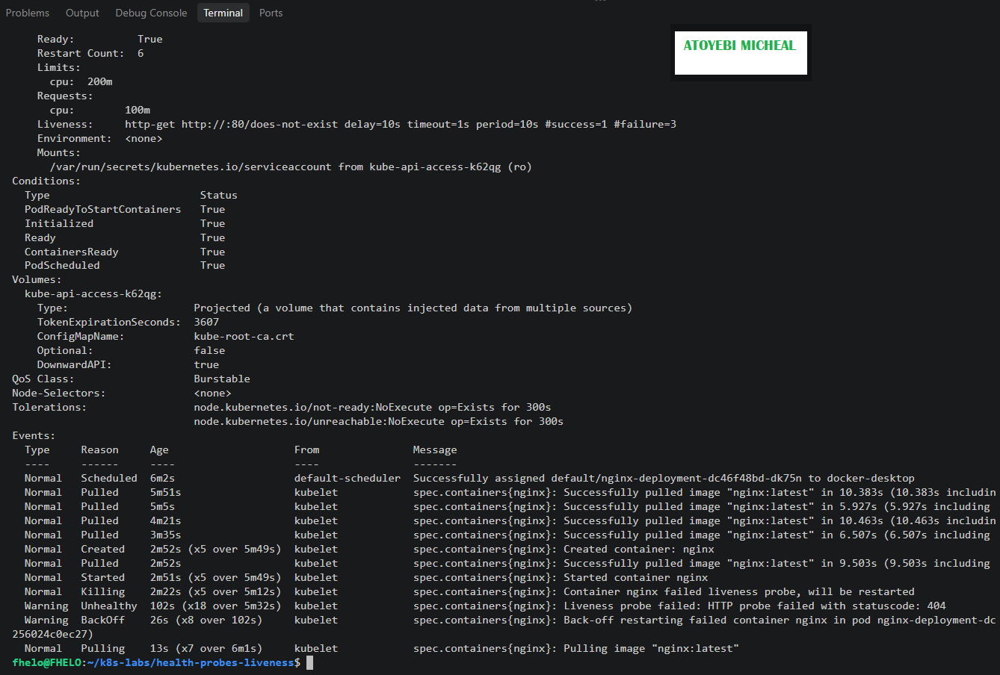

---

#### Screenshot 11 — Output showing stable running Pods after applying the fixed configuration

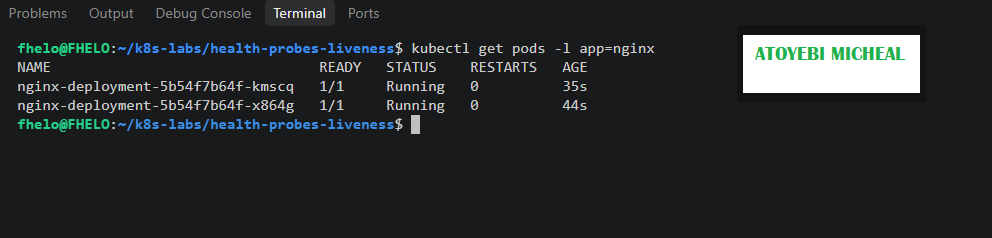

---

### Notes

**1. Why did the liveness probe fail?**

The liveness probe failed because it checked the invalid HTTP path /does-not-exist. The NGINX server returned HTTP status code 404, meaning the requested resource was not found.

**2. What happened after Kubernetes detected repeated liveness-probe failures?**

After three consecutive probe failures, Kubernetes treated the container as unhealthy and restarted it. Repeated failures eventually caused the container to enter CrashLoopBackOff.

**3. What does the RESTARTS column prove?**

The RESTARTS column shows how many times Kubernetes has restarted a container. In my experiment, the restart count increased to 6, proving that Kubernetes detected repeated liveness probe failures and automatically restarted the unhealthy container.

**4. How did you restore the Deployment to a stable state?**

I restored the valid liveness probe path from /does-not-exist to / in the fixed YAML manifest and applied it using kubectl apply. I then used kubectl rollout status and kubectl get pods to verify that the Deployment recovered and both Pods were running normally.

---

# Task 5 — Optional: Observe a Restart Loop

## Goal

Observe why overly aggressive or incorrectly configured liveness probes can create restart loops.

Complete this section only if you attempt Task 5. Otherwise, mark it as “Not attempted.”

**Task status:** Completed / Not attempted

### Evidence

#### Optional Screenshot — Pod output showing the RESTARTS count increasing during the restart-loop observation

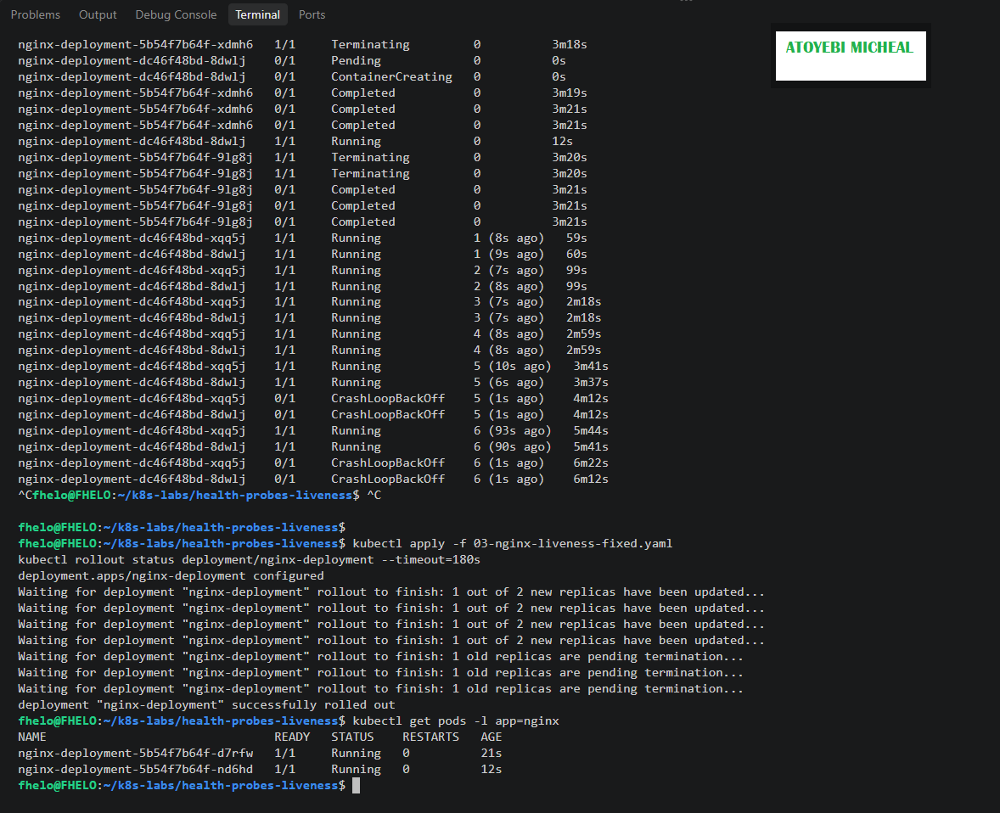

No specific restart count or CrashLoopBackOff status is required.

---

### Notes — Answer Only If Attempted

**1. What is a restart loop?**

A restart loop occurs when a container repeatedly fails and Kubernetes continuously restarts it because it cannot remain healthy.

**2. Why can an aggressive liveness probe be harmful?**

An aggressive or incorrectly configured liveness probe can cause Kubernetes to restart a container unnecessarily, even when the application could recover on its own. This can disrupt application availability.

**3. Why should liveness checks be lightweight and carefully tuned?**

Liveness checks should be lightweight to avoid consuming unnecessary resources. They should also have appropriate delays, timeouts, and failure thresholds to prevent unnecessary restarts.

---

# Task 6 — Share Your Liveness-Probe Learning on LinkedIn

## Goal

Share what you learned about Kubernetes liveness probes, container restarts, and the difference between readiness and liveness.

### Evidence

#### Screenshot 12 — Published LinkedIn post

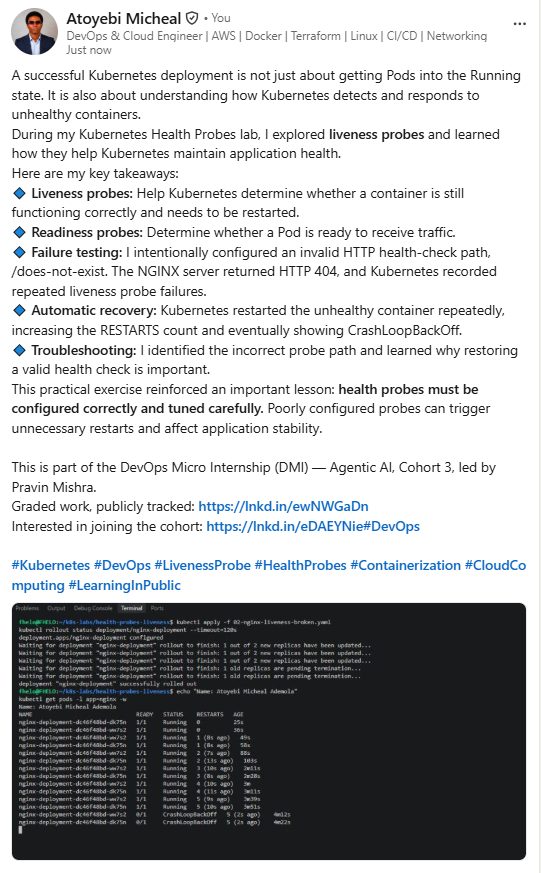

#### Linkedin post URL

https://www.linkedin.com/posts/aamicheal_kubernetes-devops-livenessprobe-share-7521707528867549184-nfn7/?highlightedUpdateUrn=urn%3Ali%3Aactivity%3A7521707531245637632&highlightedUpdateType=SOCIAL_SHARE&origin=SOCIAL_SHARE&utm_source=social_share_send&utm_medium=member_desktop_web&rcm=ACoAADFvgDYBsnsyE66xAyq2HzH3Jfsf19WE6JA

---

# Submission Instructions

- Add all required screenshots numbered 1–12.
- Include the optional Task 5 screenshot only if you attempt that task.
- Ensure your full name is visible in required screenshots.
- Use clear, readable screenshots showing the relevant manifest or output.
- Include the completed baseline and liveness-probe manifests in your repository.
- Answer all Notes questions for Tasks 1–4 in your own words.
- If you attempt Task 5, complete its Notes and restore the working configuration afterward.
- Do not expose tokens, passwords, kubeconfig files, account IDs, or other sensitive information.

---

# Completion Checklist

- [ ] Learning cluster confirmed and previous assignment resources removed where applicable
- [ ] Liveness-probe lab directory created (Screenshot 1)
- [ ] Baseline Deployment manifest completed (Screenshot 2)
- [ ] Successful rollout and two baseline Pods verified (Screenshot 3)
- [ ] Baseline Deployment details reviewed (Screenshot 4)
- [ ] Liveness probe added successfully (Screenshot 5)
- [ ] Successful liveness-probe rollout verified (Screenshot 6)
- [ ] Liveness-probe details inspected (Screenshot 7)
- [ ] Broken liveness configuration created (Screenshot 8)
- [ ] Increased container restart count observed (Screenshot 9)
- [ ] Liveness-probe failure events or restart details captured (Screenshot 10)
- [ ] Working liveness configuration restored and stable Pods verified (Screenshot 11)
- [ ] Optional Task 5 evidence and Notes completed, if attempted
- [ ] Working configuration restored after Task 5, if attempted
- [ ] LinkedIn post published (Screenshot 12)
- [ ] Notes for Tasks 1–4 completed
- [ ] Required manifests included
- [ ] All required screenshots are clear and readable
- [ ] No sensitive data exposed

---

## 📌 About DMI & CloudAdvisory

DevOps Micro Internship (DMI) is a project-based DevOps program run by Pravin Mishra (The CloudAdvisory) focused on real-world execution, systems thinking, and career readiness.

It helps learners build strong DevOps foundations with hands-on experience.

---

## 📌 Resources

- 🌐 DMI Official Website: https://dmi.pravinmishra.com?utm_source=github&utm_medium=readme  
- 🎓 University: https://university.pravinmishra.com?utm_source=github&utm_medium=readme  
- 💬 Discord Community: https://discord.pravinmishra.com?utm_source=github&utm_medium=readme  
- 📝 Blog: https://dmi.pravinmishra.com/blog?utm_source=github&utm_medium=readme  
- ▶️ YouTube Playlist: https://www.youtube.com/playlist?list=PLFeSNDtI4Cho  
- 🔗 Pravin Mishra (LinkedIn): https://www.linkedin.com/in/pravin-mishra-aws-trainer/  
- 🏢 CloudAdvisory (LinkedIn): https://www.linkedin.com/company/thecloudadvisory/

---

*This submission is part of DevOps Micro Internship (DMI) — Agentic AI Track.*
