# Assignment 7 — Kubernetes Services (ClusterIP)

Part of the DevOps Micro Internship (DMI) with Agentic AI

---

## Purpose

In this assignment, you will create and test a Kubernetes ClusterIP Service. You will connect it to a healthy NGINX Deployment, access it using DNS and its ClusterIP, break and restore its selector, and observe how readiness affects Service routing.

---

# Task 0 — Prepare the Lab Environment

## Goal

Confirm your learning-cluster context and remove previous lab resources where applicable before starting this assignment.

No screenshot or written notes are required for this pre-check.

---

# Task 1 — Set Up Your Lab Directory

## Goal

Create and enter a dedicated directory for the ClusterIP Service lab.

### Evidence

#### Screenshot 1 — Terminal showing that you are working inside `~/k8s-labs/services/clusterip`

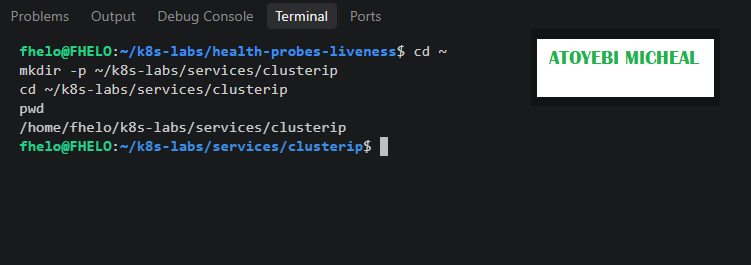

---

### Notes

**1. Why is it not reliable to communicate with an application using a Pod IP address?**

Pod IP addresses are temporary and can change whenever Pods are replaced, restarted, or recreated. Therefore, applications should not depend directly on individual Pod IP addresses.

**2. What Kubernetes resource provides a stable internal address for a group of Pods?**

A Kubernetes Service, specifically a ClusterIP Service, provides a stable internal IP address and DNS name for accessing a group of Pods.

---

# Task 2 — Create a Healthy NGINX Deployment

## Goal

Create an NGINX Deployment with labels, readiness probes, and liveness probes that can act as the backend for a Service.

### Evidence

#### Screenshot 2 — Completed `00-nginx-deploy.yaml` manifest

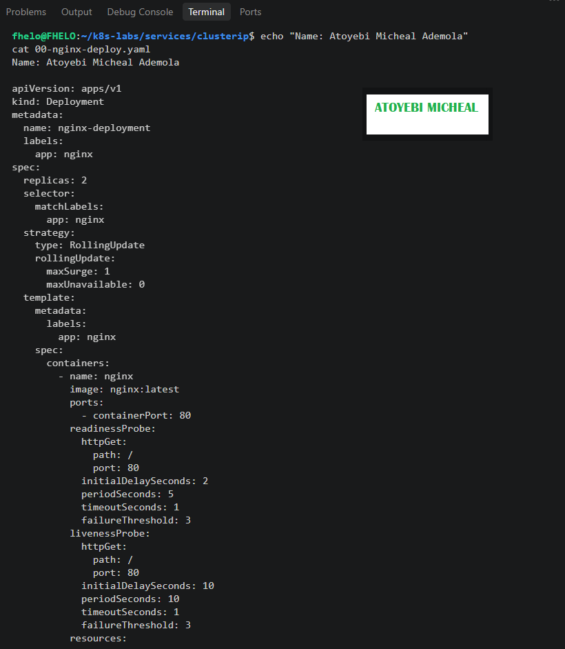

---

#### Screenshot 3 — Output showing successful rollout and two ready NGINX Pods

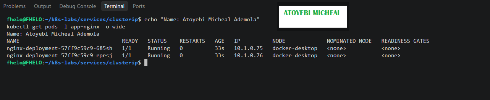

---

### Notes

**1. Which label will the Service use to find these Pods?**

The Service will use the label app: nginx to identify and select the NGINX Pods.

**2. Why is readiness important before connecting Pods to a Service?**

AReadiness ensures that a Pod is healthy and ready to receive traffic before it becomes a usable Service endpoint. This prevents traffic from being sent to Pods that are not ready.

**3. What port does the NGINX container listen on?**

The NGINX container listens on port 80.

---

# Task 3 — Create a ClusterIP Service

## Goal

Create a stable internal Service that routes traffic to the NGINX Pods.

### Evidence

#### Screenshot 4 — Completed `01-nginx-svc-clusterip.yaml` manifest

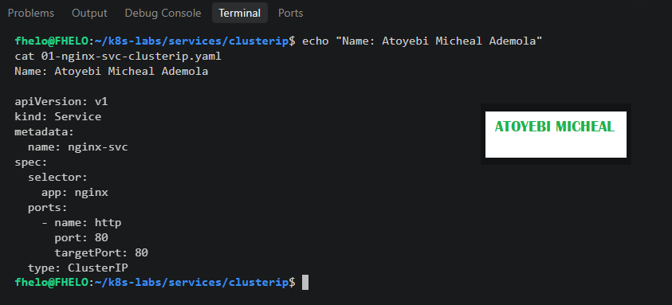

---

#### Screenshot 5 — Output showing the ClusterIP Service, endpoints, or EndpointSlices

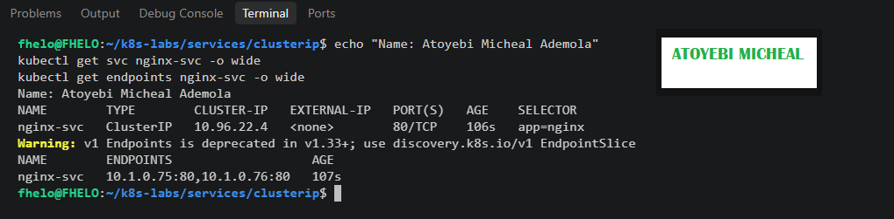

---

### Notes

**1. What is the purpose of a ClusterIP Service?**

A ClusterIP Service provides a stable internal IP address and DNS name for accessing a group of Pods within a Kubernetes cluster.

**2. What is the difference between `port` and `targetPort`?**

port is the port exposed by the Kubernetes Service, while targetPort is the port on the backend container where traffic is forwarded.

**3. Why must the Service selector match the Pod labels?**

AThe Service selector must match the Pod labels so Kubernetes can identify the correct backend Pods and route traffic to them. If they do not match, the Service will have no matching endpoints.

**4. What information do EndpointSlices contain?**

EndpointSlices contain backend Pod IP addresses, ports, and readiness conditions. They help Kubernetes track which Pods are available to receive Service traffic.

---

# Task 4 — Access the Service from Inside the Cluster

## Goal

Create a client Pod and access the NGINX Service using DNS and its ClusterIP.

### Evidence

#### Screenshot 6 — Output showing the `tester` Pod running

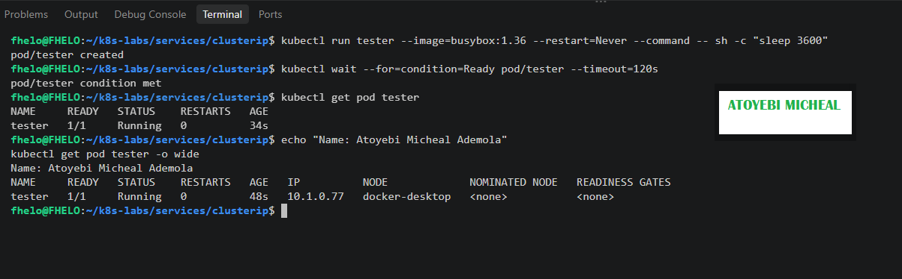

---

#### Screenshot 7 — Successful Service request using DNS name and ClusterIP

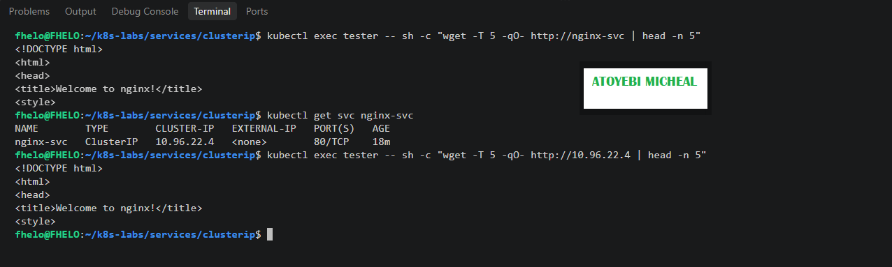

---

#### Screenshot 8 — Successful DNS lookup for the Service

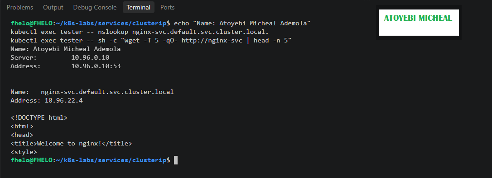

---

### Notes

**1. Why should an application use `nginx-svc` instead of a Pod IP address?**

An application should use nginx-svc because Pod IP addresses are temporary and can change when Pods are restarted, replaced, or recreated. The Service provides a stable address for accessing the application.

**2. What does the DNS name `nginx-svc.default.svc.cluster.local` represent?**

It is the fully qualified DNS name of the nginx-svc Service in the default namespace within the Kubernetes cluster. It allows applications to discover and access the Service using its name.

**3. Why can the client access the Service even if the backend Pod IPs change?**

The client can still access the Service because Kubernetes maintains a stable ClusterIP and DNS name while automatically updating the Service endpoints whenever backend Pods are replaced or their IP addresses change.

---

# Task 5 — Break and Restore the Label-Selector Contract

## Goal

Break the Service selector, observe that usable endpoints disappear, and then restore the correct selector.

### Evidence

#### Screenshot 9 — `02-nginx-svc-selector-broken.yaml` showing the incorrect selector

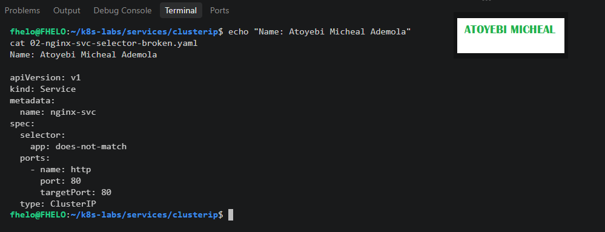

---

#### Screenshot 10 — Empty endpoints or EndpointSlice output after applying the broken selector

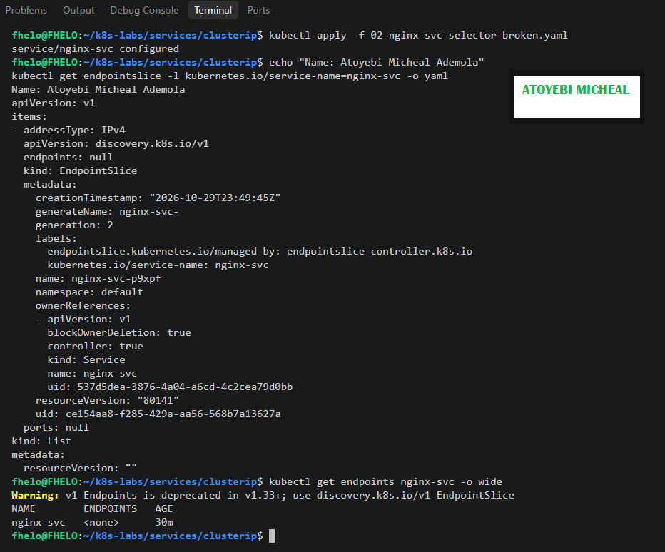

---

#### Screenshot 11 — Failed request output from the `tester` Pod

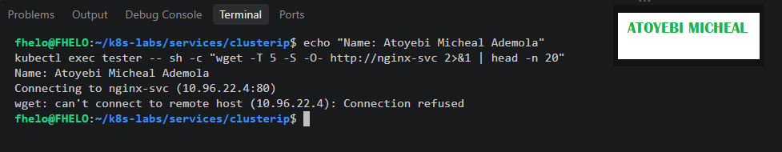

---

#### Screenshot 12 — Restored endpoints and successful Service request

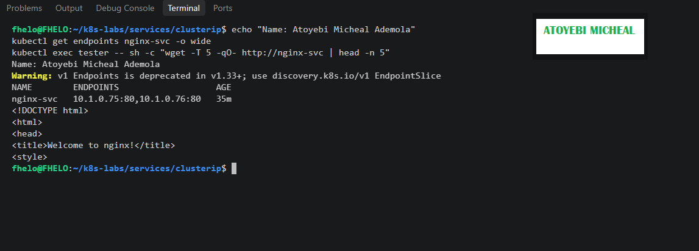

---

### Notes

**1. Why did the Service endpoints become empty?**

The Service endpoints became empty because the selector was changed to app: does-not-match, which did not match the app: nginx labels on the NGINX Pods.

**2. What caused the request from the client Pod to fail?**

The request failed because the Service could no longer identify matching backend Pods to receive and process incoming traffic.

**3. How did you restore connectivity to the NGINX Pods?**

I restored the original Service selector by applying 01-nginx-svc-clusterip.yaml. Kubernetes rediscovered the matching NGINX Pods, restored the Service endpoints, and allowed the tester Pod to access the NGINX application again.

---

# Task 6 — Observe How Readiness Affects Service Routing

## Goal

Observe how a new Pod that fails readiness is excluded from ready Service backends while the existing healthy Pod continues serving traffic.

### Evidence

#### Screenshot 13 — Output showing the Deployment scaled to one ready Pod

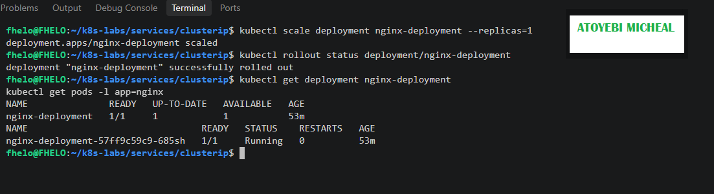

---

#### Screenshot 14 — Completed `03-readiness-broken.yaml` patch file

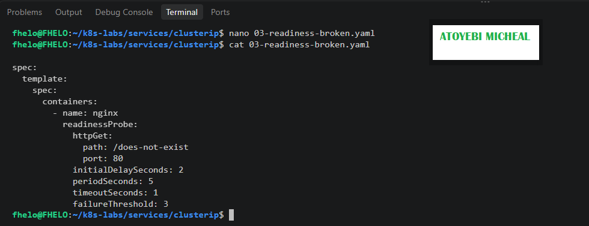

---

#### Screenshot 15 — Output showing the expected incomplete rollout or NotReady Pod

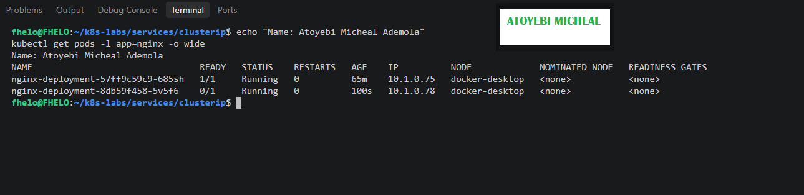

---

#### Screenshot 16 — EndpointSlice output showing the healthy Pod with `ready: true` and the new NotReady Pod with `ready: false`

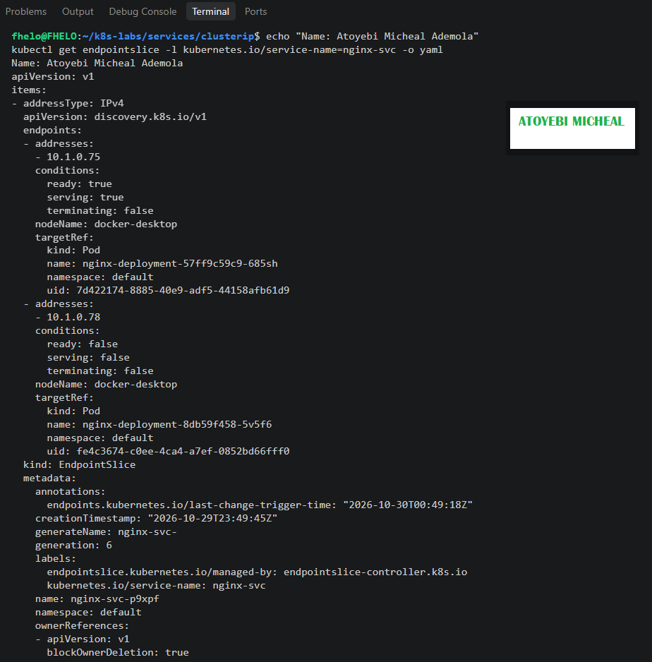
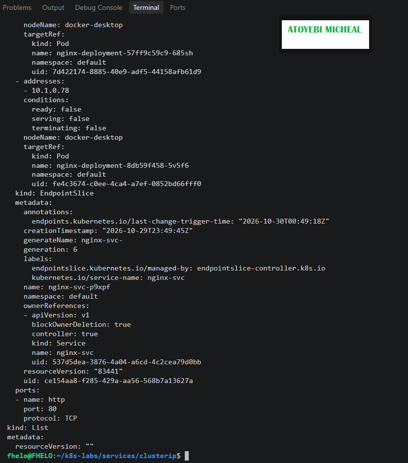

---

#### Screenshot 17 — Service EndpointSlice output showing ready backends after restoring the Deployment

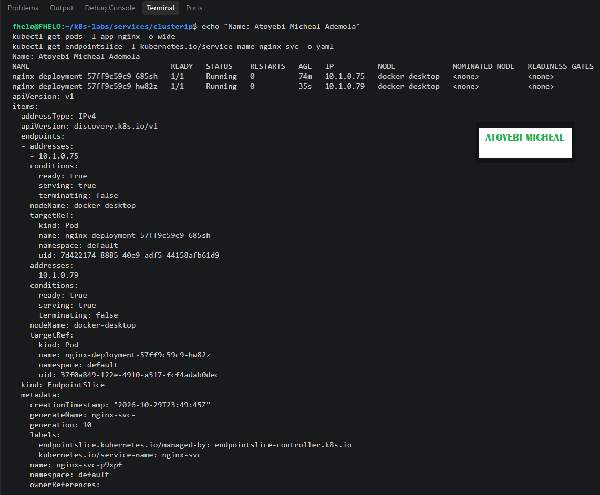

---

### Notes

**1. Why was the new NotReady Pod excluded from ready Service backends?**

The new Pod was excluded because its readiness probe was configured to check a non-existent path (/does-not-exist). The check failed, so Kubernetes marked the Pod as NotReady and excluded it from ready Service backends.

**2. What is the relationship between readiness probes and Service routing?**

Readiness probes tell Kubernetes whether a Pod is ready to receive traffic. The Service uses this readiness information to route traffic to ready Pods and avoid sending normal traffic to Pods that are not ready.

**3. Why does this behavior protect users from unhealthy application instances?**

It prevents users' requests from being sent to application instances that are not ready to serve them. This reduces failed requests and helps maintain reliable application availability.

---

# Task 7 — Share Your ClusterIP Service Learning on LinkedIn

## Goal

Share what you learned about ClusterIP Services, Kubernetes DNS, selectors, and readiness-aware Service routing.

### Evidence

#### Screenshot 18 — Published LinkedIn post

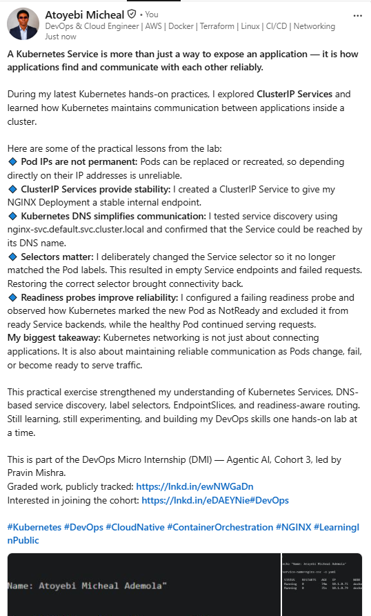

#### Linkedin post link

https://www.linkedin.com/posts/aamicheal_kubernetes-devops-cloudnative-ugcPost-7521741004375506944-0E4F/?highlightedUpdateUrn=urn%3Ali%3Aactivity%3A7521741007466459136&highlightedUpdateType=SOCIAL_SHARE&origin=SOCIAL_SHARE&utm_source=social_share_send&utm_medium=member_desktop_web&rcm=ACoAADFvgDYBsnsyE66xAyq2HzH3Jfsf19WE6JA

---

# Submission Instructions

- Add all required screenshots numbered 1–18.
- Ensure your full name is visible in required screenshots.
- Use clear, readable screenshots showing the relevant manifest or output.
- Include the completed NGINX Deployment and ClusterIP Service manifests in your repository.
- Answer all Notes questions for Tasks 1–6 in your own words.
- Include evidence of the intentional failures and successful recovery.
- Do not expose tokens, passwords, kubeconfig files, account IDs, or other sensitive information.

---

# Completion Checklist

- [ ] Learning-cluster context confirmed and previous lab resources removed where applicable
- [ ] ClusterIP lab directory created (Screenshot 1)
- [ ] Healthy NGINX Deployment manifest completed (Screenshot 2)
- [ ] Successful rollout and two ready NGINX Pods verified (Screenshot 3)
- [ ] ClusterIP Service manifest completed (Screenshot 4)
- [ ] Service and backend endpoints or EndpointSlices verified (Screenshot 5)
- [ ] Client Pod created and running (Screenshot 6)
- [ ] Service accessed using DNS name and ClusterIP (Screenshot 7)
- [ ] Service DNS resolution verified (Screenshot 8)
- [ ] Broken selector manifest created (Screenshot 9)
- [ ] Empty endpoints observed (Screenshot 10)
- [ ] Failed Service request captured (Screenshot 11)
- [ ] Original selector restored and connectivity verified (Screenshot 12)
- [ ] Deployment scaled to one ready Pod (Screenshot 13)
- [ ] Broken readiness patch created (Screenshot 14)
- [ ] Incomplete rollout or NotReady Pod observed (Screenshot 15)
- [ ] Readiness effect on Service backends verified (Screenshot 16)
- [ ] Deployment restored and ready Service backends verified (Screenshot 17)
- [ ] LinkedIn post published (Screenshot 18)
- [ ] Notes for Tasks 1–6 completed
- [ ] Required manifests included
- [ ] All required screenshots are clear and readable
- [ ] No sensitive data exposed

---

## 📌 About DMI & CloudAdvisory

DevOps Micro Internship (DMI) is a project-based DevOps program run by Pravin Mishra (The CloudAdvisory) focused on real-world execution, systems thinking, and career readiness.

It helps learners build strong DevOps foundations with hands-on experience.

---

## 📌 Resources

- 🌐 DMI Official Website: https://dmi.pravinmishra.com?utm_source=github&utm_medium=readme  
- 🎓 University: https://university.pravinmishra.com?utm_source=github&utm_medium=readme  
- 💬 Discord Community: https://discord.pravinmishra.com?utm_source=github&utm_medium=readme  
- 📝 Blog: https://dmi.pravinmishra.com/blog?utm_source=github&utm_medium=readme  
- ▶️ YouTube Playlist: https://www.youtube.com/playlist?list=PLFeSNDtI4Cho  
- 🔗 Pravin Mishra (LinkedIn): https://www.linkedin.com/in/pravin-mishra-aws-trainer/  
- 🏢 CloudAdvisory (LinkedIn): https://www.linkedin.com/company/thecloudadvisory/

---

*This submission is part of DevOps Micro Internship (DMI) — Agentic AI Track.*
