# Assignment 8 — Kubernetes Services (NodePort)

Part of the DevOps Micro Internship (DMI) with Agentic AI

---

## Purpose

Create a healthy NGINX Deployment, expose it through a NodePort Service, test access using a node IP and NodePort, and observe how the Service behaves when a backend Pod is replaced.

---

# Task 1 — Set Up Your Lab Directory

## Goal

Create and enter a dedicated directory for the NodePort Service lab.

### Evidence

#### Screenshot 1 — Terminal showing that you are working inside `~/k8s-labs/services/nodeport`

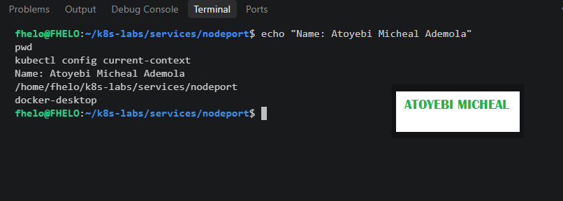

### Notes

**1. What is the difference between ClusterIP and NodePort?**

ClusterIP exposes a Service using an internal IP address that is accessible only within the Kubernetes cluster. NodePort exposes a Service through a specific port on every Kubernetes node, allowing access from outside the cluster when the node network is reachable.

**2. What does a NodePort Service allow users to do?**

A NodePort Service allows users and external systems to access an application running inside a Kubernetes cluster using a node's IP address and the assigned NodePort, without requiring a cloud LoadBalancer.

---

# Task 2 — Create a Healthy NGINX Deployment

## Goal

Create a healthy NGINX Deployment that can act as the backend for the NodePort Service.

### Evidence

#### Screenshot 2 — Completed `00-nginx-deploy.yaml` manifest

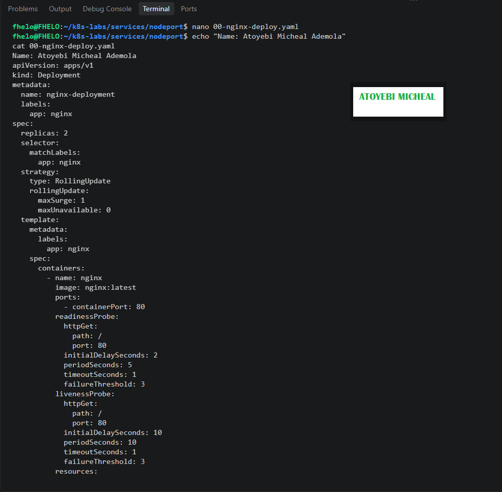

---

#### Screenshot 3 — Output showing successful rollout and two ready NGINX Pods

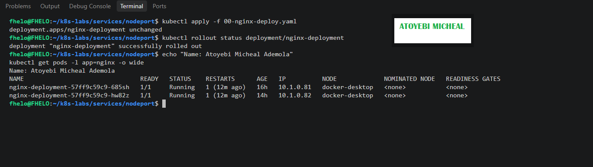

### Notes

**1. Which label will the NodePort Service use to find the NGINX Pods?**

The NodePort Service will use the label app: nginx to identify and select the NGINX Pods.

**2. Why must the Pods be ready before they can receive Service traffic?**

Pods must be ready to ensure they can successfully handle incoming requests. Kubernetes uses readiness probes to determine whether a Pod should be included as a ready Service endpoint.

**3. What port does the NGINX container listen on?**

The NGINX container listens on port 80.

---

# Task 3 — Create the NodePort Service

## Goal

Create a NodePort Service that exposes the NGINX application through a port on every cluster node.

### Evidence

#### Screenshot 4 — Completed `01-nginx-svc-nodeport.yaml` manifest

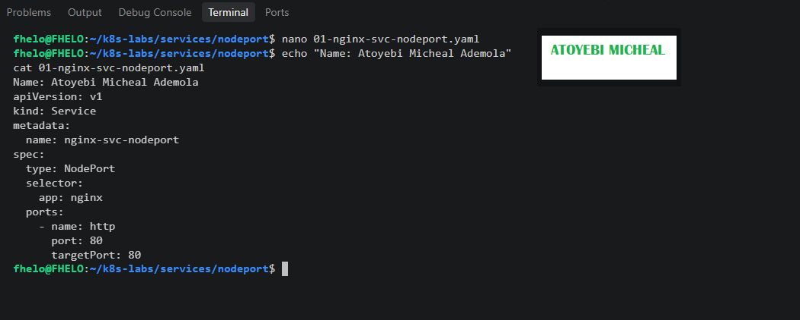

---

#### Screenshot 5 — Output showing the NodePort Service and its endpoints or EndpointSlices

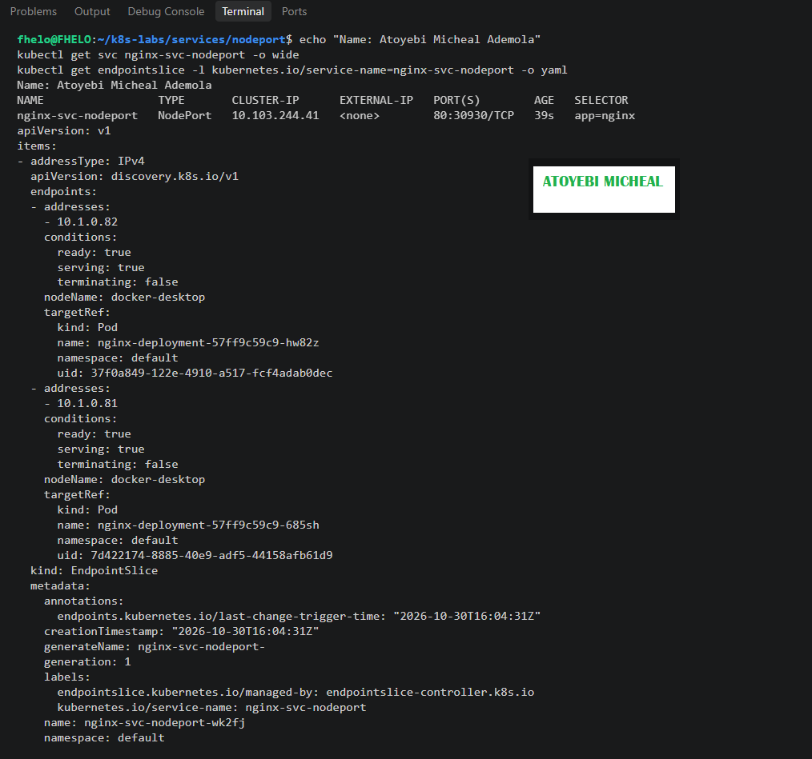

### Notes

**1. What is the purpose of `type: NodePort`?**

The purpose of type: NodePort is to expose a Kubernetes Service through a specific port on every cluster node, allowing external users and systems to access applications running inside the cluster when the node network is reachable.

**2. What is the difference between `port`, `targetPort`, and `nodePort`?**

Port: The port exposed by the Service for communication within the Kubernetes cluster.

TargetPort: The port on the backend NGINX Pods where the application receives traffic.

NodePort: The port opened on each Kubernetes node that allows access to the Service from outside the cluster.

**3. What NodePort was assigned or selected in your environment?**

Kubernetes automatically assigned 30930 as the NodePort for my nginx-svc-nodeport Service.

My Service configuration shows 80:30930/TCP, meaning port 80 is the Service port and 30930 is the externally exposed NodePort.

**4. Why do Service endpoints need ready Pods?**

Service endpoints need ready Pods to ensure that traffic is routed only to application instances that are healthy and prepared to handle requests. This prevents traffic from reaching unavailable or unhealthy Pods and improves application reliability.

---

# Task 4 — Find a Node IP and Test the NodePort

## Goal

Find a reachable node IP and access the NodePort Service.

### Evidence

#### Screenshot 6 — Output of `kubectl get nodes -o wide`

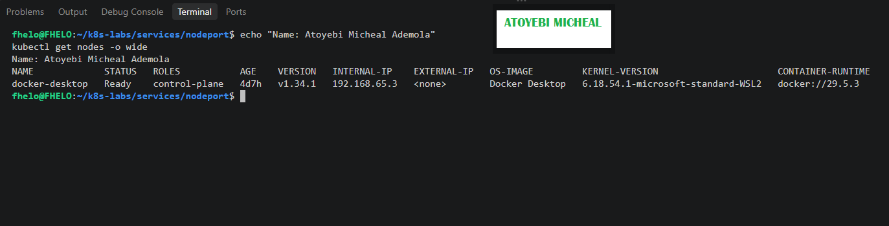

---

#### Screenshot 7 — Output showing the `tester` Pod running

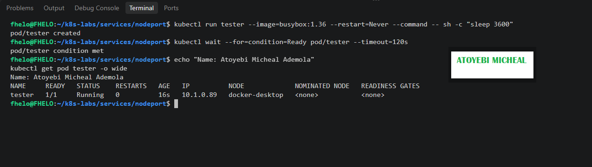

---

#### Screenshot 8 — Successful NodePort response from the laptop or the `tester` Pod

If neither route is supported by your environment, include the failed request output and ready endpoint evidence, and explain the limitation in your Notes.

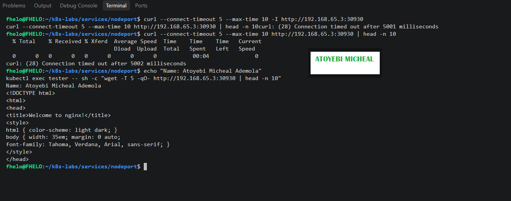

### Notes

**1. Which node IP and NodePort did you test?**

I tested using node IP 192.168.65.3 and NodePort 30930.

**2. Was your laptop able to reach the NodePort directly? Explain your result.**

No. My laptop could not directly access the NodePort because the connection timed out. However, I successfully accessed the NGINX application from inside the Kubernetes cluster using the tester Pod. This demonstrates that Docker Desktop's networking environment restricted direct access through the node IP.

**3. Why can external NodePort access behave differently in Minikube, kind, Docker Desktop, and cloud clusters?**

External NodePort access depends on each Kubernetes environment's networking architecture, node IP accessibility, firewall rules, NAT configuration, and network routing. Minikube, kind, and Docker Desktop may require additional networking configuration, while cloud clusters may provide externally reachable node IPs depending on their network and security settings.

---

# Task 5 — Optional: Test the Label-Selector Contract

## Goal

Break the Service selector, observe that usable endpoints disappear, and restore the correct selector.

Complete the Evidence and Notes below only if you attempted this optional task.

### Evidence

#### Screenshot 9 — `02-nginx-svc-selector-broken.yaml` showing the incorrect selector

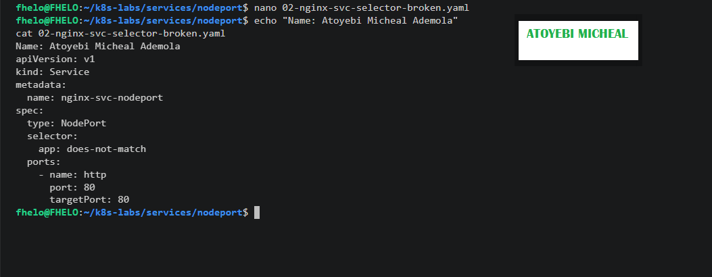

---

#### Screenshot 10 — Empty endpoints or EndpointSlice output after applying the broken selector

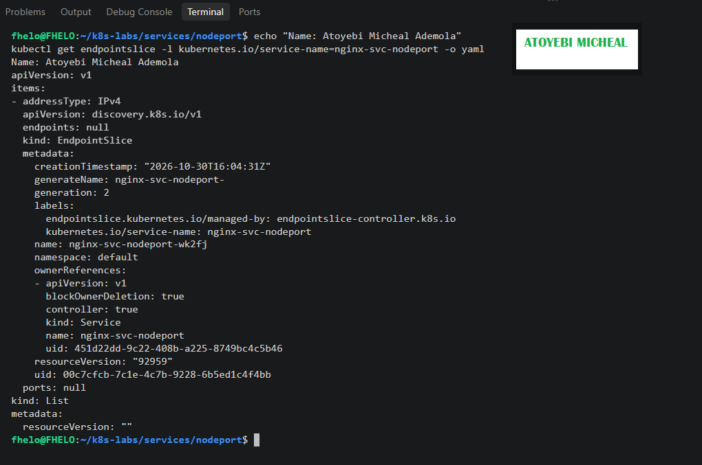

---

#### Screenshot 11 — Restored endpoints or EndpointSlices after applying the original Service manifest

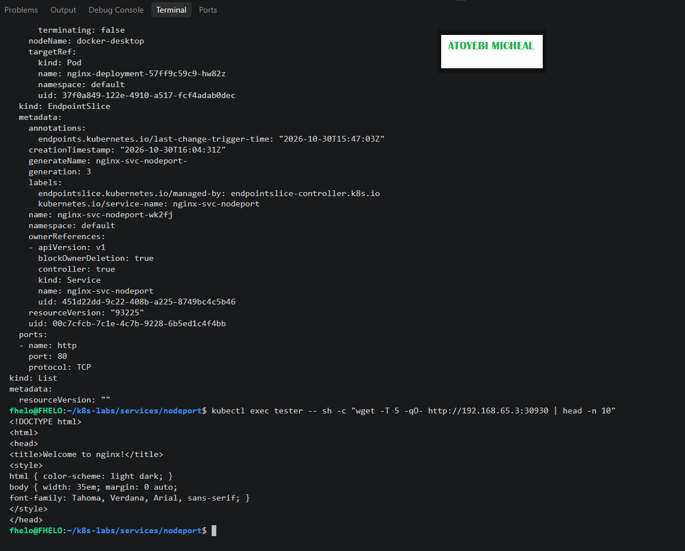

### Notes

**1. Why did the Service endpoints become empty?**

AThe Service endpoints became empty because the Service selector was changed from app: nginx to app: does-not-match. This no longer matched the labels on the NGINX Pods, so Kubernetes could not find any matching backend Pods.

**2. Why is NodePort only useful when matching ready Pods exist?**

NodePort needs matching ready backend Pods to forward incoming traffic successfully. Without ready endpoints, the Service has nowhere to send requests, resulting in failed connections.

**3. How did you restore the backend connectivity?**

I restored connectivity by applying the original Service manifest using kubectl apply -f 01-nginx-svc-nodeport.yaml. This restored the correct selector app: nginx, allowing Kubernetes to rediscover the two ready NGINX Pods as Service endpoints. I then tested the NodePort again and successfully received the NGINX welcome page.

---

# Task 6 — Observe Resilience During Pod Churn

## Goal

Delete one NGINX Pod and observe its replacement while the Service continues routing traffic to available Pods.

### Evidence

#### Screenshot 12 — Output of the Pod deletion command

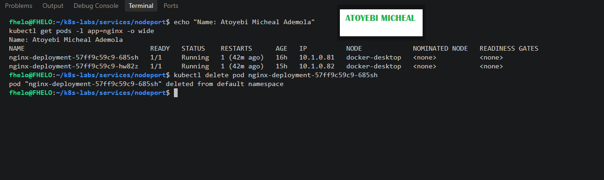

---

#### Screenshot 13 — Output showing the replacement Pod and two running, ready Pods

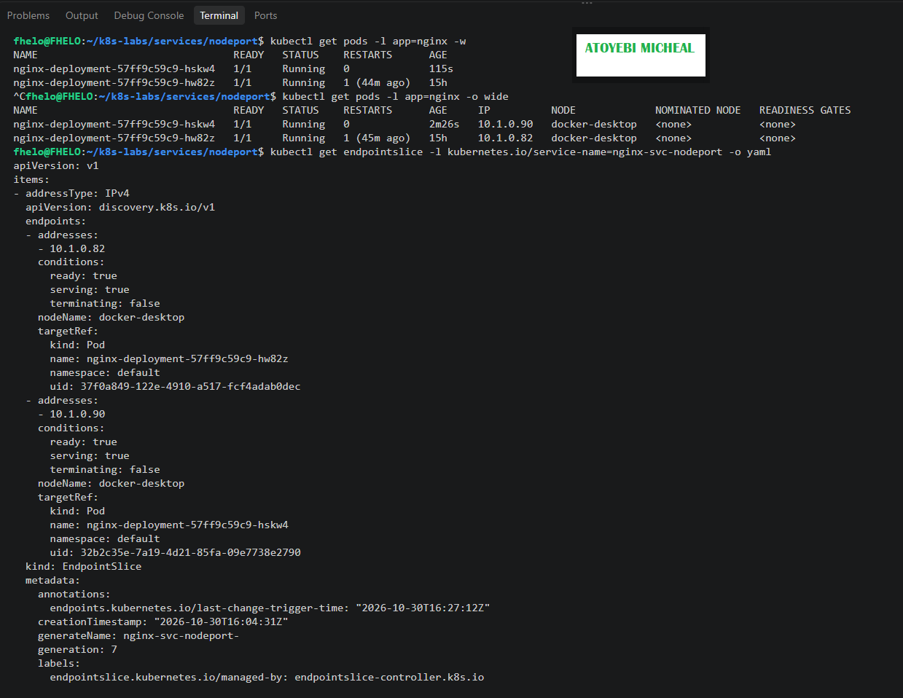

### Notes

**1. What happened after you deleted one Pod?**

After deleting one NGINX Pod, Kubernetes automatically created a replacement Pod to maintain the Deployment's desired replica count of two. The replacement became Running and Ready, while the existing Pod continued running.

**2. Which Kubernetes resource created the replacement Pod?**

The ReplicaSet created the replacement Pod. The ReplicaSet is managed by the Deployment and ensures that the desired number of Pod replicas is maintained.

**3. Why can the NodePort Service continue working during Pod churn?**

The NodePort Service can continue working because it automatically routes traffic to available ready backend Pods. When one Pod is deleted, the remaining healthy Pod can continue receiving traffic while Kubernetes creates a replacement and updates the Service endpoints.

---

# Task 7 — Share Your NodePort Learning on LinkedIn

## Goal

Share what you learned about NodePort Services, backend Pods, and network access in your Kubernetes environment.

### Evidence

#### Screenshot 14 — Published LinkedIn post about your NodePort Service lab

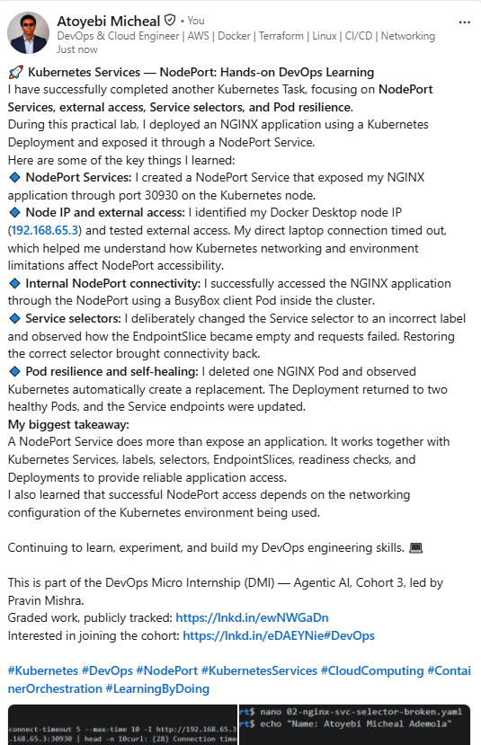

#### Linkedin post link

https://www.linkedin.com/signup/cold-join?session_redirect=https%3A%2F%2Fwww%2Elinkedin%2Ecom%2Ffeed%2Fupdate%2Furn%3Ali%3AugcPost%3A7521973434105606144%3FhighlightedUpdateUrn%3Durn%253Ali%253Aactivity%253A7521973435342721025%26highlightedUpdateType%3DSOCIAL_SHARE%26origin%3DSOCIAL_SHARE%26utm_source%3Dsocial_share_send%26utm_medium%3Dmember_desktop_web%26rcm%3DACoAADFvgDYBsnsyE66xAyq2HzH3Jfsf19WE6JA

---

# Submission Instructions

- Include the completed YAML manifests created during the lab.
- Add all required screenshots: Screenshots 1–8 and 12–14.
- Include Screenshots 9–11 only if you attempted optional Task 5.
- Complete the Notes for Tasks 1–4 and Task 6.
- Complete Task 5 Notes only if you attempted that task.
- Use clear, readable screenshots showing the relevant commands and outputs.
- Ensure your full name is visible in the required screenshots.
- If NodePort access is restricted by your environment, include the failed request output, ready endpoint evidence, and an explanation.
- Do not expose passwords, access tokens, private keys, kubeconfig contents, or account IDs.

---

# Completion Checklist

- [ ] Created and entered `~/k8s-labs/services/nodeport` (Screenshot 1)
- [ ] Created and applied the NGINX Deployment manifest (Screenshot 2)
- [ ] Confirmed successful rollout and two ready NGINX Pods (Screenshot 3)
- [ ] Created the NodePort Service manifest (Screenshot 4)
- [ ] Verified the Service and its endpoints or EndpointSlices (Screenshot 5)
- [ ] Recorded the assigned or selected NodePort
- [ ] Identified a node IP (Screenshot 6)
- [ ] Confirmed that the `tester` Pod is running (Screenshot 7)
- [ ] Tested NodePort access, or documented the environment limitation with evidence (Screenshot 8)
- [ ] Optional: Tested and restored the Service selector (Screenshots 9–11)
- [ ] Deleted one NGINX Pod (Screenshot 12)
- [ ] Confirmed the replacement Pod and two running, ready Pods (Screenshot 13)
- [ ] Completed all required Notes
- [ ] Published the LinkedIn post (Screenshot 14)
- [ ] No sensitive data exposed

---

## 📌 About DMI & CloudAdvisory

DevOps Micro Internship (DMI) is a project-based DevOps program run by Pravin Mishra (The CloudAdvisory) focused on real-world execution, systems thinking, and career readiness.

It helps learners build strong DevOps foundations with hands-on experience.

---

## 📌 Resources

- 🌐 DMI Official Website: https://dmi.pravinmishra.com?utm_source=github&utm_medium=readme  
- 🎓 University: https://university.pravinmishra.com?utm_source=github&utm_medium=readme  
- 💬 Discord Community: https://discord.pravinmishra.com?utm_source=github&utm_medium=readme  
- 📝 Blog: https://dmi.pravinmishra.com/blog?utm_source=github&utm_medium=readme  
- ▶️ YouTube Playlist: https://www.youtube.com/playlist?list=PLFeSNDtI4Cho  
- 🔗 Pravin Mishra (LinkedIn): https://www.linkedin.com/in/pravin-mishra-aws-trainer/  
- 🏢 CloudAdvisory (LinkedIn): https://www.linkedin.com/company/thecloudadvisory/

---

*This submission is part of DevOps Micro Internship (DMI) — Agentic AI Track.*
