# Assignment 09 — Kubernetes Services: LoadBalancer on AKS

Part of the DevOps Micro Internship (DMI) with Agentic AI

---

## Purpose

Deploy a healthy NGINX application to Azure Kubernetes Service (AKS), expose it publicly using a LoadBalancer Service, observe readiness behavior, and scale the application behind the same public endpoint.

---

# Task 1 — Create or Connect to an AKS Cluster

## Goal

Create a small AKS cluster for this lab, or connect to an existing approved AKS lab cluster.

### Evidence

#### Screenshot 1 — Output of `kubectl get nodes` showing ready AKS node(s)

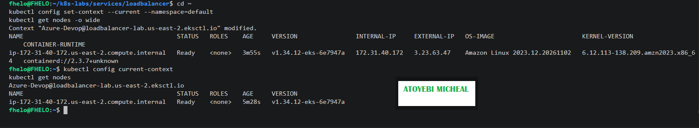

### Notes

**1. Why does this lab use a cloud-capable Kubernetes environment such as AKS for the LoadBalancer Service?**

This lab uses a cloud-capable Kubernetes environment because a LoadBalancer Service needs integration with a cloud provider to create an external load balancer. In my case, I used AWS EKS, which integrates Kubernetes with AWS networking services to make the application accessible from outside the cluster.

**2. What Azure resources can Kubernetes provision when a LoadBalancer Service is created?**

In Azure, Kubernetes can provision an Azure Load Balancer and a public IP address. It also configures the necessary load-balancing rules, backend pool and health probes to distribute incoming traffic to the application Pods.

In my AWS EKS implementation, the equivalent integration provisions an AWS load balancer and configures the required networking components to route external traffic to the Kubernetes Service.

**3. Why is it important to delete unused AKS resources after the lab?**

It is important to delete unused cloud resources because they can continue generating charges even when they are no longer being used. Removing the cluster, worker nodes, load balancers and associated resources helps control costs, prevent unnecessary resource consumption and keep the AWS account organised.

---

# Task 2 — Set Up Your Lab Directory

## Goal

Create and enter a dedicated directory for the LoadBalancer Service manifests.

### Evidence

#### Screenshot 2 — Terminal showing the output of `pwd` confirming that you are working inside `~/k8s-labs/services/loadbalancer`

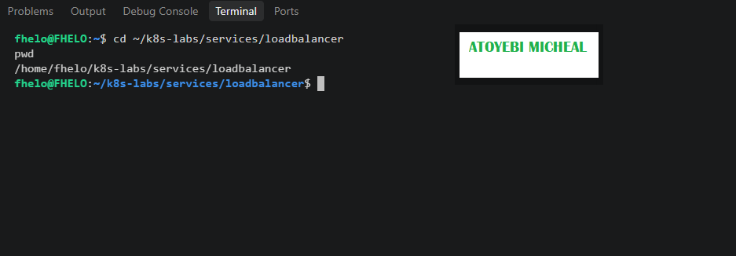

### Notes

**1. Why is it useful to keep Kubernetes manifests organized in dedicated directories?**

Keeping Kubernetes manifests in dedicated directories makes project files easier to manage, locate and maintain. It also helps separate different Kubernetes resources and assignments, reducing confusion and making troubleshooting more efficient.

**2. What are the names of the main Deployment and LoadBalancer Service YAML files you will create in this assignment?**

Deployment manifest: nginx-deployment.yaml

LoadBalancer Service manifest: nginx-loadbalancer-service.yaml

---

# Task 3 — Deploy a Healthy NGINX Application

## Goal

Create a healthy NGINX Deployment with readiness and liveness probes.

### Evidence

#### Screenshot 3 — Completed `00-nginx-deploy.yaml` manifest

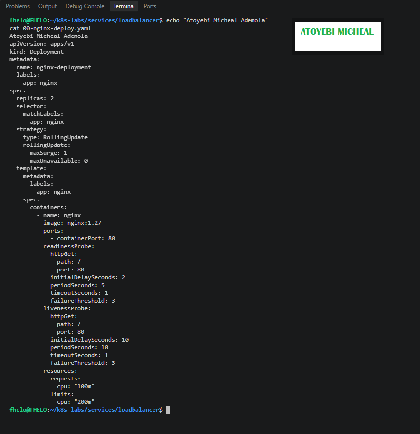

---

#### Screenshot 4 — Output showing successful rollout and two ready NGINX Pods

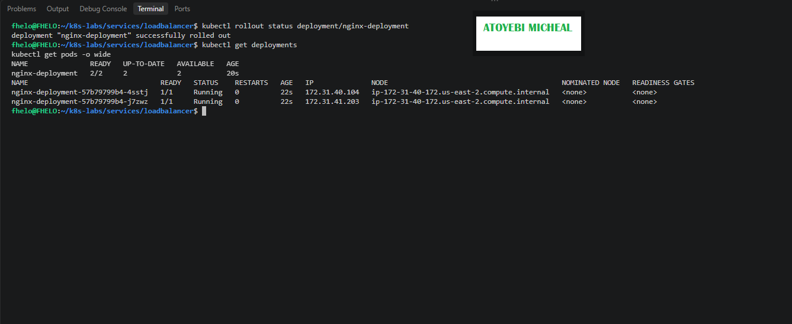

### Notes

**1. Why must Pods be ready before they should receive public traffic?**

Pods must be ready before receiving public traffic to ensure the application is healthy and capable of handling requests. This prevents traffic from reaching Pods that are still starting or experiencing problems.

**2. What is the role of the readiness probe in this Deployment?**

The readiness probe checks whether the NGINX application is ready to receive traffic. When the probe fails, Kubernetes marks the Pod as not ready and removes it from the Service's available endpoints until it becomes healthy again.

**3. What is the role of the liveness probe in this Deployment?**

The liveness probe checks whether the NGINX container is functioning correctly. If it repeatedly fails, Kubernetes restarts the container to restore the application automatically.

---

# Task 4 — Create and Test the LoadBalancer Service

## Goal

Create a public LoadBalancer Service and verify that the NGINX application is reachable from the internet.

### Evidence

#### Screenshot 5 — Completed `01-nginx-svc-loadbalancer.yaml` manifest

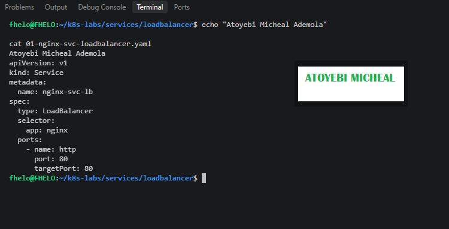

---

#### Screenshot 6 — Output showing the Service with an assigned EXTERNAL-IP

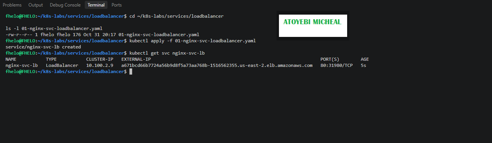

---

#### Screenshot 7 — Successful curl output from the public IP

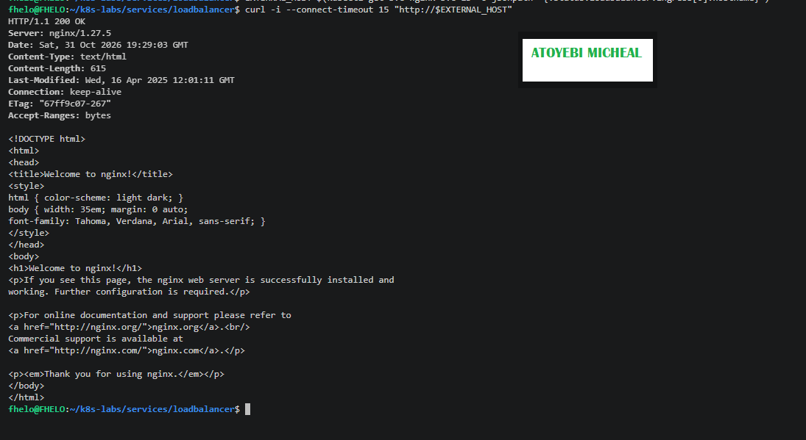

### Notes

**1. What does `type: LoadBalancer` instruct AKS to do?**

It instructs Kubernetes to request an external load balancer from the cloud provider. In my AWS EKS implementation, this created an AWS Elastic Load Balancer that exposes the NGINX application to external traffic through a public endpoint.

**2. What public IP was assigned to your Service?**

AWS assigned the following external DNS hostname to my nginx-svc-lb Service:

a671bcd66b7724a56b9d8f5a73aa768b-1516562355.us-east-2.elb.amazonaws.com
This is a DNS hostname, not a direct public IP address.

**3. How does the public request eventually reach the NGINX Pods?**

A public request first reaches the AWS load balancer through its external DNS hostname. The load balancer forwards the traffic to the Kubernetes Service, which uses its selector (app: nginx) to direct requests to the available and ready NGINX Pods on port 80.

**4. Why should you wait for EXTERNAL-IP before testing the Service?**

It is important to wait until the external address is assigned because AWS needs time to provision and configure the load balancer. Testing before this process is complete may result in connection failures because the public endpoint might not yet be available.

---

# Task 5 — Observe How Readiness Protects Public Traffic

## Goal

Intentionally break readiness and observe how Kubernetes excludes unready Pods from ready Service backends while existing healthy Pods continue serving public traffic.

### Evidence

#### Screenshot 8 — Completed `02-readiness-broken.yaml` patch file

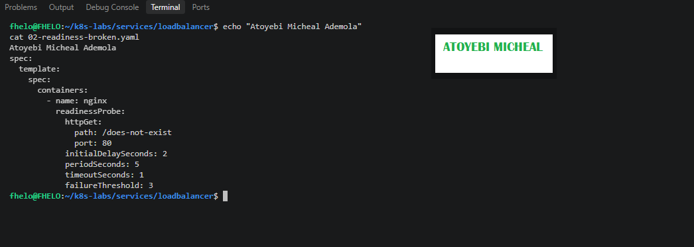

---

#### Screenshot 9 — Output showing the expected incomplete rollout or readiness failure

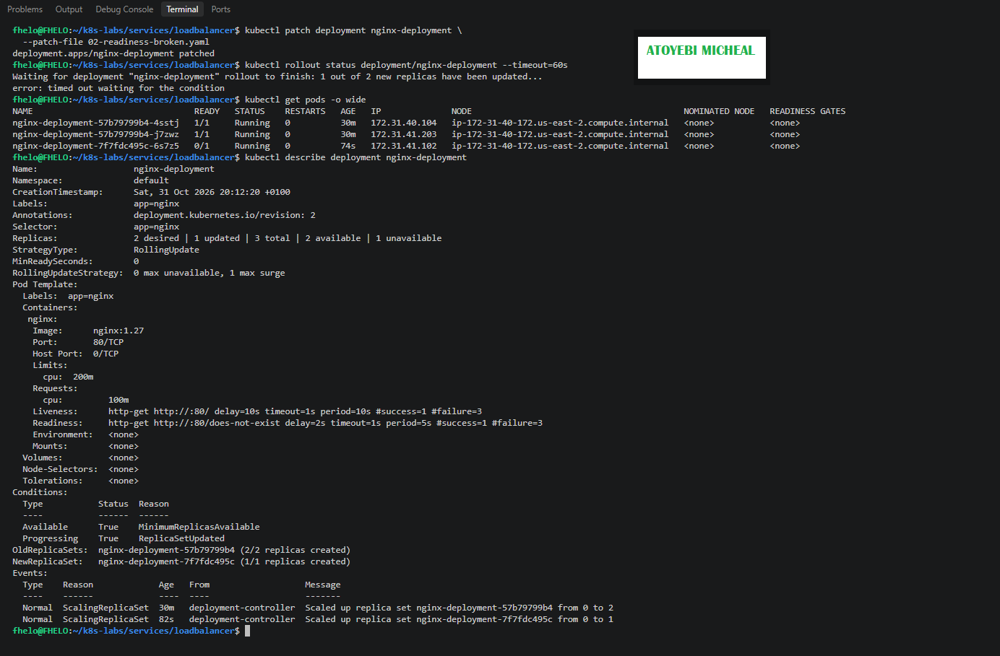

---

#### Screenshot 10 — EndpointSlice output showing ready healthy backends and the effect of the readiness failure

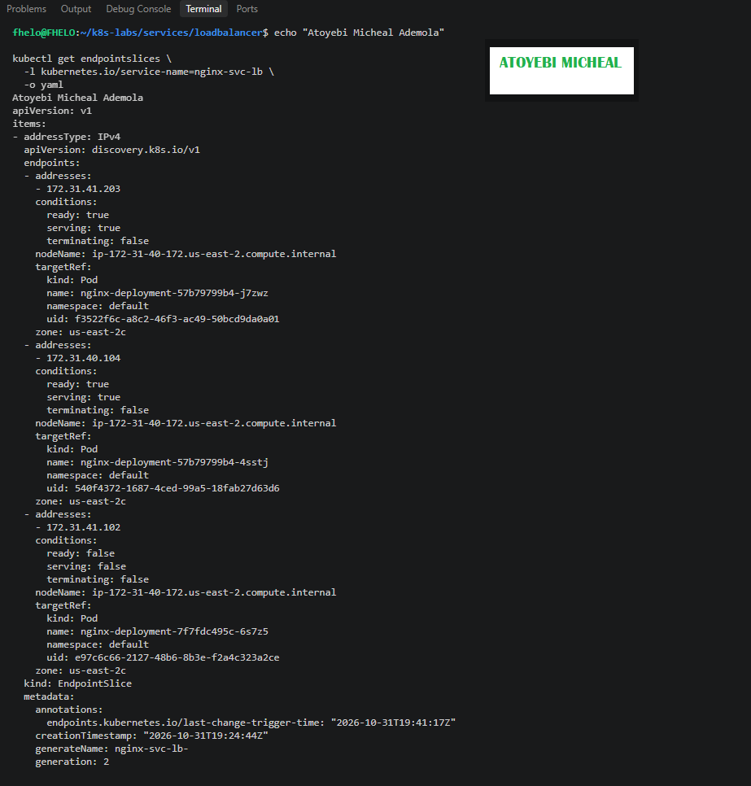

---

#### Screenshot 11 — Successful public curl response after recovery

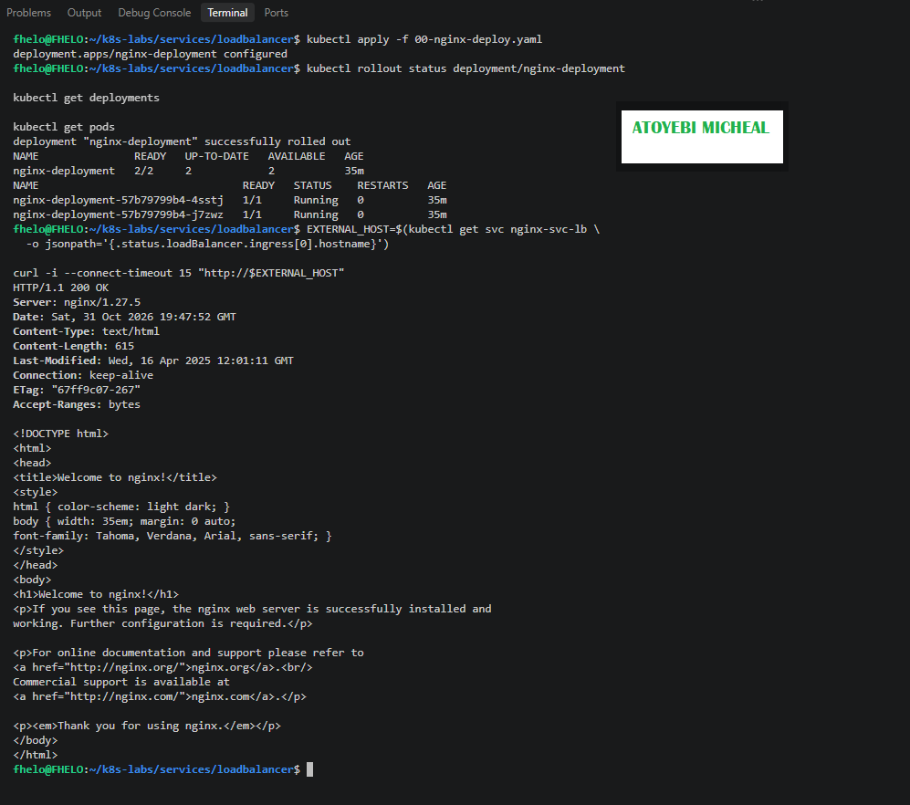

### Notes

**1. Why did the rollout not complete?**

The rollout did not complete because the newly created NGINX Pod failed its readiness probe. I deliberately configured the readiness probe to check /does-not-exist, which returned an unsuccessful HTTP response. Kubernetes therefore could not mark the new Pod as ready.

**2. Why can the public endpoint still work while new Pods fail readiness?**

The public endpoint continued working because the two existing healthy NGINX Pods remained available. Kubernetes excluded the unready Pod from the ready Service endpoints and continued directing traffic to the healthy Pods.

**3. What would happen if Kubernetes routed traffic to Pods before they were ready?**

Users could experience failed HTTP requests, application errors or service interruptions because the Pods might not be ready to handle incoming traffic.

**4. How did you restore the Deployment successfully?**

I reapplied the original 00-nginx-deploy.yaml manifest, which restored the readiness probe path to /. I then verified that the Deployment successfully rolled out with two ready Pods and tested the public endpoint using curl, which returned HTTP 200 OK.

---

# Task 6 — Scale the Deployment Behind the Load Balancer

## Goal

Scale the NGINX Deployment and confirm that more ready Pods become available behind the same public endpoint.

### Evidence

#### Screenshot 12 — Two ready NGINX Pods verified initially; four ready Pods verified after scaling

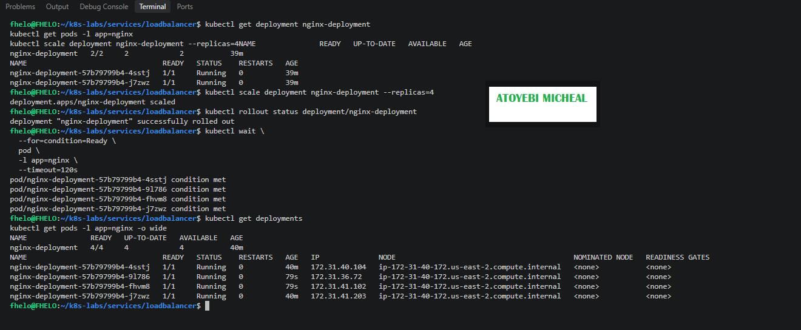

---

#### Screenshot 13 — Successful public curl response after scaling

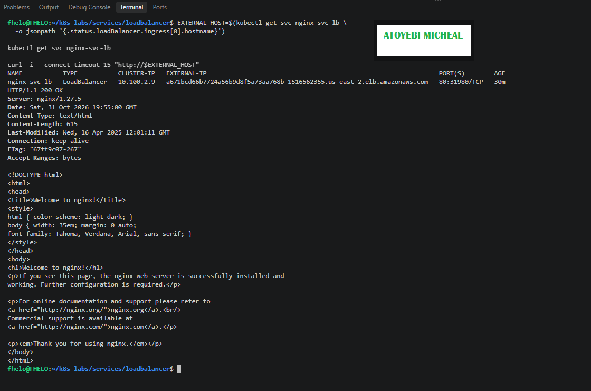

### Notes

**1. What changed after scaling the Deployment from two to four replicas?**

The number of NGINX Pods increased from two to four. Kubernetes created two additional Pods, and all four became ready and available. This increased the application's capacity to handle incoming requests.

**2. Did the public IP change after scaling? Explain why or why not.**

No. The external DNS hostname remained unchanged because I scaled the existing Deployment without deleting or recreating the LoadBalancer Service. The same AWS load balancer continued exposing the application.

**3. Why does scaling behind a LoadBalancer Service not require users to change the URL or IP they use?**

The LoadBalancer Service provides a stable external endpoint independent of the number of application Pods. Kubernetes automatically updates the Service's backend endpoints as Pods are added or removed, allowing users to continue accessing the application through the same hostname.

---

# Task 7 — Share Your LoadBalancer Lab on LinkedIn

## Goal

Share what you learned about exposing an NGINX application publicly through a LoadBalancer Service on AKS.

### Evidence

#### Screenshot 14 — Published LinkedIn post about your LoadBalancer lab on AKS

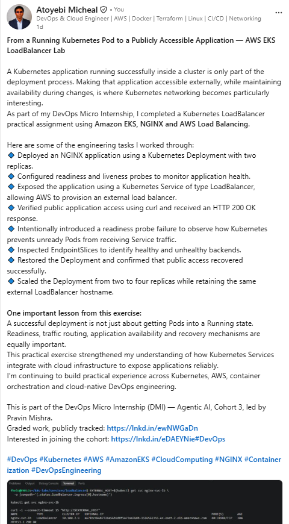

#### LinkedIn post link

https://www.linkedin.com/posts/aamicheal_devops-kubernetes-aws-share-7522387597587914752-UJav/?utm_source=social_share_send&utm_medium=member_desktop_web&rcm=ACoAADFvgDYBsnsyE66xAyq2HzH3Jfsf19WE6JA

---

# Submission Instructions

- Include the completed YAML files:
  - `00-nginx-deploy.yaml`
  - `01-nginx-svc-loadbalancer.yaml`
  - `02-readiness-broken.yaml`
- Add all required screenshots, numbered 1–14, under their corresponding Evidence sections.
- Use clear, readable screenshots showing the relevant commands, configuration, and outputs.
- Ensure your full name is visible in the required screenshots.
- Complete the Notes for Tasks 1–6 in your own words.
- Capture all required evidence before cleaning up Azure resources.
- Plan or complete Azure cleanup according to your lab ownership and reuse arrangements.
- Do not expose passwords, tokens, private keys, cluster credentials, kubeconfig contents, subscription IDs, account IDs, or infrastructure details you are not permitted to share.

---

# Completion Checklist

- [ ] Created or connected to an approved AKS lab cluster
- [ ] Confirmed ready AKS node(s) (Screenshot 1)
- [ ] Created and entered the LoadBalancer lab directory (Screenshot 2)
- [ ] Created the NGINX Deployment manifest (Screenshot 3)
- [ ] Verified successful rollout and two ready NGINX Pods initially (Screenshot 4)
- [ ] Created the LoadBalancer Service manifest (Screenshot 5)
- [ ] Verified the assigned external IP (Screenshot 6)
- [ ] Verified successful public access using curl (Screenshot 7)
- [ ] Created the broken readiness patch (Screenshot 8)
- [ ] Observed the expected incomplete rollout or readiness failure (Screenshot 9)
- [ ] Inspected EndpointSlices during the readiness failure (Screenshot 10)
- [ ] Restored the healthy Deployment and verified public access (Screenshot 11)
- [ ] Scaled the Deployment to four ready Pods and verified updated Service backends (Screenshot 12)
- [ ] Verified public access after scaling (Screenshot 13)
- [ ] Completed the Notes for Tasks 1–6
- [ ] Published the LinkedIn post (Screenshot 14)
- [ ] Included all required YAML files and screenshots
- [ ] Planned or completed Azure cleanup
- [ ] No sensitive data exposed

---

## 📌 About DMI & CloudAdvisory

DevOps Micro Internship (DMI) is a project-based DevOps program run by Pravin Mishra (The CloudAdvisory) focused on real-world execution, systems thinking, and career readiness.

It helps learners build strong DevOps foundations with hands-on experience.

---

## 📌 Resources

- 🌐 DMI Official Website: https://dmi.pravinmishra.com?utm_source=github&utm_medium=readme  
- 🎓 University: https://university.pravinmishra.com?utm_source=github&utm_medium=readme  
- 💬 Discord Community: https://discord.pravinmishra.com?utm_source=github&utm_medium=readme  
- 📝 Blog: https://dmi.pravinmishra.com/blog?utm_source=github&utm_medium=readme  
- ▶️ YouTube Playlist: https://www.youtube.com/playlist?list=PLFeSNDtI4Cho  
- 🔗 Pravin Mishra (LinkedIn): https://www.linkedin.com/in/pravin-mishra-aws-trainer/  
- 🏢 CloudAdvisory (LinkedIn): https://www.linkedin.com/company/thecloudadvisory/

---

*This submission is part of DevOps Micro Internship (DMI) — Agentic AI Track.*
