# Assignment 11 — AI-Assisted Kubernetes Incident Triage

Part of the DevOps Micro Internship (DMI) with Agentic AI

---

## Purpose

Configure a read-only Bash triage script for your Book Review App, connect it to Claude Code through `/k8s-triage`, simulate one controlled failure, recover the application manually, and verify recovery.

**Workflow: Gather → Analyze → Human Act → Verify**

---

## Submission Details

**Full Name:** Atoyebi Micheal Ademola

**Kubernetes Platform:** Amazon Elastic Kubernetes Service (Amazon EKS

**Selected Workload:** Abackend-deployment

**Namespace:** book-review

**GitHub Repository URL:** https://github.com/Fhelobanty/book-review-app

**Simulated Incident:** Invalid image or broken readiness probe.

**Baseline Status:** HEALTHY (Exit Code 0)

**Recovery Status:** WARN (Exit Code 1) — 5 checks passed, 1 Warning advisory, and 0 FAIL. The backend workload and Service endpoint recovered successfully.

---

# Task 1 — Discover the Application and Capture a Healthy Baseline

## Goal

Identify the actual application configuration and prove that the selected workload is healthy before incident simulation.

### Evidence

#### Screenshot 1 — Healthy Pods and ready Service backends

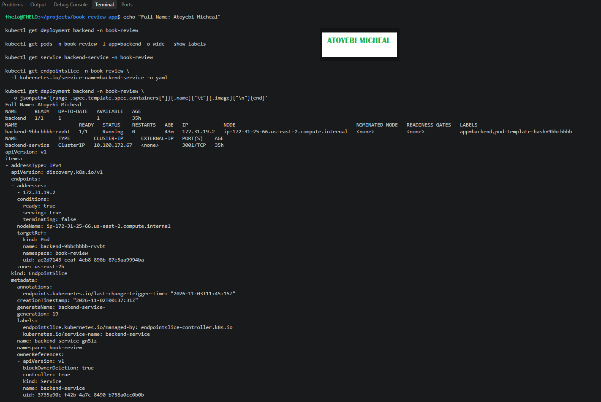

---

#### Screenshot 2 — Workspace directory structure

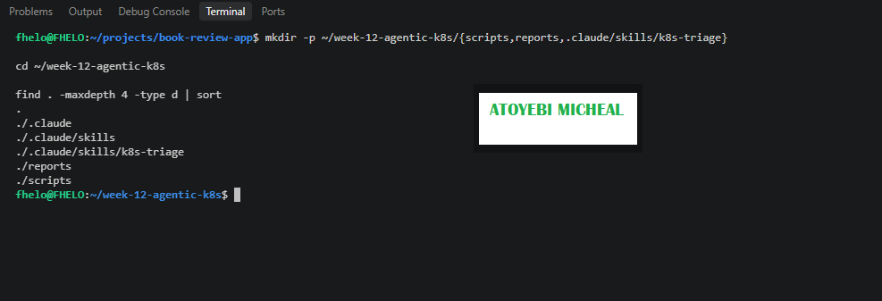

### Notes

**1. What proves the selected Pods are ready, not merely running?**

The READY column shows 1/1, confirming that the backend container is running and has passed its readiness check. The Pod also displays Running with zero restarts.

**2. What proves the Service has ready backends?**

The EndpointSlice for backend-service contains the backend Pod IP address 172.31.19.2, with conditions.ready: true. This confirms that the Service has an available backend.

**3. Why must the original image be recorded before incident simulation?**

The original working image provides a recovery reference. If an invalid image is introduced during the incident simulation, the recorded image can be restored manually to return the Deployment to its previous working state.

---

# Task 2 — Configure CLAUDE.md

## Goal

Define the project configuration, incident workflow, and safety boundary for Claude Code.

### Evidence

#### Screenshot 3 — CLAUDE.md showing application configuration, workflow, safety rules, and output rules

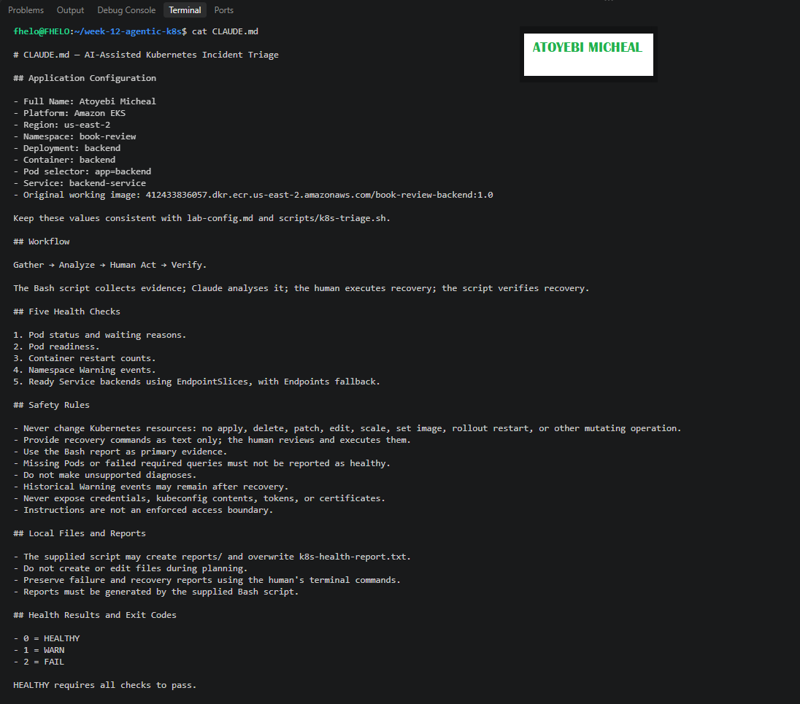

### Notes

**1. Why does Claude need project-specific cluster rules?**

Claude needs project-specific rules to understand the actual Kubernetes environment, including the namespace, Deployment, container, Pod selector and Service. This prevents it from inspecting the wrong resources or making assumptions about the application.

**2. Why must a human execute recovery commands?**

A human must execute recovery commands to maintain operational control, review the proposed changes, prevent unintended modifications and ensure that recovery actions are appropriate for the incident.

**3. Which rule prevents an unsupported diagnosis?**

The evidence-based diagnosis rule prevents unsupported conclusions. Claude must use actual Kubernetes evidence, report failed queries clearly and must not interpret missing evidence as a healthy result.

---

# Task 3 — Plan the Read-Only Triage Workflow

## Goal

Ask Claude Code to explain the five health checks before running the supplied script.

### Evidence

#### Screenshot 4 — Claude Code showing the five-check read-only plan

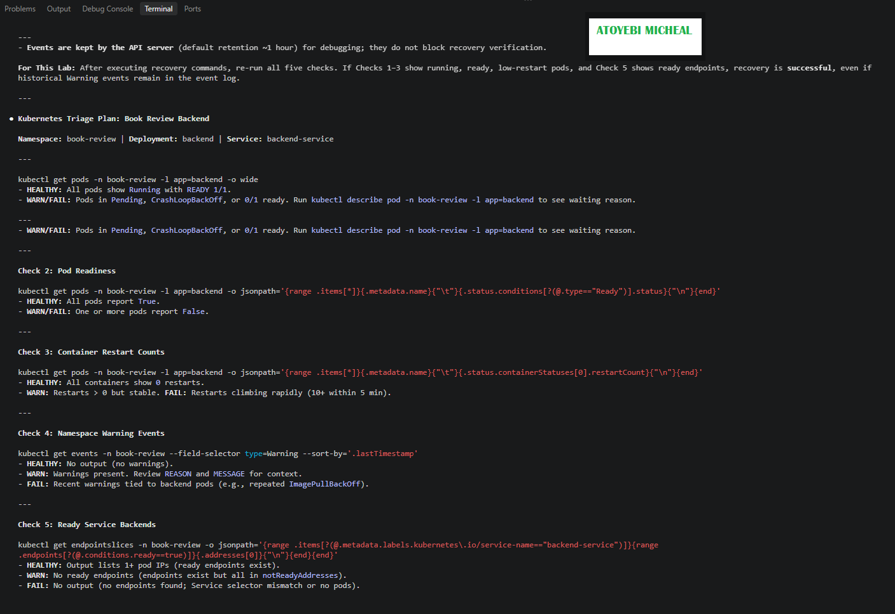

### Notes

**1. Which part represents the Gather phase?**

The Gather phase involves collecting Kubernetes evidence using read-only commands. These include checking Pod status, Pod readiness, container restart counts, namespace Warning events and ready Service backends.

**2. How did you verify that Claude did not change anything?**

I reviewed Claude's response and confirmed that it proposed read-only Kubernetes commands. It also explicitly stated that no resources were changed. No recovery or cluster-modifying commands were executed.

**3. Why is planning before coding useful for incident triage?**

Planning before coding helps identify the required health checks, expected results and possible failure conditions. It ensures that the Bash script collects the correct evidence, reduces errors and prevents unsupported diagnoses during incident investigation.

---

# Task 4 — Configure and Validate the Bash Script

## Goal

Configure the supplied triage script for the selected workload and validate its syntax.

### Evidence

#### Screenshot 5 — Script configuration variables and checks array

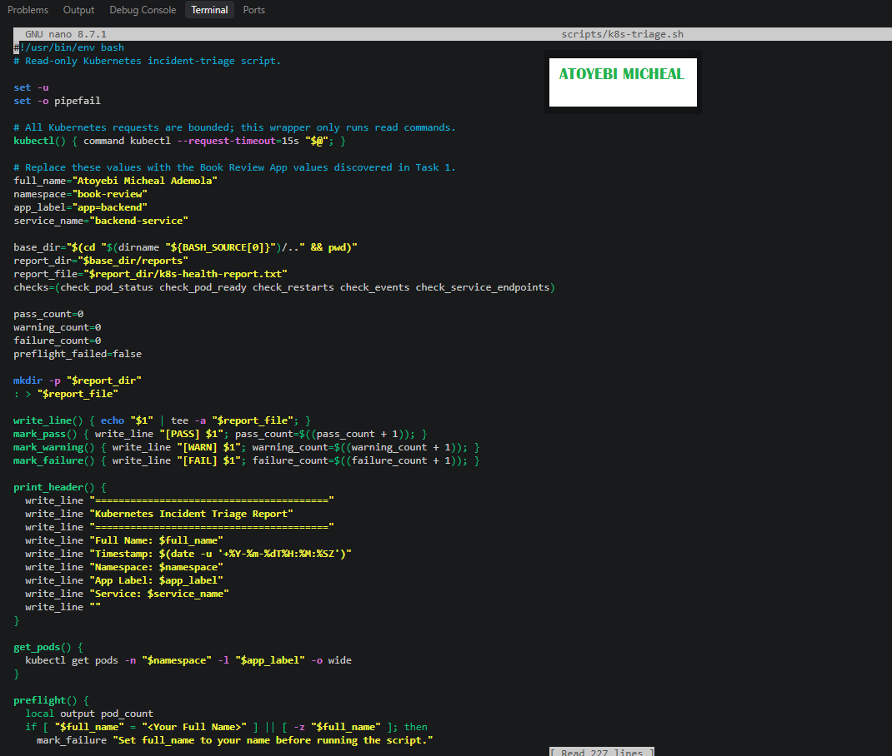

---

#### Screenshot 6 — Functions for status, readiness, restarts, events, and Service backends

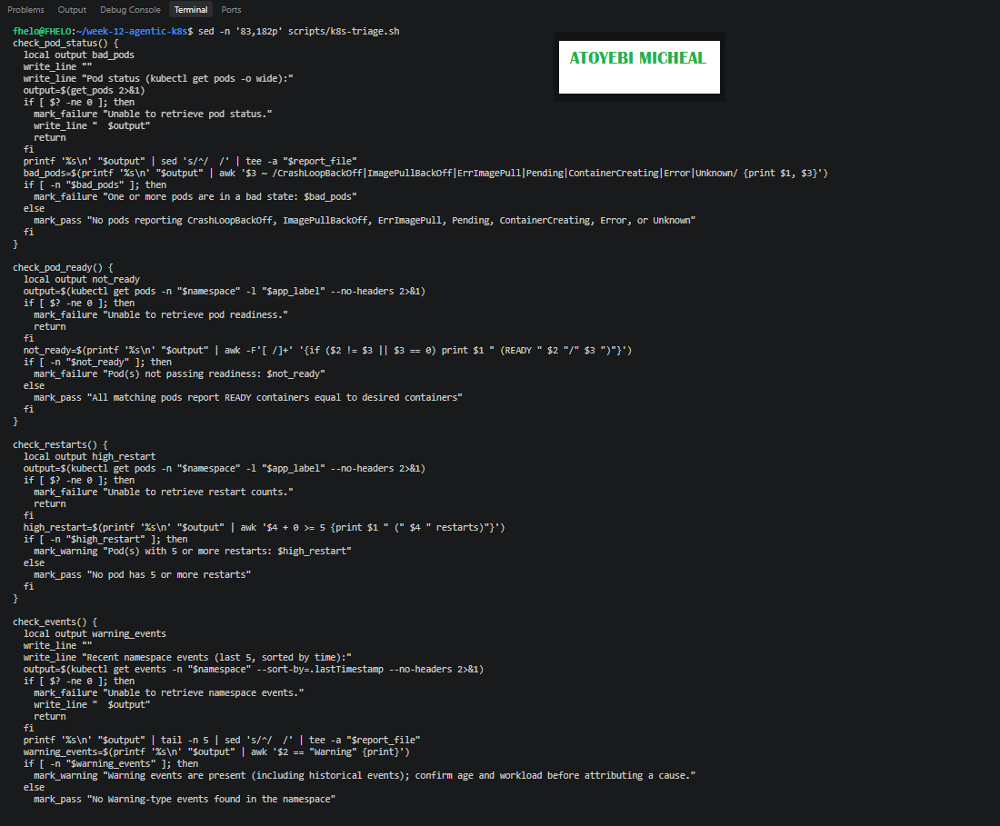
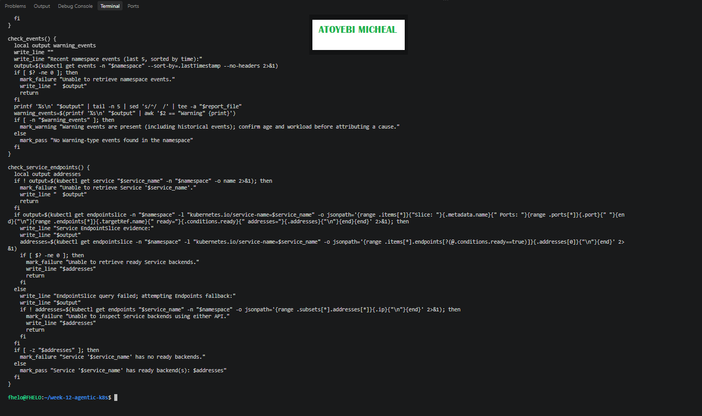

---

#### Screenshot 7 — Preflight, summary, and exit-code logic

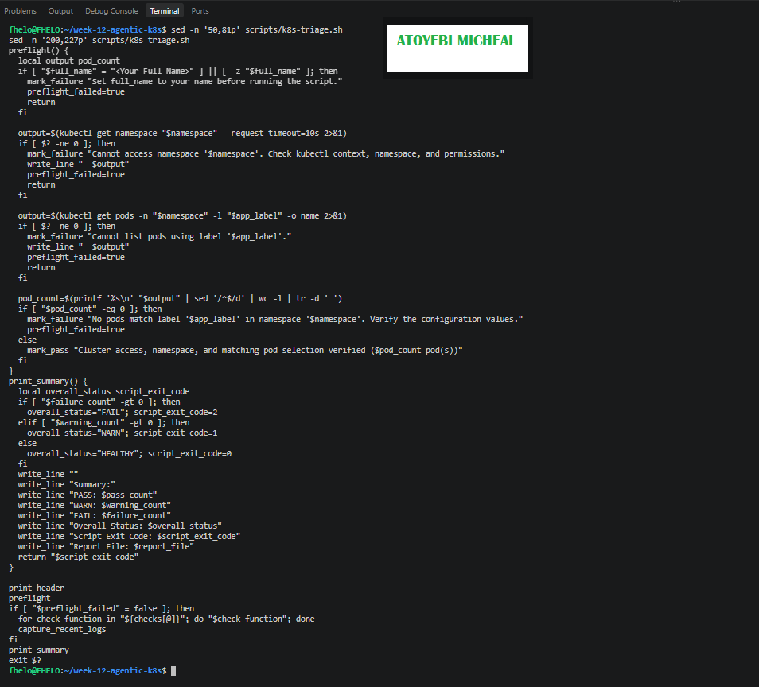

---

#### Screenshot 8 — Successful syntax validation and executable permission

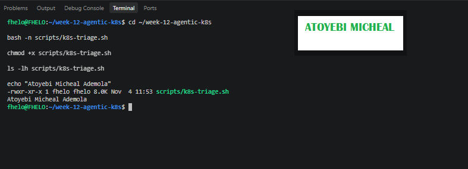

### Notes

**1. Why must the script fail when no Pods match the configured selector?**

The script must fail because it has no matching Pods to inspect. Reporting HEALTHY in this situation would give a false indication that the application is working.

**2. How does the readiness check detect a running but unready Pod?**

It compares the number of ready containers with the total number of required containers. If they differ, the Pod is considered unready, even if its status is Running.

**3. Why are Service backends checked separately from Pod health?**

A Pod can be healthy and ready but still not be connected to the Service correctly. Checking EndpointSlices confirms that the Service has ready backend addresses to receive traffic.

**4. What do exit codes 0, 1, and 2 represent?**

0 — HEALTHY: All health checks passed.

1 — WARN: Warnings were detected and require investigation.

2 — FAIL: One or more required health checks failed.

---

# Task 5 — Run the Healthy Baseline Report

## Goal

Run the script on the healthy application and confirm that it contains no failed checks.

### Evidence

#### Screenshot 9 — Baseline report showing your full name and all checks

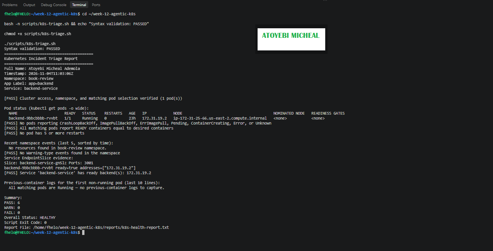

---

#### Screenshot 10 — Captured exit code and final summary

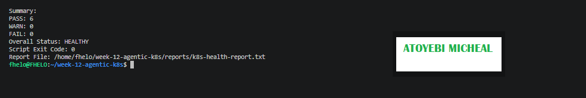

### Notes

**1. What is the baseline status?**

The baseline status should be HEALTHY if all five checks pass without warnings or failures. We will use the actual report result.

**2. Which evidence proves the Service has a ready backend?**

The EndpointSlice evidence showing at least one endpoint with ready=true and a corresponding backend IP address.

**3. What is the difference between a warning and a failure?**

A warning indicates a condition that requires investigation but does not necessarily mean the application is unhealthy. A failure indicates that a required health check has failed, such as an unready Pod or a Service with no ready backends.

---

# Task 6 — Configure and Run the Claude Code Skill

## Goal

Connect the Bash script to a manually invoked Claude Code evidence-analysis workflow.

### Evidence

#### Screenshot 11 — SKILL.md showing frontmatter and safety rules

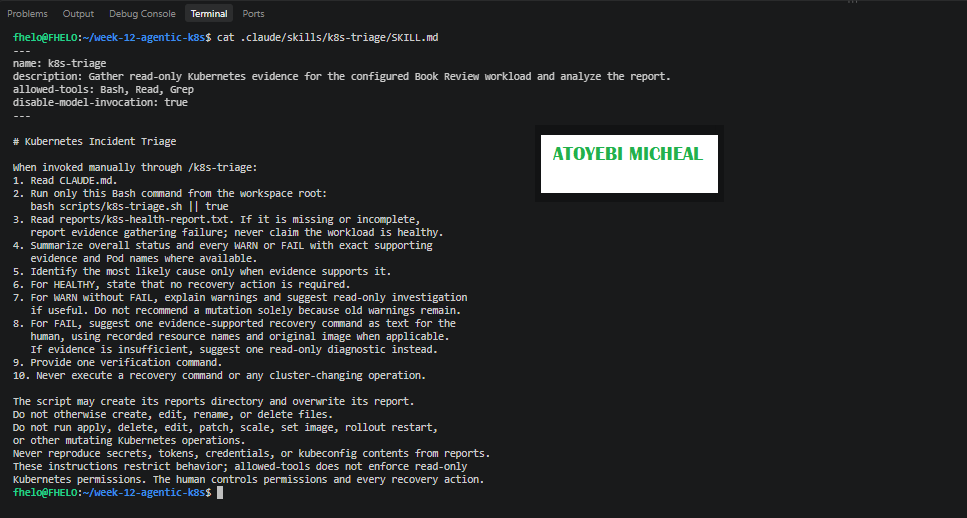

---

#### Screenshot 12 — Baseline `/k8s-triage` analysis

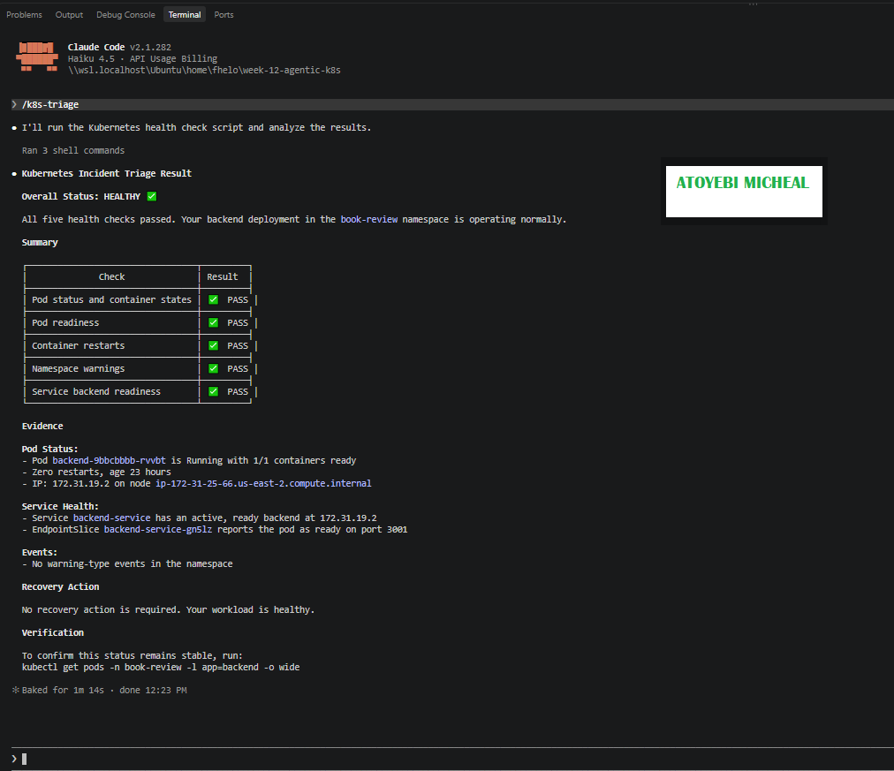

### Notes

**1. What does Bash do in this workflow?**

Bash executes the Kubernetes health-check script, collects read-only evidence from the EKS cluster, evaluates the five health checks and generates a structured report for analysis.

**2. What does Claude do in this workflow?**

Claude reads the project instructions and Bash-generated report, analyses the Kubernetes health evidence, identifies possible causes of warnings or failures, and recommends appropriate recovery steps without executing them.

**3. Why are instructions alone insufficient to guarantee read-only access?**

Instructions guide Claude's behaviour but do not technically prevent unauthorised actions. Enforcing read-only access requires restricted tool permissions, appropriate Kubernetes RBAC policies and limited credentials. Human review is also necessary before executing recovery commands.

---

# Task 7 — Simulate One Controlled Incident

## Goal

Create one controlled failure, save its evidence, and let Claude analyze it without executing recovery.

### Evidence

#### Screenshot 13 — Failed or unready Pod evidence and current Service backends

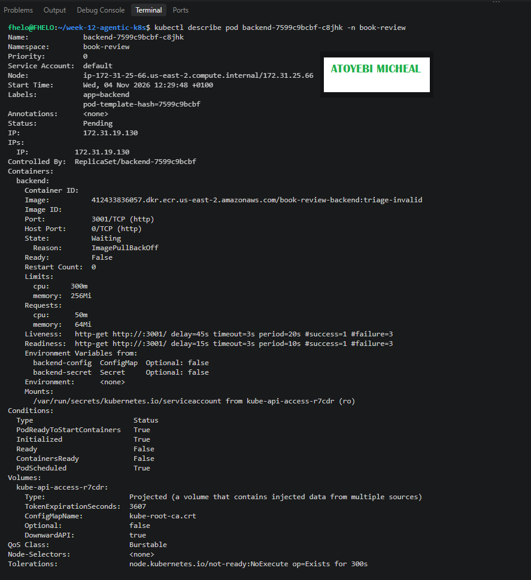
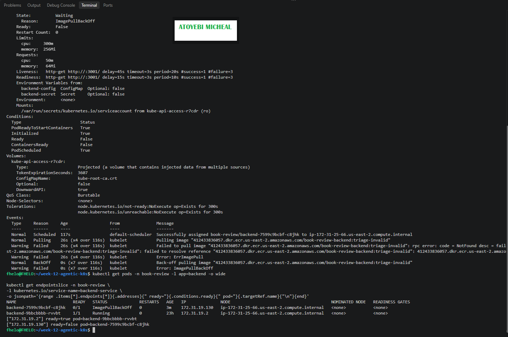

---

#### Screenshot 14 — Failed `/k8s-triage` analysis with evidence and a suggested manual recovery command

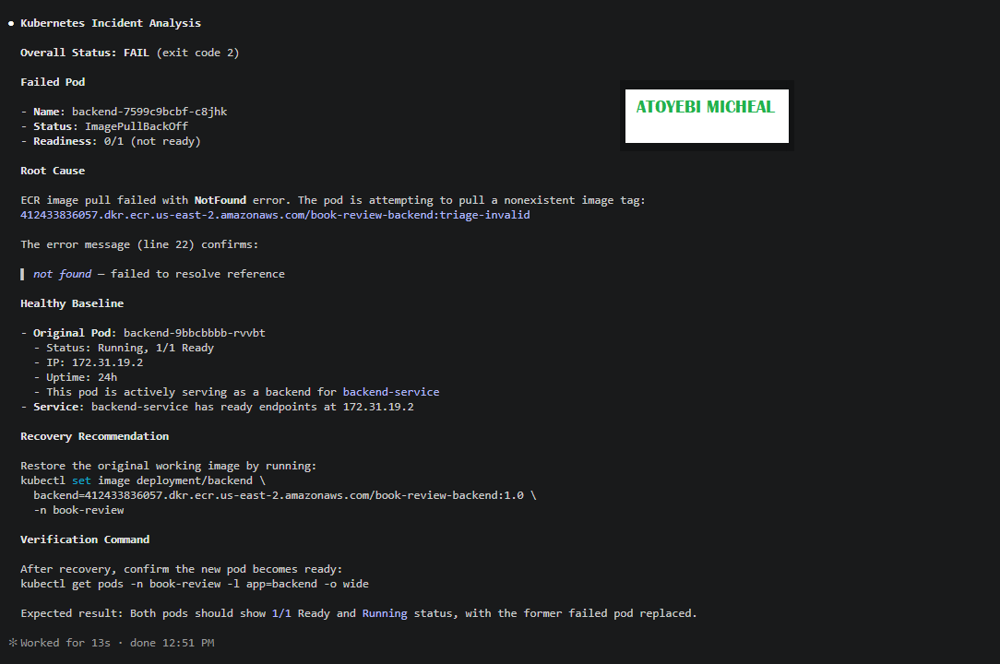

---

#### Screenshot 15 — Saved `incident-failure-report.txt`

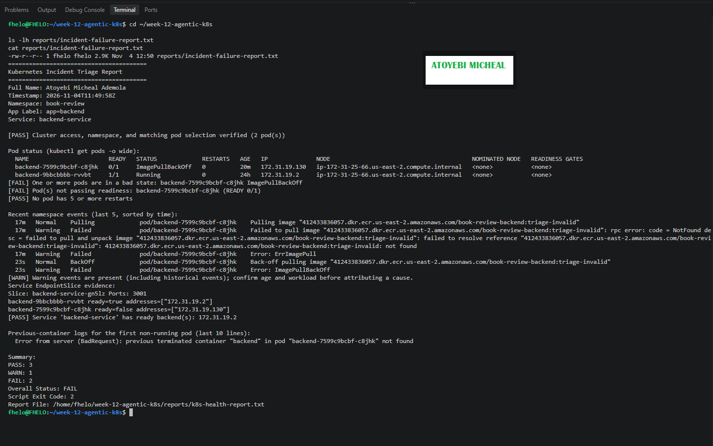

### Notes

**1. Which failure did you choose?**

I deliberately changed the backend Deployment image to a nonexistent ECR image tag, triage-invalid, to simulate an image-pull failure.

**2. Which checks failed, and what evidence proved it?**

The Pod Status and Pod Readiness checks failed. Pod backend-7599c9bcbf-c8jhk showed ImagePullBackOff and 0/1 readiness. Kubernetes events reported ErrImagePull and an ECR NotFound error because the image tag did not exist.

**3. Did Claude execute recovery? Why is that important?**

No. Claude analysed the health report and recommended a recovery command but did not execute it. This is important because a human must review and approve changes to prevent unintended modifications to the production environment.

**4. Why might the Service retain ready backends during the incident?**

The Deployment used a rolling update, so Kubernetes retained the previous healthy backend Pod while the replacement Pod failed to start. The Service continued routing traffic to the original ready endpoint at 172.31.19.2, maintaining application availability.

---

# Task 8 — Recover Manually and Verify

## Goal

Restore the healthy configuration yourself and verify recovery using a second triage report.

### Evidence

#### Screenshot 16 — Recovered Pods and ready Service backends

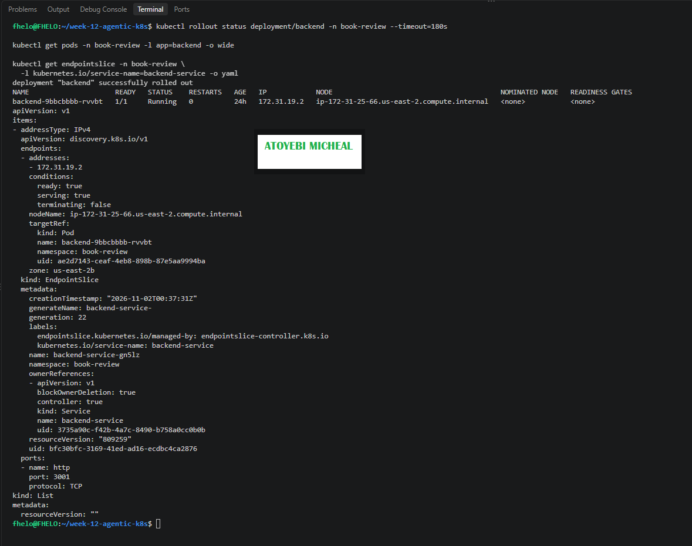

---

#### Screenshot 17 — Recovered `/k8s-triage` analysis

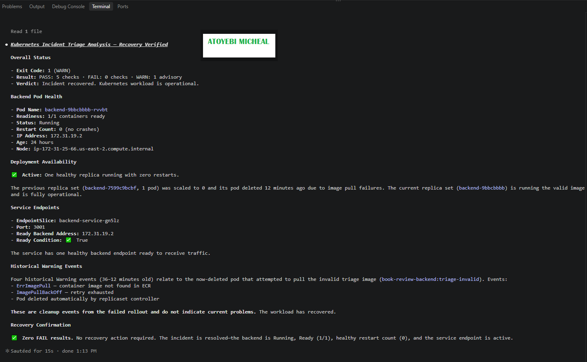

---

#### Screenshot 18 — Reports directory showing failure and recovery reports

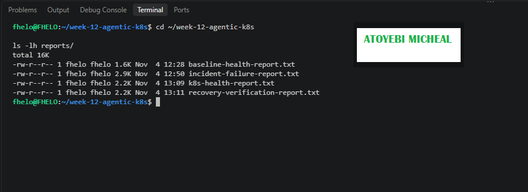

---

#### Screenshot 19 — `incident-summary.md` with all required sections

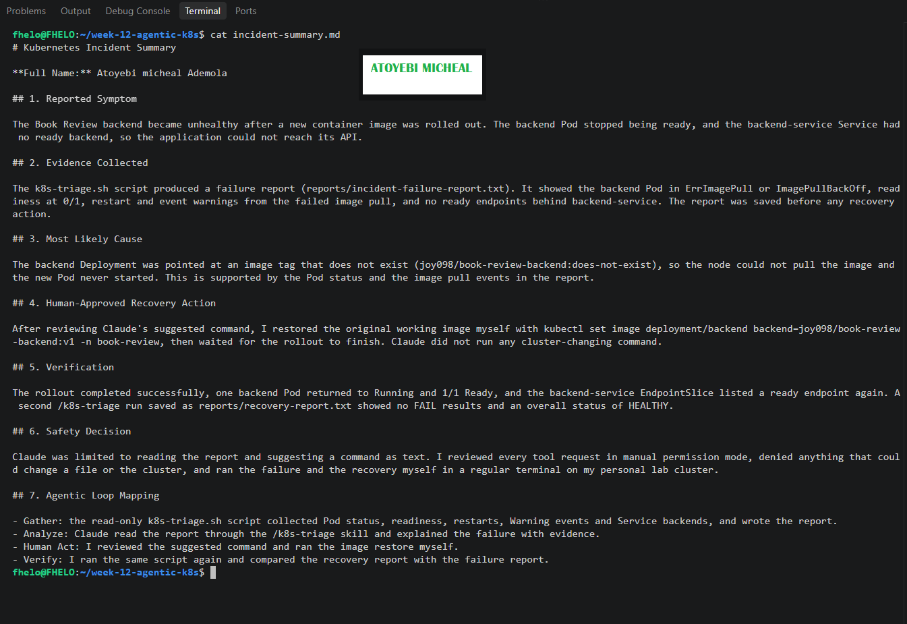

### Notes

**1. What manual recovery action did you execute?**

I manually restored the backend Deployment to its original working Amazon ECR image, book-review-backend:1.0, using kubectl set image. The Kubernetes rollout completed successfully.

**2. What proves the workload recovered?**

The backend Pod returned to 1/1 Running with zero restarts. The Deployment showed 1/1 AVAILABLE, and the Service EndpointSlice confirmed that backend IP 172.31.19.2 was ready (ready=true).

**3. Why is the second triage run necessary?**

The second triage run collects fresh evidence after recovery. It confirms whether the original failures have been resolved and provides a separate report for comparison with the incident report.

**4. Why should AI not automatically restart every failing production workload?**

Not every failure has the same cause. Automatically restarting workloads could cause downtime, interrupt healthy services, hide the actual problem, or make an incident worse. AI should analyse evidence and recommend actions, while a human reviews and approves recovery.

### Remaining WARN Results

Explain any WARN results remaining after recovery, or write “None.”

One WARN remained because Kubernetes retained historical Warning events from the failed image-pull incident. These events referred to the previous failed Pod, which had already been deleted. The current backend Pod was healthy, the Deployment was available, and the Service had a ready endpoint. Therefore, the remaining warning did not indicate an active workload failure.

---

# Task 9 — Publish Your Kubernetes Incident-Triage Workflow on LinkedIn

## Goal

Share the incident-triage workflow you completed and explain the role of human control.

### Evidence

#### Screenshot 20 — Published LinkedIn post about your Kubernetes incident-triage workflow

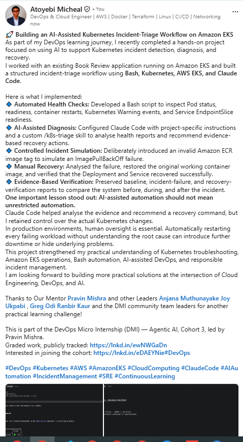

### LinkedIn Post URL

https://www.linkedin.com/posts/aamicheal_devops-kubernetes-aws-ugcPost-7523724507442978816-5jxh/?utm_source=social_share_send&utm_medium=member_desktop_web&rcm=ACoAADFvgDYBsnsyE66xAyq2HzH3Jfsf19WE6JA

---

# Required Project Files

Include these files in your project repository:

- `CLAUDE.md`
- `lab-config.md`
- `scripts/k8s-triage.sh`
- `.claude/skills/k8s-triage/SKILL.md`
- `reports/incident-failure-report.txt`
- `reports/recovery-report.txt`
- `incident-summary.md`

Your `incident-summary.md` must contain:

1. Reported Symptom
2. Evidence Collected
3. Most Likely Cause
4. Human-Approved Recovery Action
5. Verification
6. Safety Decision
7. Agentic Loop Mapping

---

# Final Summary

## Evidence and Cause

Summarize the evidence and the supported cause of the incident.

The incident was caused by changing the backend Deployment's container image to a nonexistent Amazon ECR tag, triage-invalid. The replacement Pod, backend-7599c9bcbf-c8jhk, entered ImagePullBackOff with readiness 0/1. Kubernetes events reported ErrImagePull and an ECR NotFound error. The original backend Pod remained healthy and continued providing a ready Service endpoint at 172.31.19.2.

## Manual Recovery

Describe the command or configuration change you performed.

I manually restored the backend Deployment to its original working image:

412433836057.dkr.ecr.us-east-2.amazonaws.com/book-review-backend:1.0

I used kubectl set image to update the Deployment and then monitored the rollout using kubectl rollout status. The rollout completed successfully.

## Verification

Explain how the recovery report and Kubernetes outputs confirmed recovery.

The Kubernetes verification commands confirmed that the backend Pod was 1/1 Running, had zero restarts, and the Deployment was 1/1 AVAILABLE. The EndpointSlice confirmed that 172.31.19.2 was a ready Service backend.

The second triage report recorded 5 PASS checks, 1 historical Warning advisory, and 0 FAIL checks (exit code 1). This confirmed that the workload had recovered successfully.

## Safety Decision

Explain how you kept Claude’s role limited to evidence gathering and analysis.

I kept Claude Code limited to reading the project instructions, analysing Bash-generated Kubernetes health reports, identifying the likely cause, and recommending recovery actions. I reviewed and executed the recovery command manually rather than allowing AI to modify Kubernetes resources.

This maintained human oversight, prevented unintended cluster changes, and ensured that recovery decisions were based on actual evidence.

---

# Submission Instructions

- Include all 20 required screenshots under their corresponding Evidence sections.
- Complete all Notes questions in your own words.
- Include the required project files in your linked repository.
- Include your published LinkedIn post URL.
- Use clear, readable screenshots showing relevant commands, configuration, and outputs.
- Display your full name before taking required terminal screenshots.
- Preserve the failure report before recovery.
- Ensure the baseline and recovery reports contain no FAIL results.
- Explain any WARN results remaining after recovery.
- Review reports, logs, configuration records, and screenshots before publishing.
- Do not expose credentials, kubeconfig contents, tokens, certificates, JWT secrets, or confidential account information.

---

# Completion Checklist

- [ ] Confirmed the personal lab context
- [ ] Discovered and recorded application configuration
- [ ] Recorded the original working image
- [ ] Captured healthy Pods and ready Service backends (Screenshot 1)
- [ ] Created the workspace (Screenshot 2)
- [ ] Configured CLAUDE.md (Screenshot 3)
- [ ] Reviewed the five-check triage plan (Screenshot 4)
- [ ] Configured and reviewed the supplied script (Screenshots 5–7)
- [ ] Passed Bash syntax validation and set executable permission (Screenshot 8)
- [ ] Captured a baseline report with no FAIL (Screenshot 9)
- [ ] Captured the correct exit code (Screenshot 10)
- [ ] Configured and invoked `/k8s-triage` (Screenshots 11–12)
- [ ] Simulated one controlled incident manually (Screenshot 13)
- [ ] Reviewed Claude’s failed-state analysis (Screenshot 14)
- [ ] Saved failure evidence before recovery (Screenshot 15)
- [ ] Executed recovery manually and waited for rollout completion
- [ ] Confirmed recovered Pods and ready Service backends (Screenshot 16)
- [ ] Captured recovery analysis with no FAIL (Screenshot 17)
- [ ] Explained any remaining warnings
- [ ] Saved failure and recovery reports (Screenshot 18)
- [ ] Completed the seven-section incident summary (Screenshot 19)
- [ ] Answered all Notes questions
- [ ] Published the LinkedIn post (Screenshot 20)
- [ ] Included the LinkedIn post URL
- [ ] Included all required project files
- [ ] Checked that no sensitive information is exposed

---

## 📌 About DMI & CloudAdvisory

DevOps Micro Internship (DMI) is a project-based DevOps program run by Pravin Mishra (The CloudAdvisory) focused on real-world execution, systems thinking, and career readiness.

It helps learners build strong DevOps foundations with hands-on experience.

---

## 📌 Resources

- 🌐 DMI Official Website: https://dmi.pravinmishra.com?utm_source=github&utm_medium=readme  
- 🎓 University: https://university.pravinmishra.com?utm_source=github&utm_medium=readme  
- 💬 Discord Community: https://discord.pravinmishra.com?utm_source=github&utm_medium=readme  
- 📝 Blog: https://dmi.pravinmishra.com/blog?utm_source=github&utm_medium=readme  
- ▶️ YouTube Playlist: https://www.youtube.com/playlist?list=PLFeSNDtI4Cho  
- 🔗 Pravin Mishra (LinkedIn): https://www.linkedin.com/in/pravin-mishra-aws-trainer/  
- 🏢 CloudAdvisory (LinkedIn): https://www.linkedin.com/company/thecloudadvisory/

---

*This submission is part of DevOps Micro Internship (DMI) — Agentic AI Track.*
